# v01 日本語試作：映像と音声の対応表

対象は2026-10-15制作のv01。Claudeのv02修正・英語化は未反映。
画像は実際のMP4から抽出。文章・発話時刻は音声合成時の記録で、音声認識による書き起こしではありません。音量は完成MP4の音声を再測定。
無音検出はBGM込みの音声が−45 dBFS未満となる20ms区間を連結したもの。語間の間や発音の正しさを判定するものではありません。

## N01 00:00.000–00:20.661 天秤に置かれる、人生

音声RMS -19.36 dBFS／サンプルピーク -2.17 dBFS（トゥルーピークとは別の値）

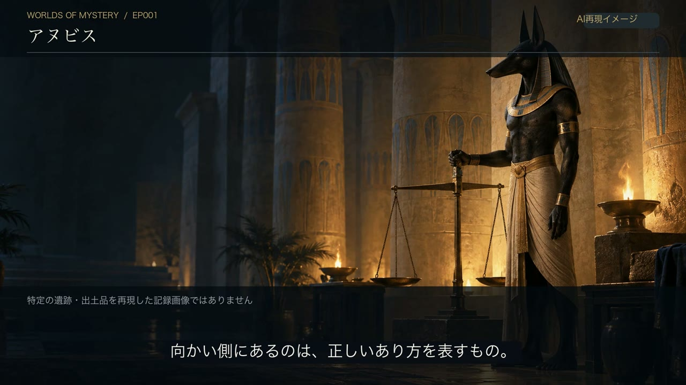

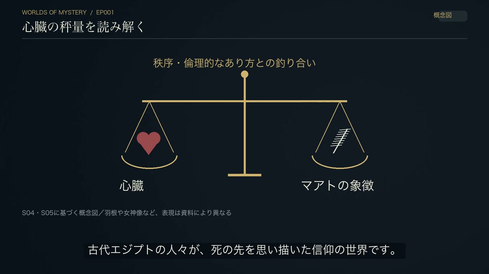

|開始|終了|合成時の入力文|
|---|---|---|
|00:00.000|00:02.752|一つの心臓が、天秤に置かれる。|
|00:02.912|00:06.464|向かい側にあるのは、正しいあり方を表すもの。|
|00:06.624|00:11.307|その秤を見守るのは、犬のような頭を持つ神、アヌビスです。|
|00:11.467|00:15.019|これは実際の出来事を撮影した場面ではありません。|
|00:15.179|00:19.701|古代エジプトの人々が、死の先を思い描いた信仰の世界です。|

## N02 00:20.661–00:41.289 裁く神か、守る神か

音声RMS -19.68 dBFS／サンプルピーク -2.08 dBFS（トゥルーピークとは別の値）

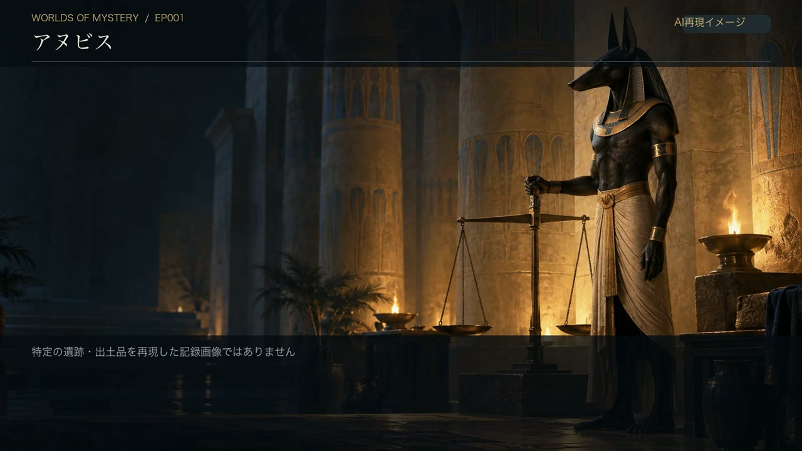

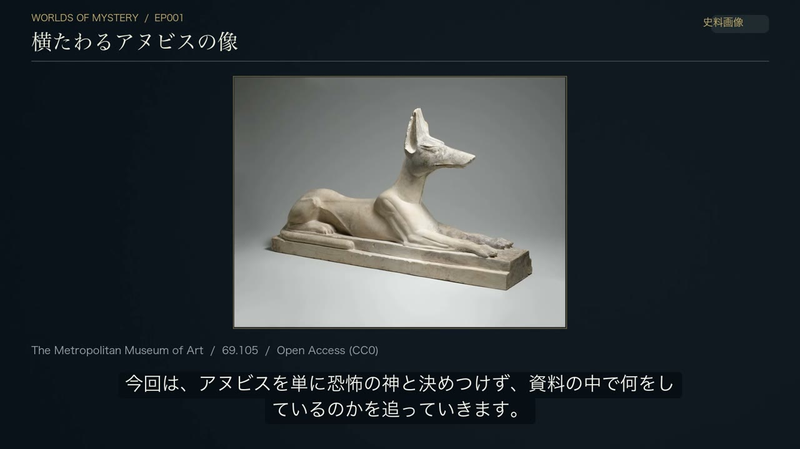

|開始|終了|合成時の入力文|
|---|---|---|
|00:20.661|00:25.728|死者の前に立つ神と聞くと、恐ろしい裁判官を想像するかもしれません。|
|00:25.888|00:30.816|けれど、残された像や絵をよく見ると、もう一つの役割が浮かびます。|
|00:30.976|00:34.016|身体を守り、死者の旅を支えること。|
|00:34.176|00:40.779|今回は、アヌビスを単に恐怖の神と決めつけず、資料の中で何をしているのかを追っていきます。|

## N03 00:41.289–01:02.748 物語を、資料から読む

音声RMS -18.49 dBFS／サンプルピーク -2.0 dBFS（トゥルーピークとは別の値）

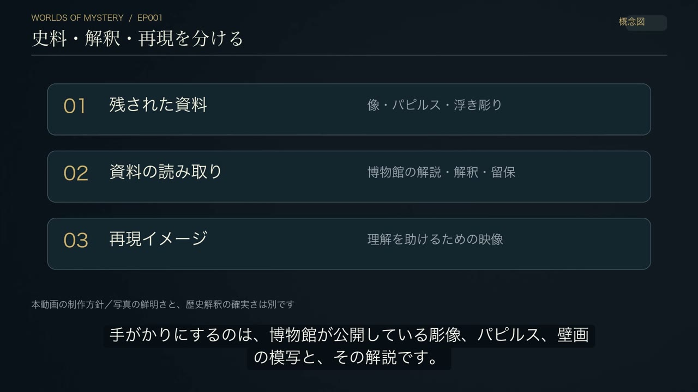

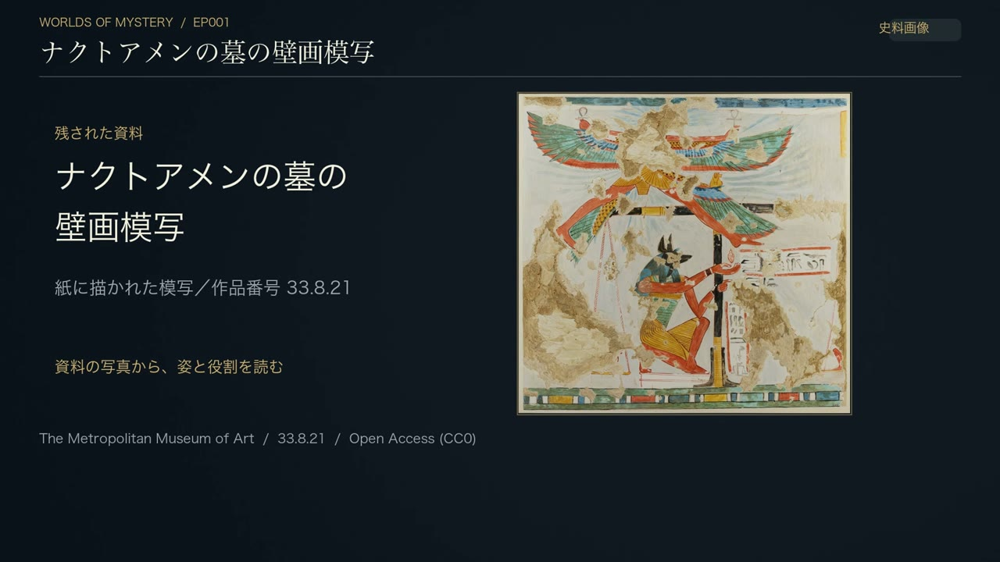

|開始|終了|合成時の入力文|
|---|---|---|
|00:41.289|00:48.702|手がかりにするのは、博物館が公開している彫像、パピルス、壁画の模写と、その解説です。|
|00:48.862|00:54.995|実物の写真は史料画像として、想像を補う映像は再現イメージとして表示します。|
|00:55.155|00:57.385|どちらも同じ証拠ではありません。|
|00:57.545|01:02.238|この区別が、神話を楽しみながら歴史を知るための入口になります。|

## N04 01:02.748–01:23.953 警戒する犬科の姿

音声RMS -19.18 dBFS／サンプルピーク -1.9 dBFS（トゥルーピークとは別の値）

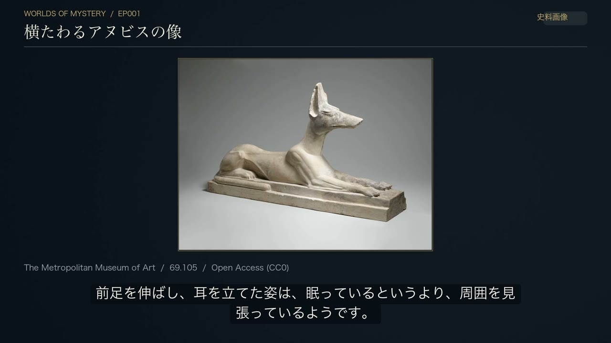

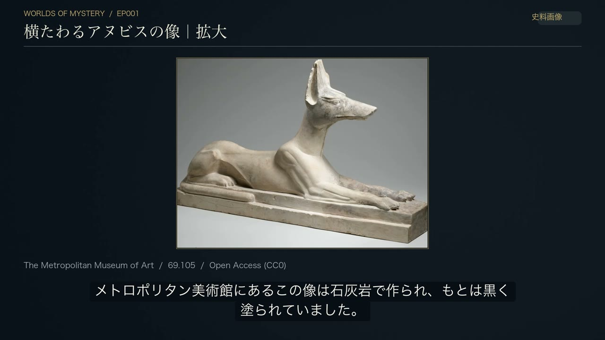

|開始|終了|合成時の入力文|
|---|---|---|
|01:02.748|01:06.396|まず、横たわる犬科の動物の像を見てください。|
|01:06.556|01:12.999|前足を伸ばし、耳を立てた姿は、眠っているというより、周囲を見張っているようです。|
|01:13.159|01:18.812|メトロポリタン美術館にあるこの像は石灰岩で作られ、もとは黒く塗られていました。|
|01:18.972|01:22.993|神は、人の姿だけで表されたわけではなかったのです。|

## N05 01:23.953–01:46.799 墓地と動物の関わり

音声RMS -19.21 dBFS／サンプルピーク -2.02 dBFS（トゥルーピークとは別の値）

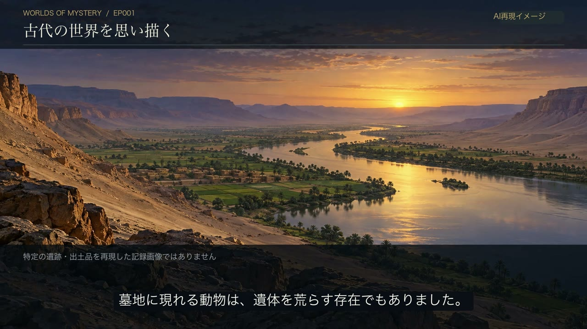

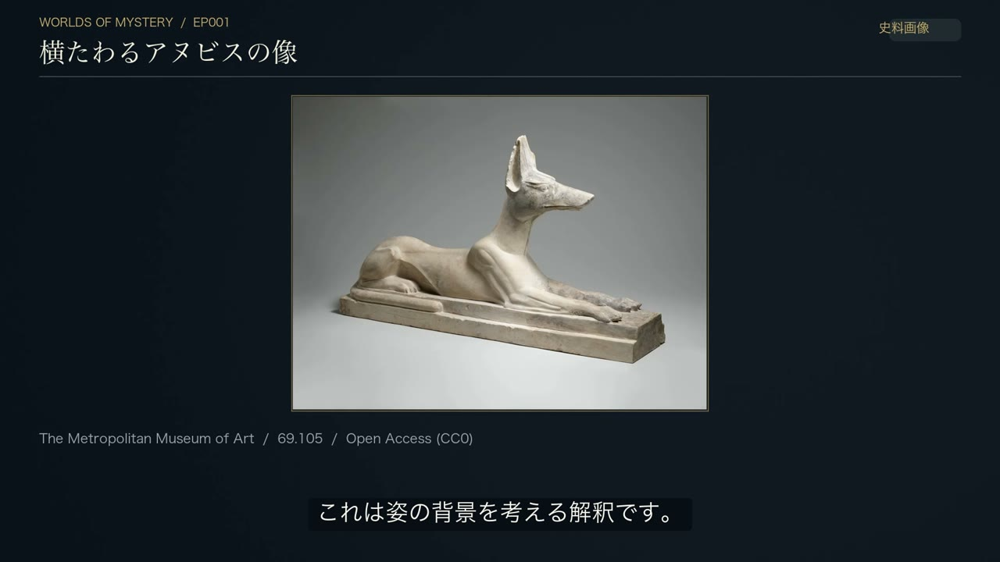

|開始|終了|合成時の入力文|
|---|---|---|
|01:23.953|01:28.689|美術館の解説は、墓地と犬科の動物の関わりに注目します。|
|01:28.849|01:32.817|墓地に現れる動物は、遺体を荒らす存在でもありました。|
|01:32.977|01:38.599|その一方で、警戒する姿は、死者を見守る力として捉えられたのでしょう。|
|01:38.759|01:41.745|これは姿の背景を考える解釈です。|
|01:41.905|01:46.289|アヌビスの起源を、ただ一つの理由で証明したものではありません。|

## N06 01:46.799–02:07.565 人の身体と、動物の頭

音声RMS -18.78 dBFS／サンプルピーク -2.01 dBFS（トゥルーピークとは別の値）

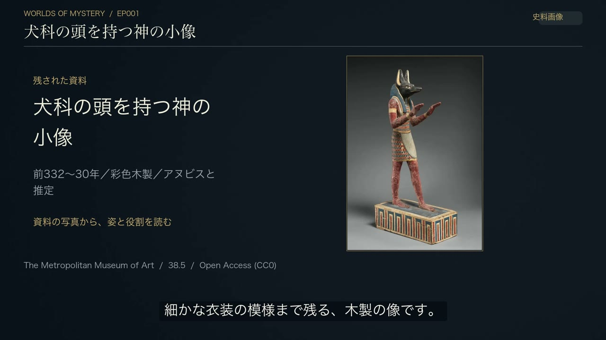

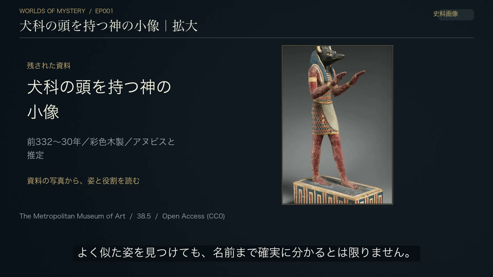

|開始|終了|合成時の入力文|
|---|---|---|
|01:46.799|01:51.461|別の小像では、動物の頭に人の身体が組み合わされています。|
|01:51.621|01:55.119|細かな衣装の模様まで残る、木製の像です。|
|01:55.279|01:59.034|美術館は、これをおそらくアヌビスと説明しています。|
|01:59.194|02:02.106|犬科の頭を持つ神は複数いたためです。|
|02:02.266|02:07.055|よく似た姿を見つけても、名前まで確実に分かるとは限りません。|

## N07 02:07.565–02:28.193 像の年代も、手がかりになる

音声RMS -18.81 dBFS／サンプルピーク -1.93 dBFS（トゥルーピークとは別の値）

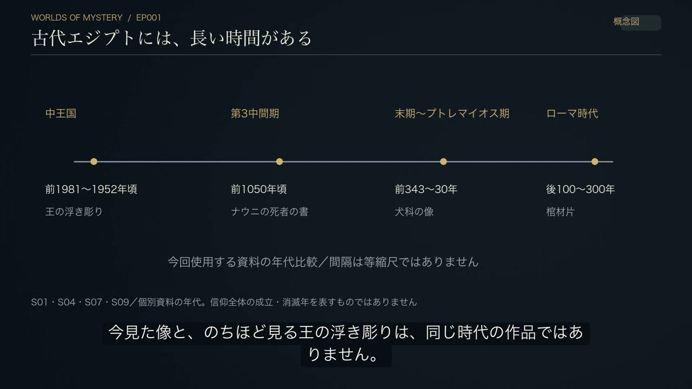

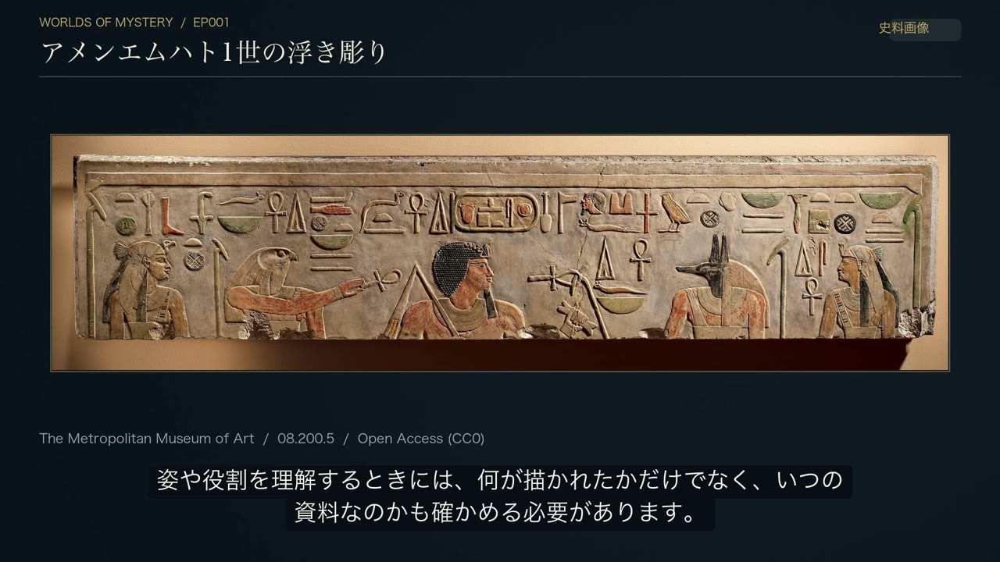

|開始|終了|合成時の入力文|
|---|---|---|
|02:07.565|02:10.168|ここで大切なのが、年代です。|
|02:10.328|02:15.640|今見た像と、のちほど見る王の浮き彫りは、同じ時代の作品ではありません。|
|02:15.800|02:20.077|古代エジプトという名前の中には、長い時間が含まれています。|
|02:20.237|02:27.683|姿や役割を理解するときには、何が描かれたかだけでなく、いつの資料なのかも確かめる必要があります。|

## N08 02:28.193–02:48.811 死後の旅を支える準備

音声RMS -19.03 dBFS／サンプルピーク -1.96 dBFS（トゥルーピークとは別の値）

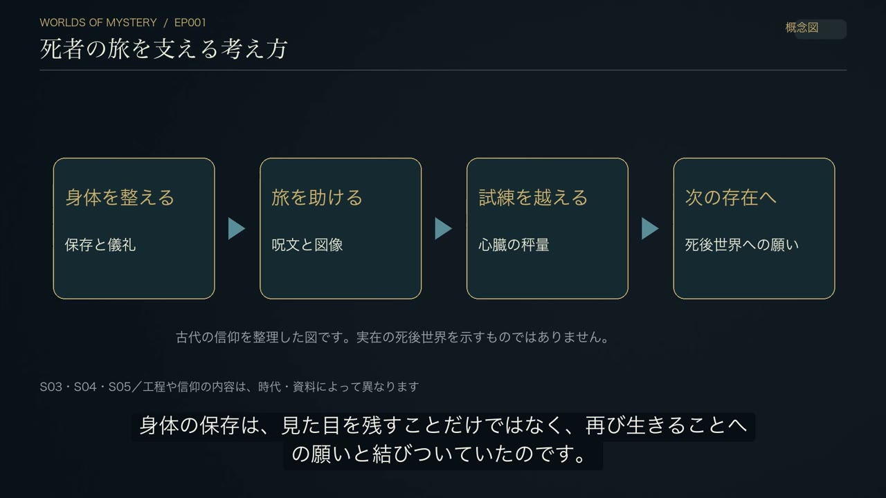

|開始|終了|合成時の入力文|
|---|---|---|
|02:28.193|02:32.726|アヌビスの重要な役割の一つが、ミイラ作りとの関わりです。|
|02:32.886|02:41.025|古代の信仰では、亡くなった人の身体を整え、儀礼を行うことが、死後の存在を支える準備とされました。|
|02:41.185|02:47.851|身体の保存は、見た目を残すことだけではなく、再び生きることへの願いと結びついていたのです。|

## N09 02:48.811–03:06.921 神が身体を守る場面

音声RMS -18.91 dBFS／サンプルピーク -2.05 dBFS（トゥルーピークとは別の値）

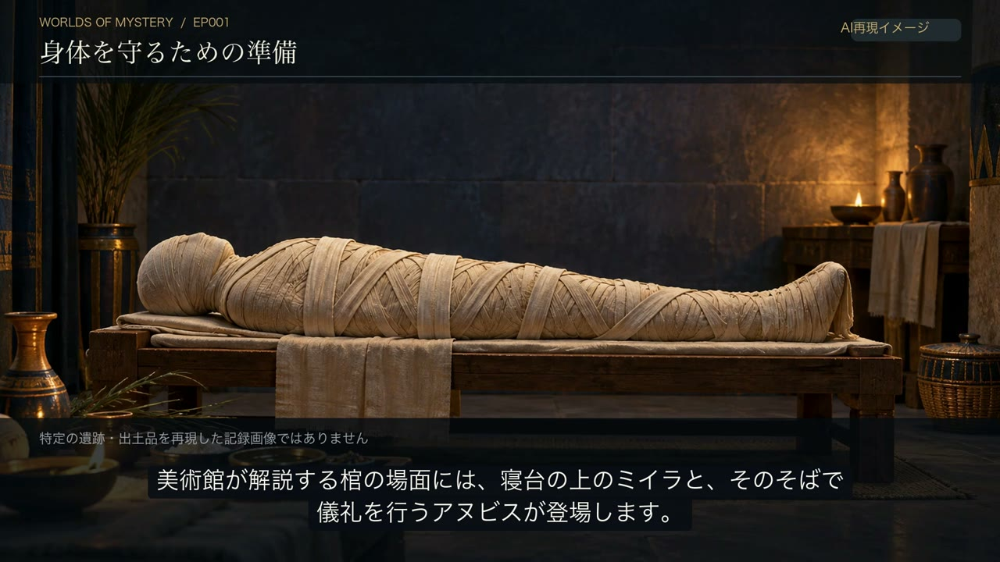

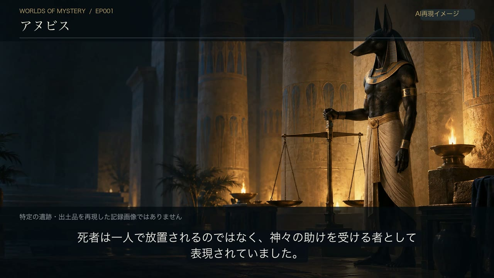

|開始|終了|合成時の入力文|
|---|---|---|
|02:48.811|02:56.161|美術館が解説する棺の場面には、寝台の上のミイラと、そのそばで儀礼を行うアヌビスが登場します。|
|02:56.321|03:00.395|イシスとネフティスも、ミイラを守る存在として描かれています。|
|03:00.555|03:06.411|死者は一人で放置されるのではなく、神々の助けを受ける者として表現されていました。|

## N10 03:06.921–03:27.847 儀礼は、生きている人が行う

音声RMS -18.59 dBFS／サンプルピーク -1.88 dBFS（トゥルーピークとは別の値）

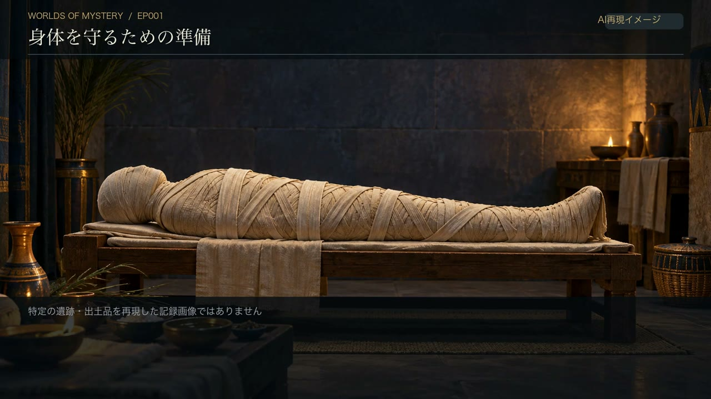

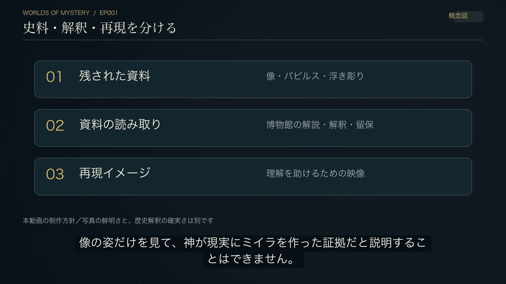

|開始|終了|合成時の入力文|
|---|---|---|
|03:06.921|03:12.148|ただし、ここでも信仰の物語と、現実の人の行いを分けましょう。|
|03:12.308|03:17.481|亡くなった人を整え、埋葬の準備をしたのは、生きている人々です。|
|03:17.641|03:21.215|神の役割は、その営みに意味を与えていました。|
|03:21.375|03:27.337|像の姿だけを見て、神が現実にミイラを作った証拠だと説明することはできません。|

## N11 03:27.847–03:50.149 守るための、別のかたち

音声RMS -18.56 dBFS／サンプルピーク -1.88 dBFS（トゥルーピークとは別の値）

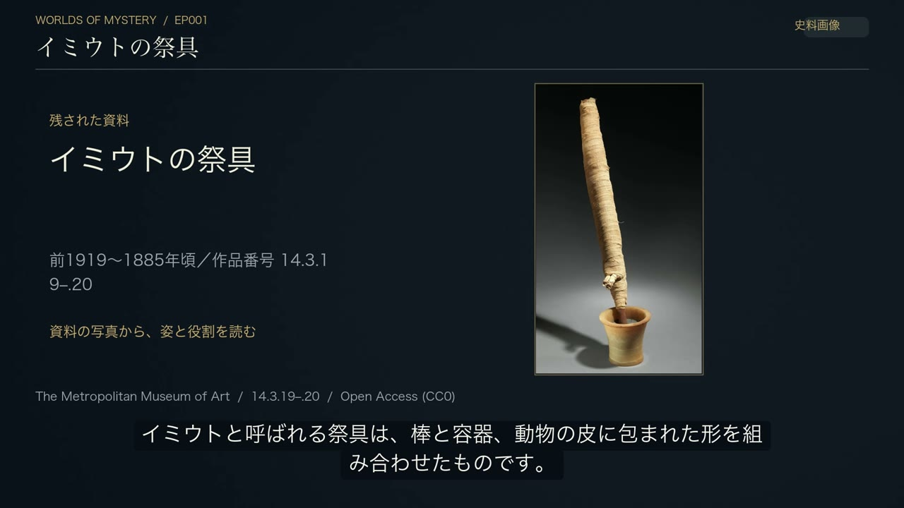

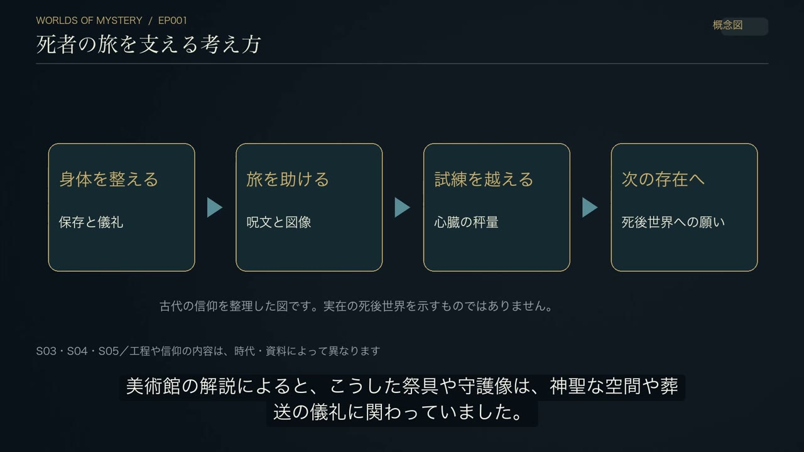

|開始|終了|合成時の入力文|
|---|---|---|
|03:27.847|03:31.645|保護の考え方は、神の像以外にも表れています。|
|03:31.805|03:38.247|イミウトと呼ばれる祭具は、棒と容器、動物の皮に包まれた形を組み合わせたものです。|
|03:38.407|03:45.735|美術館の解説によると、こうした祭具や守護像は、神聖な空間や葬送の儀礼に関わっていました。|
|03:45.895|03:49.639|死者を守る準備には、さまざまな形があったのです。|

## N12 03:50.149–04:09.979 死者の書を開く

音声RMS -19.03 dBFS／サンプルピーク -2.08 dBFS（トゥルーピークとは別の値）

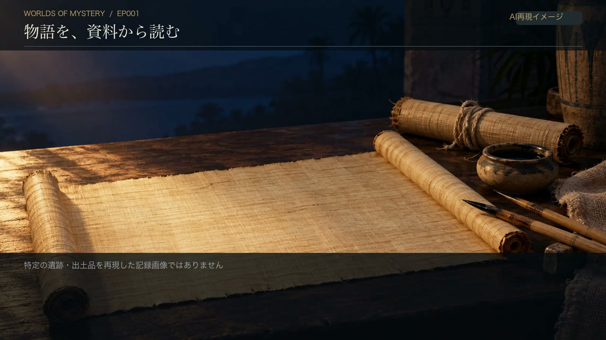

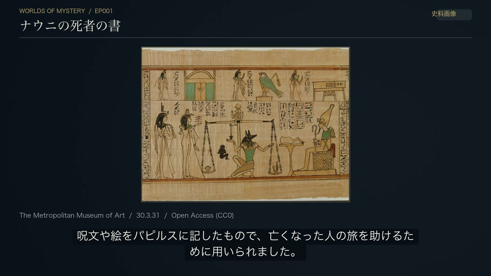

|開始|終了|合成時の入力文|
|---|---|---|
|03:50.149|03:55.067|次に、身体を守る準備から、死後の旅の物語へ移ります。|
|03:55.227|03:57.915|ここで登場するのが、死者の書です。|
|03:58.075|04:03.355|美術館の解説では、もとの名は、日中に出ていくための書とされています。|
|04:03.515|04:09.019|呪文や絵をパピルスに記したもので、亡くなった人の旅を助けるために用いられました。|

## N13 04:09.979–04:31.747 一人のためのパピルス

音声RMS -18.17 dBFS／サンプルピーク -2.04 dBFS（トゥルーピークとは別の値）

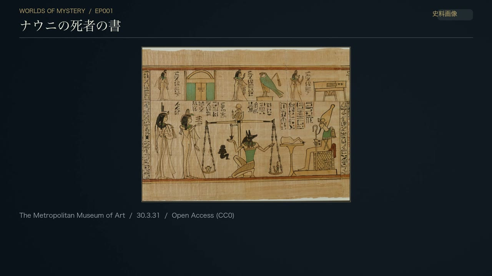

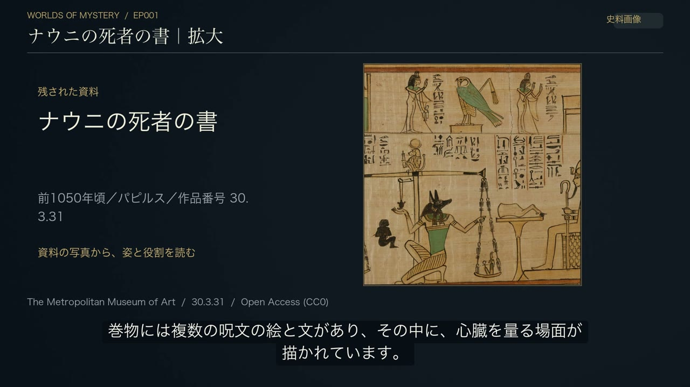

|開始|終了|合成時の入力文|
|---|---|---|
|04:09.979|04:15.408|今、画面にあるのは、ナウニという女性の埋葬に伴っていたパピルスです。|
|04:15.568|04:19.845|美術館の年代表示は、紀元前千五十年頃。|
|04:20.005|04:26.448|巻物には複数の呪文の絵と文があり、その中に、心臓を量る場面が描かれています。|
|04:26.608|04:31.237|抽象的な死者ではなく、ある一人のために用意された資料なのです。|

## N14 04:31.747–04:52.993 心臓に託されたもの

音声RMS -18.79 dBFS／サンプルピーク -1.98 dBFS（トゥルーピークとは別の値）

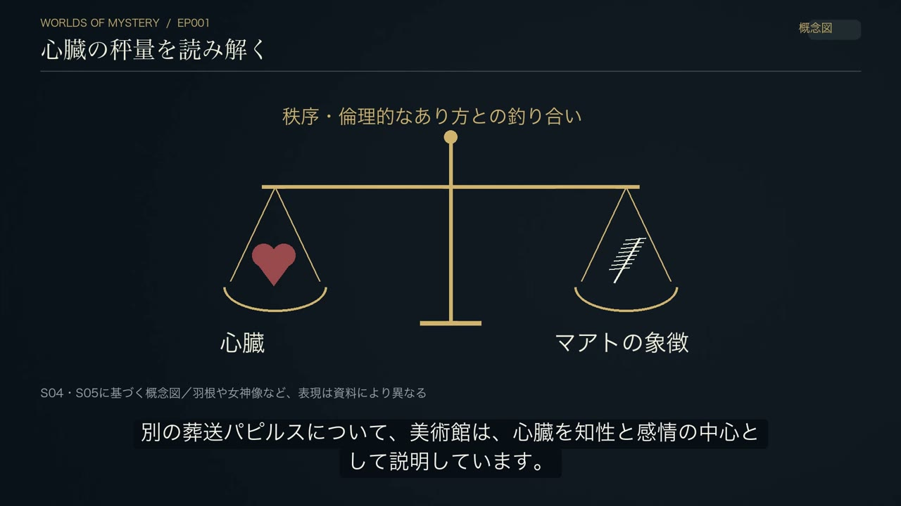

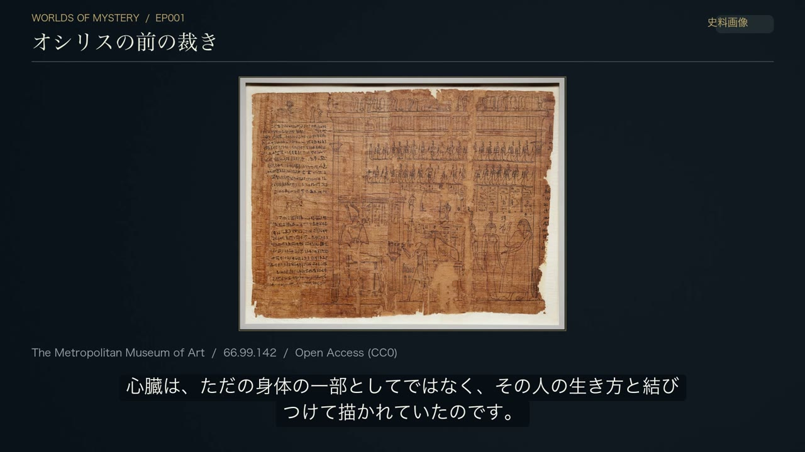

|開始|終了|合成時の入力文|
|---|---|---|
|04:31.747|04:34.382|なぜ、量るのは心臓なのでしょう。|
|04:34.542|04:41.443|別の葬送パピルスについて、美術館は、心臓を知性と感情の中心として説明しています。|
|04:41.603|04:45.657|秤量の場面では、その人がどのように生きたかが問われます。|
|04:45.817|04:52.483|心臓は、ただの身体の一部としてではなく、その人の生き方と結びつけて描かれていたのです。|

## N15 04:52.993–05:13.855 相手は、マアト

音声RMS -18.81 dBFS／サンプルピーク -1.85 dBFS（トゥルーピークとは別の値）

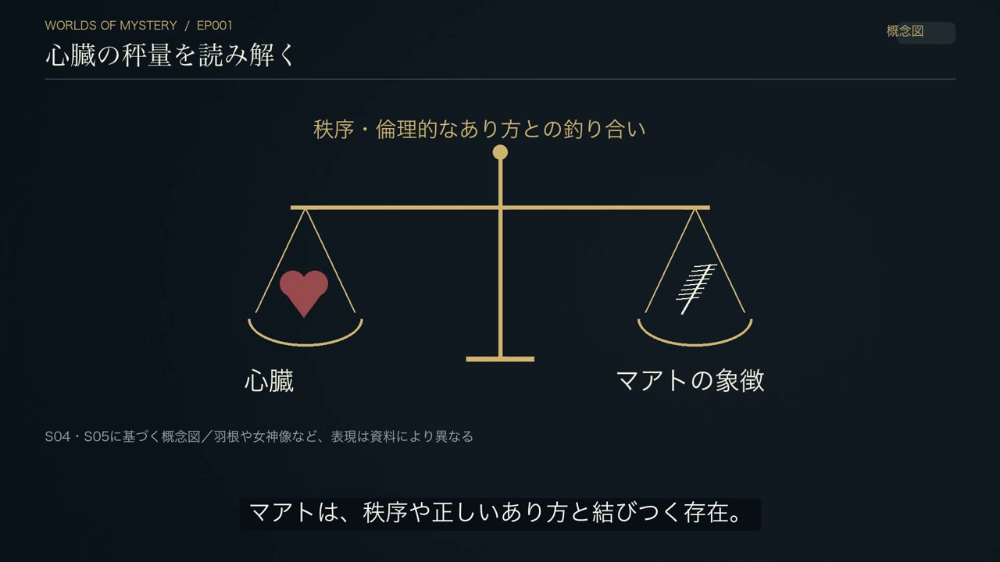

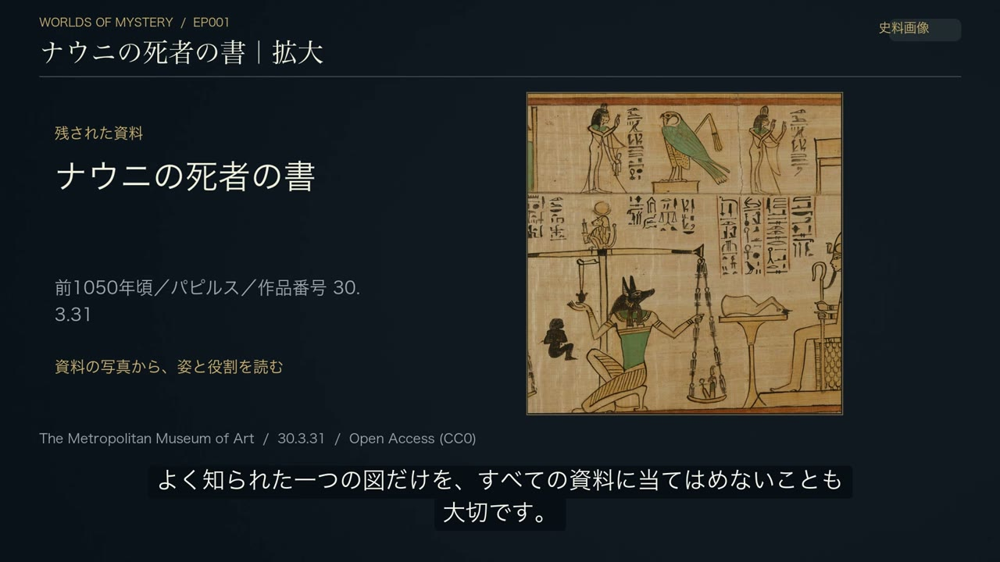

|開始|終了|合成時の入力文|
|---|---|---|
|04:52.993|04:57.089|天秤の反対側に置かれるのは、マアトを表すものです。|
|04:57.249|05:00.951|マアトは、秩序や正しいあり方と結びつく存在。|
|05:01.111|05:08.311|羽根だけを思い浮かべがちですが、ナウニの資料では、羽根を身につけた小さな女神の姿で表されています。|
|05:08.471|05:13.345|よく知られた一つの図だけを、すべての資料に当てはめないことも大切です。|

## N16 05:13.855–05:33.171 壁画のように見える、この画像

音声RMS -18.39 dBFS／サンプルピーク -1.9 dBFS（トゥルーピークとは別の値）

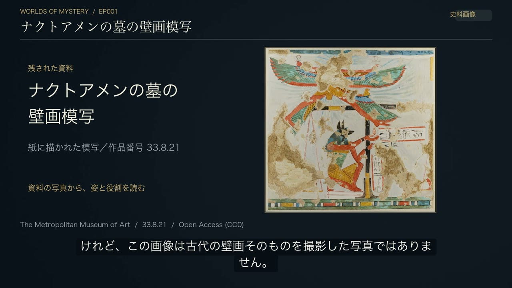

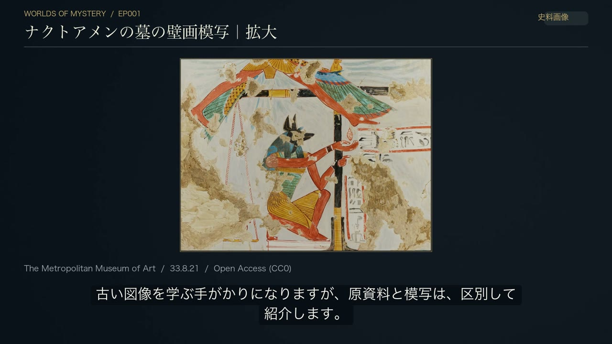

|開始|終了|合成時の入力文|
|---|---|---|
|05:13.855|05:16.821|こちらも、アヌビスと天秤の場面です。|
|05:16.981|05:21.866|けれど、この画像は古代の壁画そのものを撮影した写真ではありません。|
|05:22.026|05:26.730|ニーナ・ド・ガリス・デイヴィスが、ナクトアメンの墓の絵を紙に写したものです。|
|05:26.890|05:32.661|古い図像を学ぶ手がかりになりますが、原資料と模写は、区別して紹介します。|

## N17 05:33.171–05:54.899 秤を読むアヌビス

音声RMS -19.1 dBFS／サンプルピーク -1.89 dBFS（トゥルーピークとは別の値）

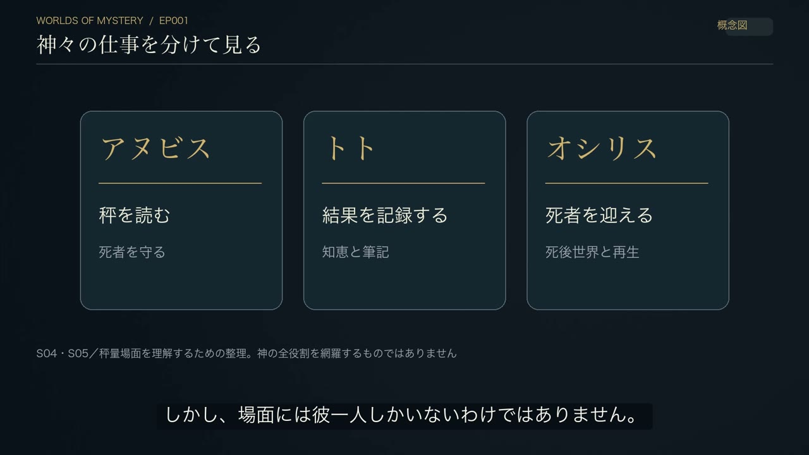

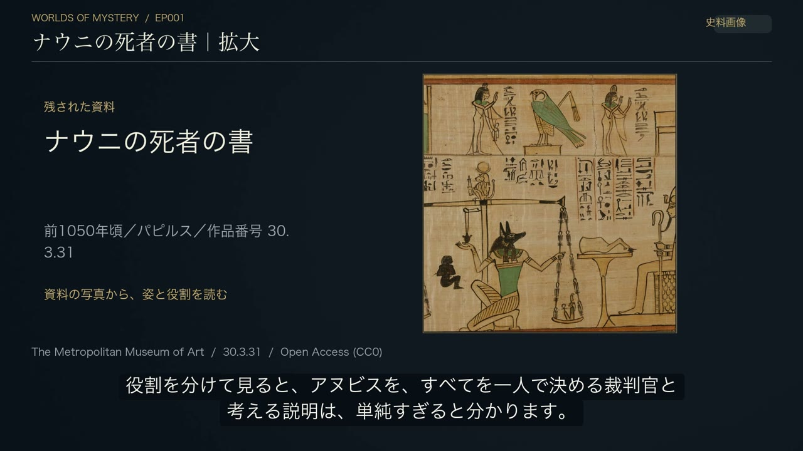

|開始|終了|合成時の入力文|
|---|---|---|
|05:33.171|05:35.571|ナウニのパピルスをもう一度見ましょう。|
|05:35.731|05:38.120|アヌビスは、秤を読んでいます。|
|05:38.280|05:42.056|しかし、場面には彼一人しかいないわけではありません。|
|05:42.216|05:45.789|結果を記録する神と、死者を迎える神もいます。|
|05:45.949|05:53.939|役割を分けて見ると、アヌビスを、すべてを一人で決める裁判官と考える説明は、単純すぎると分かります。|

## N18 05:54.899–06:14.929 結果を記すトト

音声RMS -18.32 dBFS／サンプルピーク -1.97 dBFS（トゥルーピークとは別の値）

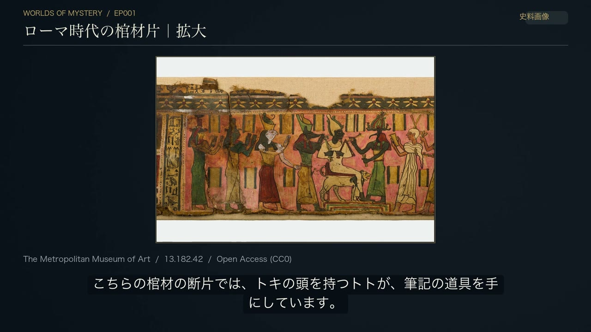

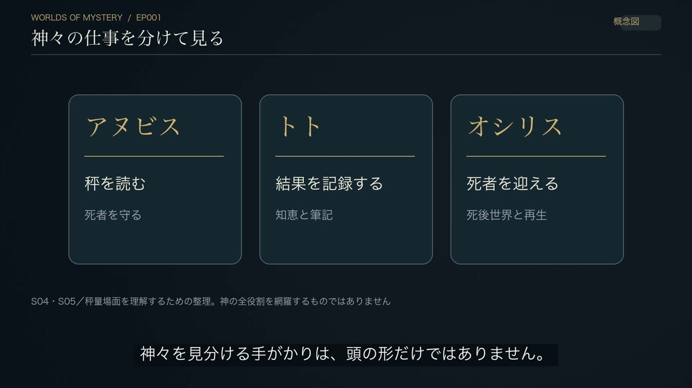

|開始|終了|合成時の入力文|
|---|---|---|
|05:54.899|06:00.680|こちらの棺材の断片では、トキの頭を持つトトが、筆記の道具を手にしています。|
|06:00.840|06:05.800|美術館は、彼が死者をオシリスに紹介する場面だと説明しています。|
|06:05.960|06:10.141|神々を見分ける手がかりは、頭の形だけではありません。|
|06:10.301|06:14.419|持ち物と、その場で何をしているかも、重要なのです。|

## N19 06:14.929–06:36.473 オシリスの前へ

音声RMS -18.9 dBFS／サンプルピーク -1.93 dBFS（トゥルーピークとは別の値）

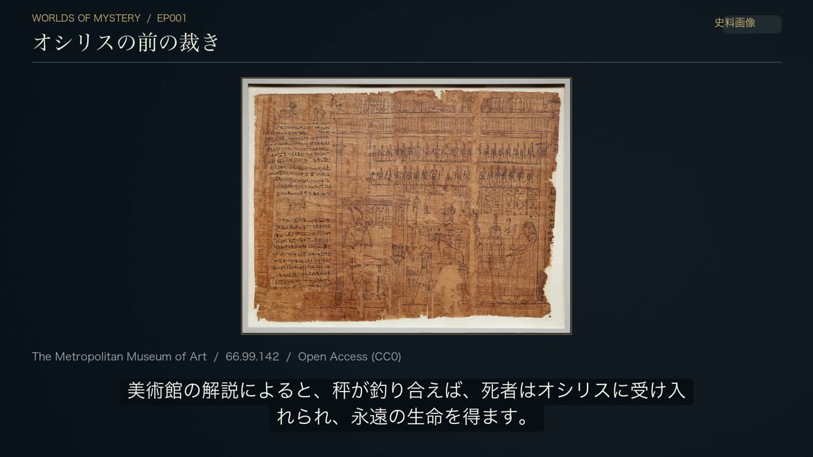

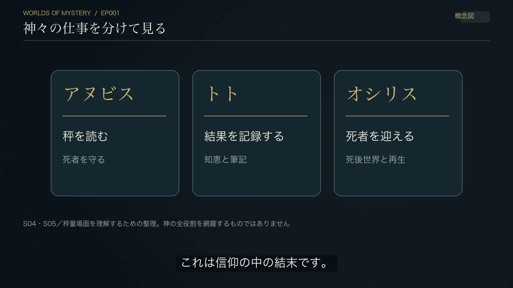

|開始|終了|合成時の入力文|
|---|---|---|
|06:14.929|06:22.182|美術館の解説によると、秤が釣り合えば、死者はオシリスに受け入れられ、永遠の生命を得ます。|
|06:22.342|06:28.721|釣り合わなければ、心臓はアメミトと呼ばれる存在に食べられ、死者は永久に死ぬとされました。|
|06:28.881|06:31.206|これは信仰の中の結末です。|
|06:31.366|06:35.963|死後世界が実在することを、この絵が証明するわけではありません。|

## N20 06:36.473–06:57.133 怖さの向こうにある目的

音声RMS -18.93 dBFS／サンプルピーク -1.84 dBFS（トゥルーピークとは別の値）

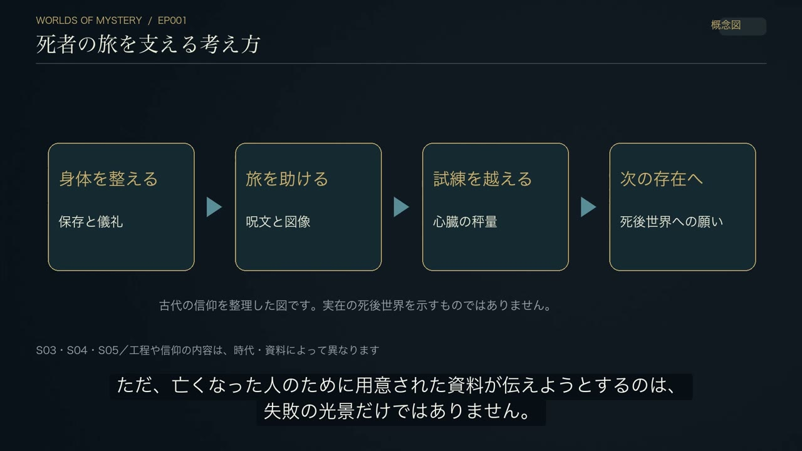

|開始|終了|合成時の入力文|
|---|---|---|
|06:36.473|06:39.876|たしかに、裁きの場面には恐ろしさがあります。|
|06:40.036|06:46.777|ただ、亡くなった人のために用意された資料が伝えようとするのは、失敗の光景だけではありません。|
|06:46.937|06:50.233|無事に試練を越え、次の存在へ進むこと。|
|06:50.393|06:56.623|アヌビスの姿を保護の役割から見ると、同じ天秤の場面も、少し違って見えてきます。|

## N21 06:57.133–07:19.831 死だけに限られない場面

音声RMS -18.83 dBFS／サンプルピーク -2.0 dBFS（トゥルーピークとは別の値）

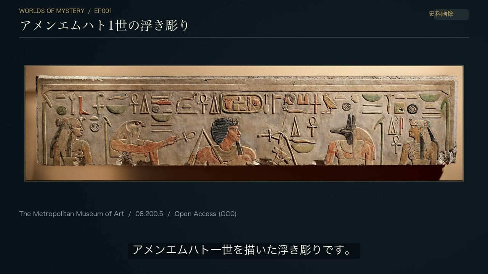

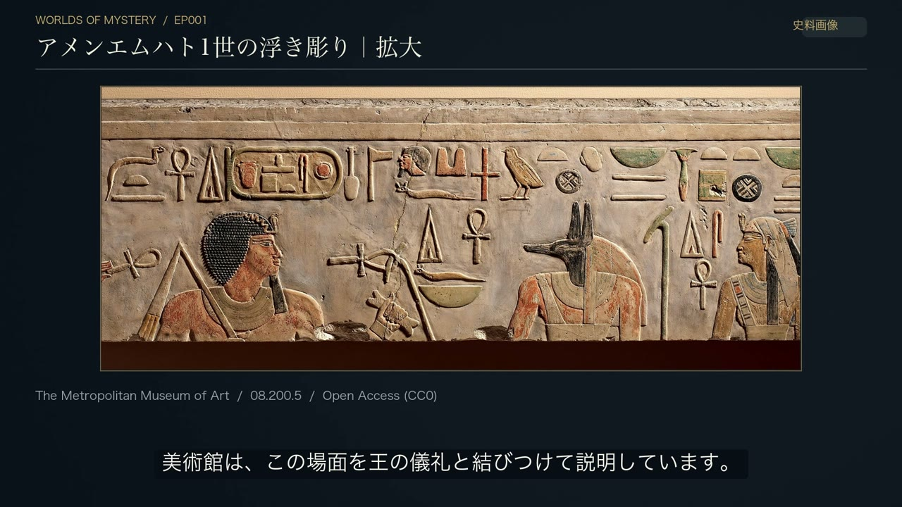

|開始|終了|合成時の入力文|
|---|---|---|
|06:57.133|06:59.639|ここで、少し意外な資料を見ます。|
|06:59.799|07:03.021|アメンエムハト一世を描いた浮き彫りです。|
|07:03.181|07:06.178|王の両側には、ホルスとアヌビスがいます。|
|07:06.338|07:09.997|神々は、生命を表すアンクを差し出しています。|
|07:10.157|07:14.669|美術館は、この場面を王の儀礼と結びつけて説明しています。|
|07:14.829|07:18.871|アヌビスが現れるのは、心臓の秤量だけではないのです。|

## N22 07:19.831–07:41.888 王の力を確かめる儀礼

音声RMS -18.9 dBFS／サンプルピーク -2.0 dBFS（トゥルーピークとは別の値）

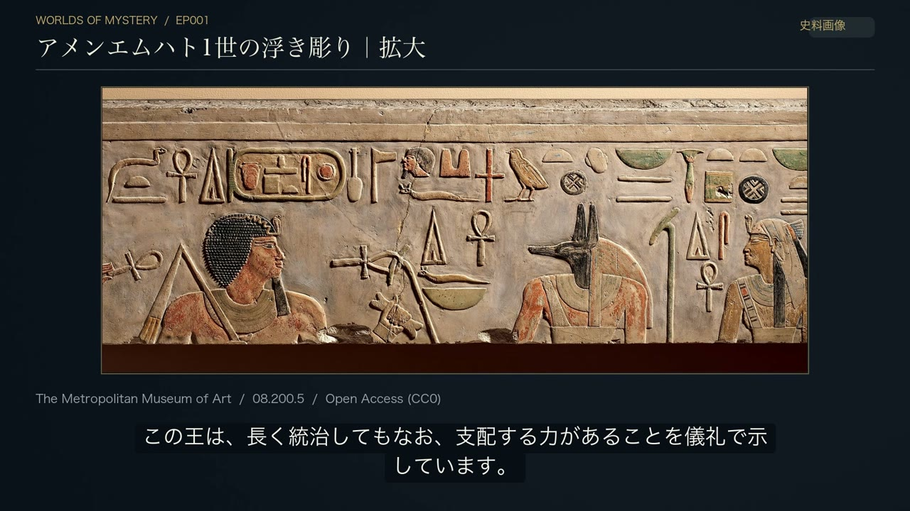

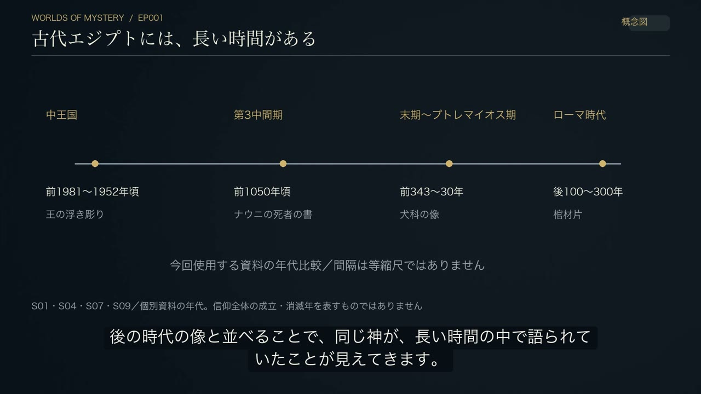

|開始|終了|合成時の入力文|
|---|---|---|
|07:19.831|07:25.421|この王は、長く統治してもなお、支配する力があることを儀礼で示しています。|
|07:25.581|07:30.455|アヌビスは、墓地の主という役割でも、この場所に関わっていました。|
|07:30.615|07:34.775|作品は、紀元前二千年頃にさかのぼります。|
|07:34.935|07:41.378|後の時代の像と並べることで、同じ神が、長い時間の中で語られていたことが見えてきます。|

## N23 07:41.888–08:04.510 時代が変わっても、描かれる神

音声RMS -18.73 dBFS／サンプルピーク -1.93 dBFS（トゥルーピークとは別の値）

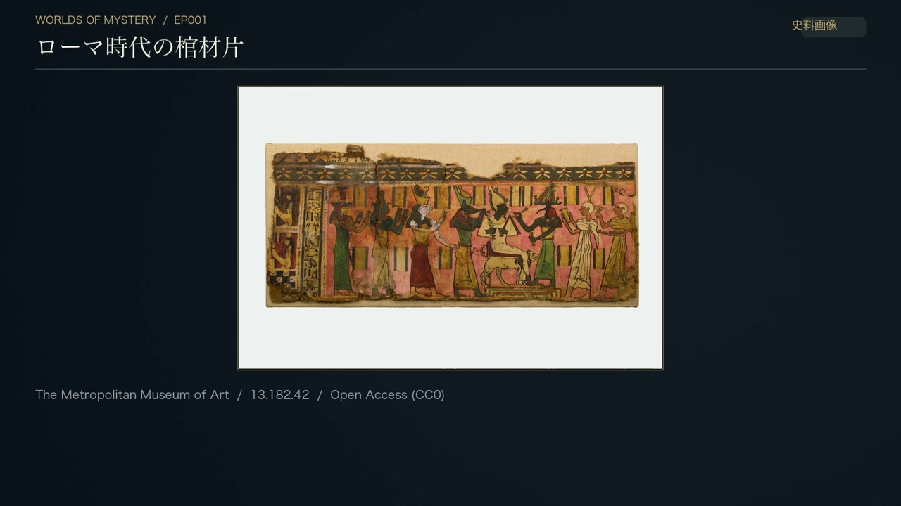

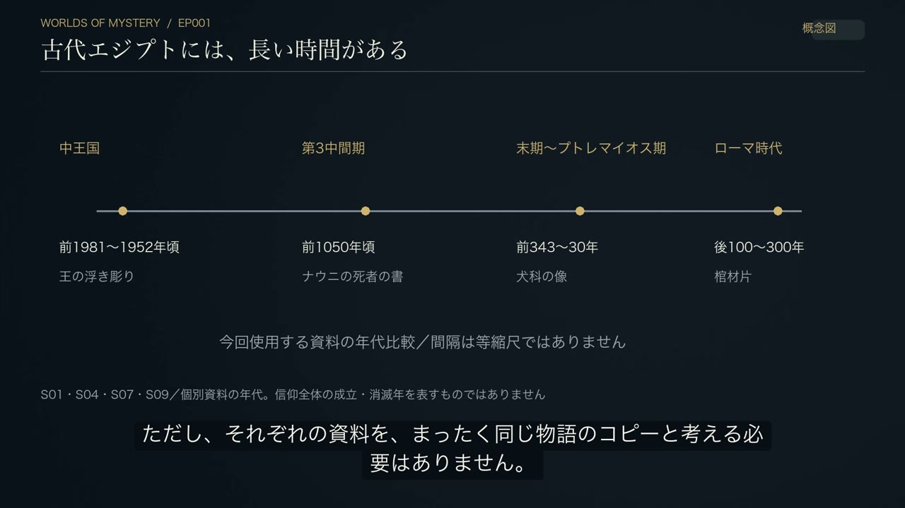

|開始|終了|合成時の入力文|
|---|---|---|
|07:41.888|07:47.573|さらに時代が下ると、ローマ時代の棺材の断片にも、アヌビスが登場します。|
|07:47.733|07:52.779|中心にオシリスが座り、その近くにトトやほかの神々が描かれています。|
|07:52.939|07:57.771|長い時間がたっても、死者と神々の関係は表現され続けました。|
|07:57.931|08:04.000|ただし、それぞれの資料を、まったく同じ物語のコピーと考える必要はありません。|

## N24 08:04.510–08:25.959 名前の後ろの、疑問符

音声RMS -19.2 dBFS／サンプルピーク -1.86 dBFS（トゥルーピークとは別の値）

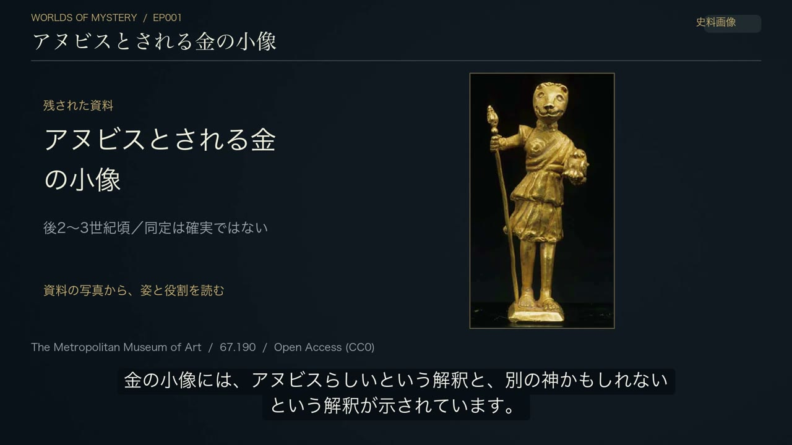

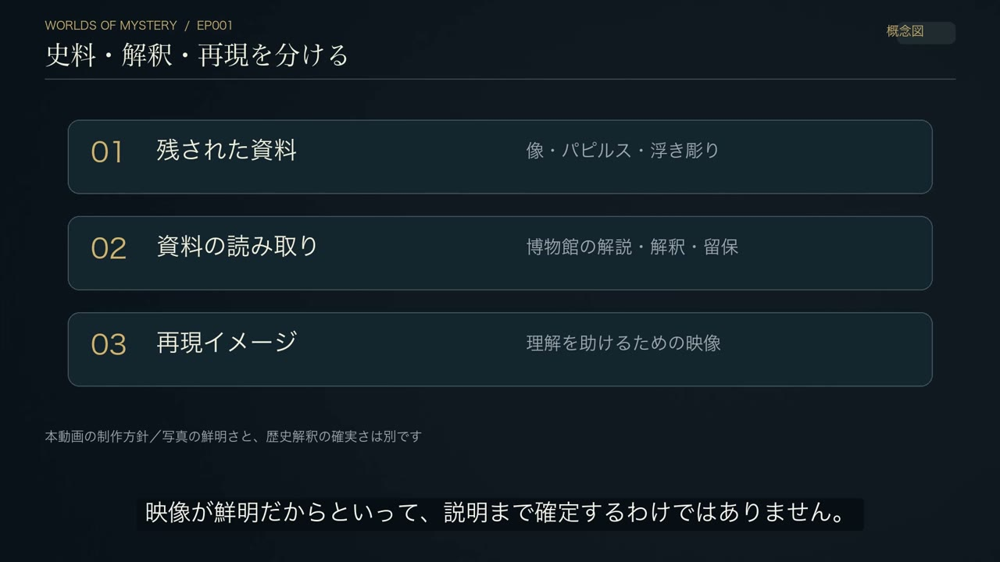

|開始|終了|合成時の入力文|
|---|---|---|
|08:04.510|08:11.283|金の小像には、アヌビスらしいという解釈と、別の神かもしれないという解釈が示されています。|
|08:11.443|08:15.379|美術館は、正体は確実ではないと明記しています。|
|08:15.539|08:20.446|分からないことを分からないと残す姿勢も、歴史を伝えるために必要です。|
|08:20.606|08:25.449|映像が鮮明だからといって、説明まで確定するわけではありません。|

## N25 08:25.959–08:47.194 小さな像にも、目を向ける

音声RMS -18.68 dBFS／サンプルピーク -2.02 dBFS（トゥルーピークとは別の値）

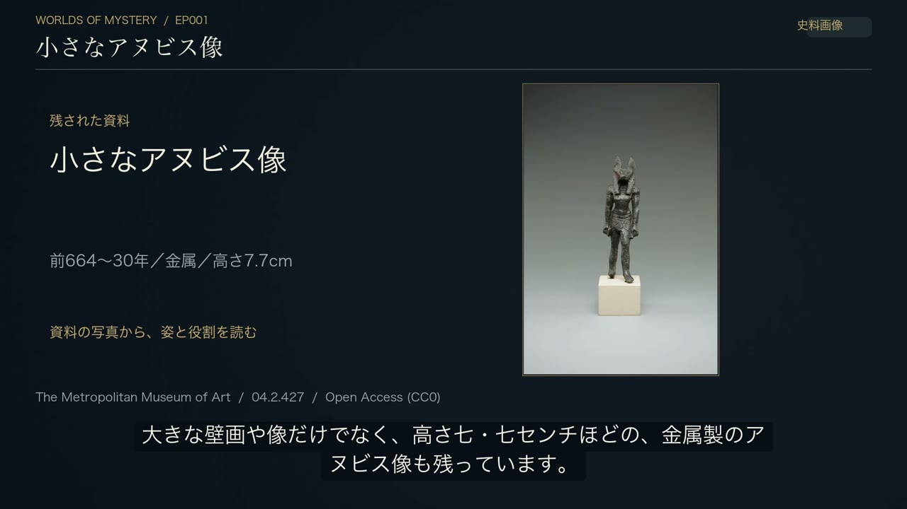

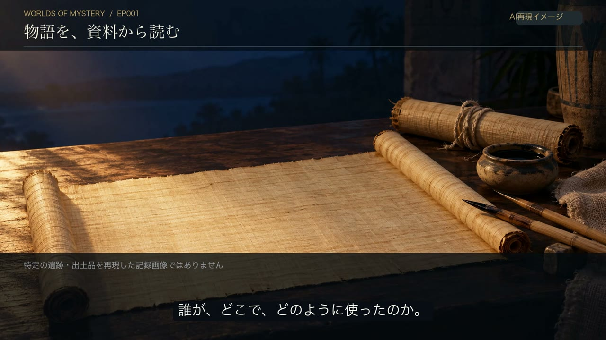

|開始|終了|合成時の入力文|
|---|---|---|
|08:25.959|08:32.743|大きな壁画や像だけでなく、高さ七・七センチほどの、金属製のアヌビス像も残っています。|
|08:32.903|08:39.889|博物館の資料を見ていくと、壮大な神話が、手に取れる大きさの物にも表されていたと分かります。|
|08:40.049|08:43.143|誰が、どこで、どのように使ったのか。|
|08:43.303|08:46.684|小さな資料は、新しい問いを開いてくれます。|

## N26 08:47.194–09:08.547 再現は、証拠ではない

音声RMS -18.49 dBFS／サンプルピーク -2.0 dBFS（トゥルーピークとは別の値）

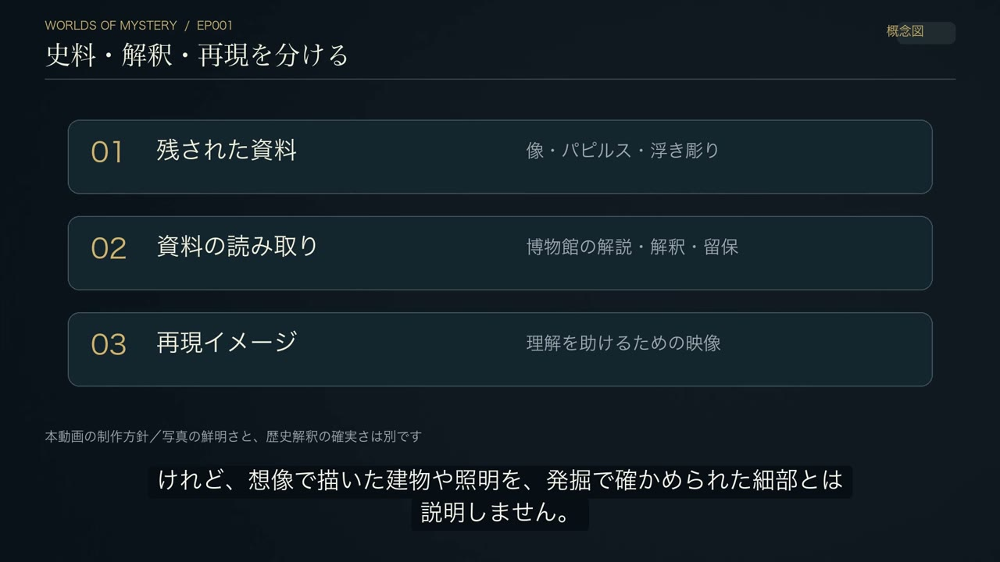

|開始|終了|合成時の入力文|
|---|---|---|
|08:47.194|08:51.802|今回の映像にも、資料を理解するための再現画を使っています。|
|08:51.962|08:58.437|けれど、想像で描いた建物や照明を、発掘で確かめられた細部とは説明しません。|
|08:58.597|09:04.282|史料が示すこと、研究者が解釈すること、私たちが想像を補うこと。|
|09:04.442|09:08.037|その境界を残しながら、物語をたどっています。|

## N27 09:08.547–09:30.563 守り、量り、次へつなぐ

音声RMS -19.19 dBFS／サンプルピーク -2.0 dBFS（トゥルーピークとは別の値）

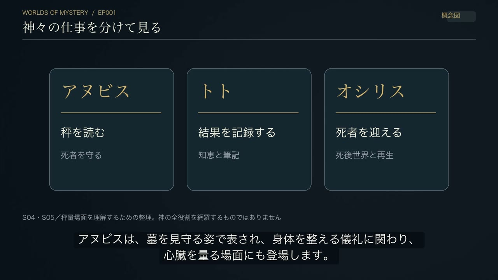

|開始|終了|合成時の入力文|
|---|---|---|
|09:08.547|09:16.611|アヌビスは、墓を見守る姿で表され、身体を整える儀礼に関わり、心臓を量る場面にも登場します。|
|09:16.771|09:22.189|死と深く結びつく神ですが、その役割を恐怖だけでまとめることはできません。|
|09:22.349|09:24.813|守ることと、試練を越えること。|
|09:24.973|09:29.603|その両方に関わる存在として、資料から読み解くことができます。|

## N28 09:30.563–09:52.555 残されたのは、人の願い

音声RMS -19.06 dBFS／サンプルピーク -1.92 dBFS（トゥルーピークとは別の値）

|開始|終了|合成時の入力文|
|---|---|---|
|09:30.563|09:35.608|パピルスに残る心臓の物語から、私たちは一つの問いを受け取れます。|
|09:35.768|09:40.952|死の先へ持っていくとしたら、自分の何が、その人らしさを語るのでしょう。|
|09:41.112|09:46.616|ここでの答えは科学的な事実ではなく、古代の信仰を通じて考える問いです。|
|09:46.776|09:52.045|神々の姿の向こうには、亡くなった人の旅を支えようとする願いが見えます。|

## N29 09:52.555–10:12.233 出典と制作について

音声RMS -18.38 dBFS／サンプルピーク -1.8 dBFS（トゥルーピークとは別の値）

|開始|終了|合成時の入力文|
|---|---|---|
|09:52.555|09:57.515|この動画は、博物館の公開資料と解説をもとに構成しました。|
|09:57.675|10:03.307|ナレーションには音声合成を、一部の映像にはエーアイによる再現画を使っています。|
|10:03.467|10:08.747|作品名、出典、素材の利用条件は付属の資料にまとめています。|
|10:08.907|10:11.723|ご覧いただき、ありがとうございました。|
