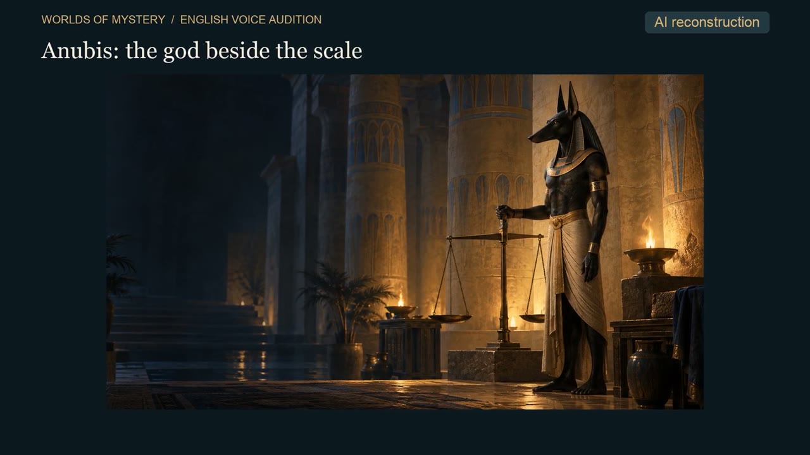
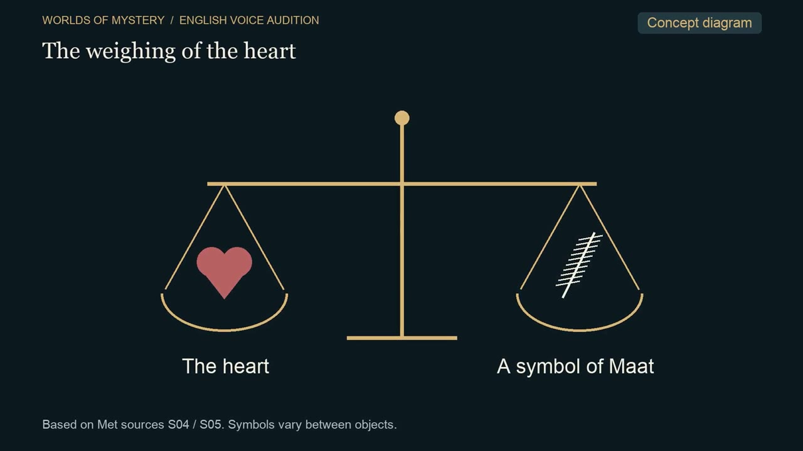
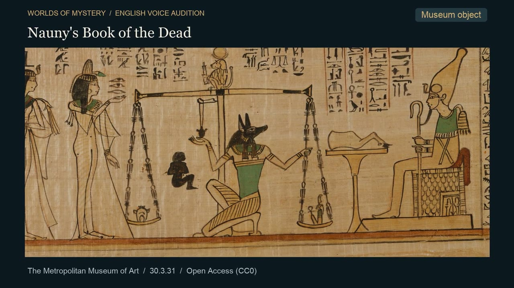
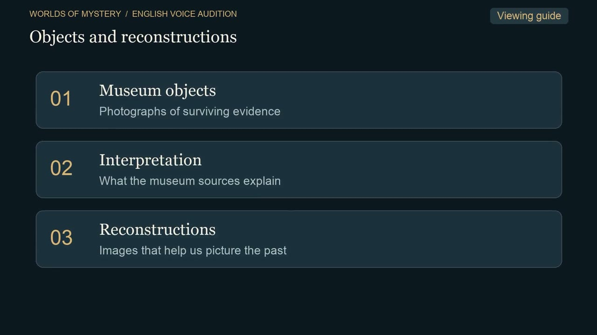
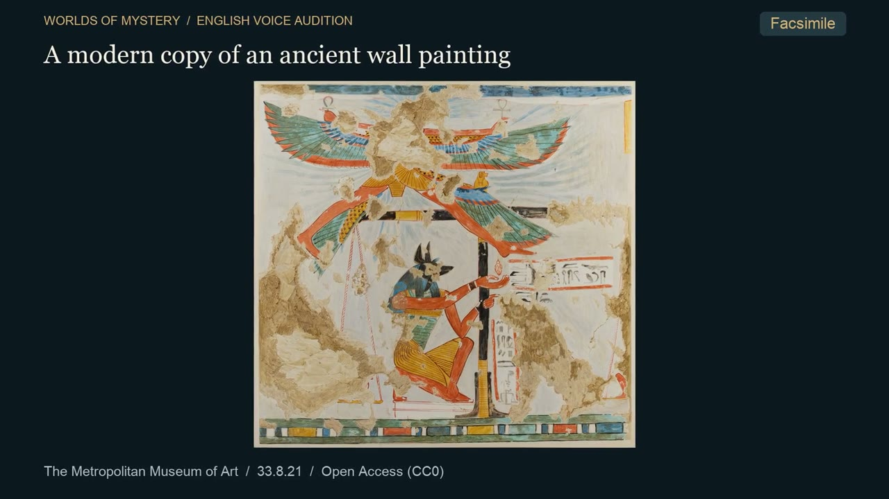
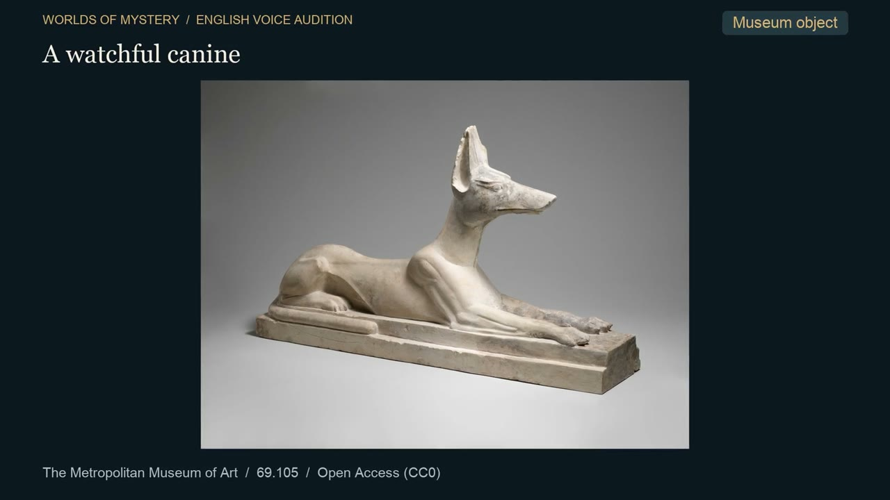
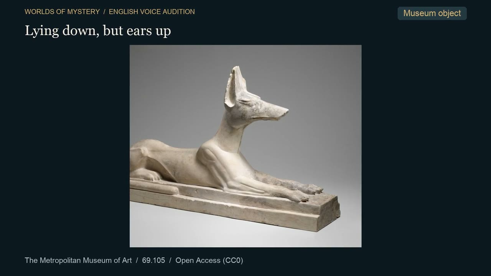

# アヌビス第1話：英語の声を選ぶ90秒試聴

**手順1まで完了。A・B・Cのどれを採用するか、本人の試聴待ちです。**
英語メイン・日本語第2言語の全編制作は、声の選択後に進めます。

## 試聴する動画

[3本の動画を置いた非公開Draft Release](https://github.com/yasukawa1980/youtube/releases/tag/untagged-110af3bbb733c897c2a8)

|候補|声|英語|ファイル|実尺|実測LUFS／TP|
|---|---|---|---|---|---|
|A|Michael（男声）|米語|`wom01_voice_A_am_michael_90s.mp4`|90.000秒|−16.01 LUFS／−4.55 dBTP|
|B|Heart（女声）|米語|`wom01_voice_B_af_heart_90s.mp4`|90.000秒|−15.99 LUFS／−4.55 dBTP|
|C|George（男声）|英国英語|`wom01_voice_C_bm_george_90s.mp4`|90.000秒|−15.98 LUFS／−5.05 dBTP|

3本とも1920×1080・30fps。映像ストリームのハッシュが一致しており、同じ映像と同じBGM条件で比較できます。音声モデルはKokoro-82M、Mac内のCPUで生成。有料音声API・追加契約・購入は使用していません。

Mac保存先：

```text
/Users/ryo/Desktop/BGM/Worlds of Mystery/EP001_Anubis/英語声試聴_20261020/
```

## 今回そろえた条件

- 最新の英語台本N01〜N04、197語をすべて読み上げる。[英語と日本語の台本](試聴用台本.md)
- 語りの割当時間は83秒、段落内の間を含め約142.4語／分。各段落の開始・終了を3声でそろえた。
- 各声の合成速度を調整後、ピッチを保った微小な時間補正で尺を統一。今回の補正率は `voice_generation.json` に記録している。
- 冒頭は1.5秒、N04の章頭は1.8秒、末尾は2.7秒のBGM区間。末尾はBGMをフェードアウトして終える。
- 字幕は焼き込んでいない。画面内の見出し・図解・資料区分は英語。今回は音声選定用なので別添SRTは未作成。
- N02ではナウニのパピルスの天秤部分を拡大し、史料の写真を大きくした。全8ショットにゆっくりした拡大を付けた。
- 写真・AI再現画・図解・現代の模写を右上の表示で区別した。画像生成の追加実行はしていない。

声の好み、英語の聞き取りやすさ、話す速さ、BGMの大きさを確認してください。声の自然さをCodexが聴いて確認済みという扱いにはしていません。

## BGMの調整と実測

既存のオリジナル音響を使用。段落の中では低めに保ち、語りのない区間で上げるダッキングを実装しました。語間の細かい隙間ごとに音量が上下しない方式です。

- 語りの下のBGM：**−36.50 dBFS RMS**
- N04前の間のBGM：**−33.35 dBFS RMS**（1秒の安定区間で測定）
- BGMとナレーションの差：A −18.94 dB／B −18.46 dB／C −19.22 dB
- 無音区間の設定上の上げ幅：4 dB。音源自体の変化・フェードがあるため区間実測差はこれと一致しない。
- 最終MP4の全編デコード、実尺、LUFS・トゥルーピーク、映像共通性を確認。

詳細：[検品実測](audition_qc.json)／[生成設定と共通タイムライン](voice_generation.json)／[共有検証](sharing_verification.json)

## Claudeから取得する方法

前回取得に成功したREST API方式を掲載します。GraphQLに依存する `gh release download` はClaude環境で失敗することがあります。

```sh
gh api repos/yasukawa1980/youtube/releases \
  --jq '.[] | select(.tag_name=="wom01-en-voices-20261020") | .assets[] | "\(.id) \(.name)"'
```

2026-10-20時点の添付ID：

|候補|ID|
|---|---|
|A MP4|659150510|
|B MP4|659150514|
|C MP4|659150517|
|SHA256SUMS.txt|659150513|

例：

```sh
gh api -H 'Accept: application/octet-stream' \
  repos/yasukawa1980/youtube/releases/assets/659150510 > wom01_voice_A_am_michael_90s.mp4
```

push権限を持つ認証が必要です。Draftは公開に切り替えないでください。取得後は [SHA256SUMS.txt](SHA256SUMS.txt) で照合してください。取得できることと、モデルが音を直接聴けることは別です。Claudeには場面画像と数値解析による確認を依頼する形です。

## 場面確認
















## 利用条件と再生成

[音声利用条件の記録](../../worlds-of-mystery/EP001_Anubis/records/voice_license.json)の `english_audition_20261020` を参照。

- [Kokoro公式モデルカード](https://huggingface.co/hexgrad/Kokoro-82M)：Apache-2.0表記と商用・制作環境での利用を確認。
- [公式の声一覧](https://huggingface.co/hexgrad/Kokoro-82M/blob/main/VOICES.md)：今回の英語3声について、個別の追加クレジット条件は記載されていない。出所明示のため任意で `English narration: Kokoro-82M (hexgrad), voice [ID], generated locally with kokoro-onnx. Synthetic narration.` を資料とRelease説明に記載。
- [kokoro-onnx](https://github.com/thewh1teagle/kokoro-onnx/blob/main/LICENSE)：MIT。モデルやライブラリ自体を公開配布していない。再配布時は各ライセンスの通知要件を別途守る。

今回の固定入力用スクリプトは [音声生成](../wom01_voice_auditions.py) と [試聴動画作成](../wom01_audition_videos.py)。[依存バージョン](requirements.txt)を保存。モデルと声のハッシュは音声利用条件記録に保存した。生成済み音声と中間映像はMacの試聴フォルダ内 `_work/` にあり、Gitには入れていない。

実行用Python環境は `/private/tmp/wom01-kokoro-venv/`（OSによって消去される可能性あり）。モデルは `/Users/ryo/Desktop/BGM/_共通/音声モデル/Kokoro82M_v1/` に保存。台本・画面・尺を変える再試作は新しい出力フォルダを指定する。

日本語v01の原本は維持。日本語音声の再生成、N05以降の英語音声、全編の言語共通時間軸は未着手。SSD同期は未実施。
