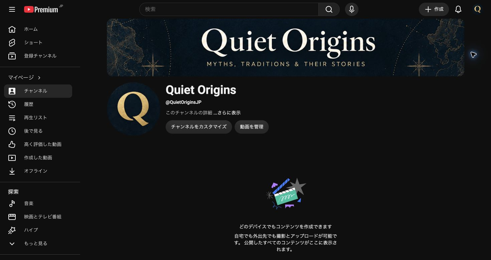

# Quiet Origins：アイコン・バナーはA案を採用

2026-10-21、本人が「Aでいきます。」と選択。**A「古い刻印を思わせるQ」**を採用する。B「灯」、C「年輪」は比較案として選外。

## 採用する方向性

- アイコン：濃紺の円形背景に、金色の明快なQ一文字。小さく表示しても識別できる太さと余白を保つ。
- バナー：濃紺を基調に、端へ控えめな地図風の装飾。中央にアイボリーのセリフ体で `Quiet Origins`。
- 補助文：`Myths, Traditions & Their Stories`。ラフでは大文字組み。
- 配色の目安：濃紺 `#0c1820`、落ち着いた金 `#d8b575`、アイボリー `#f4efdf`。ラフ画像の画素がこの値に厳密一致するという意味ではない。
- 世界の神話・伝承・行事の由来を扱える共通デザインとし、アヌビスなど特定の題材には限定しない。

## 採用ラフの保存・取得

原寸PNGはMacの `/Users/ryo/Desktop/新チャンネル/ブランド素材/A案_採用ラフ_20261021/Quiet_Origins_A_採用ラフ.png` にコピーして保全。内蔵image_genで生成した比較ボードで、再生成や画像編集は行っていない。

[非公開Draft Release](https://github.com/yasukawa1980/youtube/releases/tag/untagged-b517f7ea562ad4b1b9de)：Release ID **419157229**、Asset ID **661335456**。
原寸素材はGitへ入れずDraft添付で共有。RESTで再取得しSHA-256一致を確認（1,628,094 bytes）。

```sh
gh api -H 'Accept: application/octet-stream' repos/yasukawa1980/youtube/releases/assets/661335456 > Quiet_Origins_A.png
```

## 登録用仕上げ・YouTube設定済み（2026-10-21）

本人の「A案のアイコンとバナーを仕上げて、チャンネルに設定して下さい。」により、[Quiet Origins（@QuietOriginsJP）](https://www.youtube.com/@QuietOriginsJP)へ反映済み。

- アイコン：1024×1024 PNG、1,760,968 bytes。円形切り抜きでQの欠けなし。
- バナー：2560×1440 PNG、5,161,036 bytes。YouTubeの全デバイス安全範囲でタイトル・補助文が欠けないことを確認。
- 内蔵image_genで採用ラフを参照し2点を生成。生成原寸はアイコン1254×1254、バナー1672×941。sipsで登録寸法へリサイズ。生成原寸は別名保全。
- Studioの再読み込みと公開ページで両方の反映を確認。動画は未投稿。指定SSDへの同期は未実施。



[バナー安全範囲](20261021_Aバナー安全範囲.jpg)／[登録記録・生成プロンプト全文](20261021_A登録用_v01.json)。

### 保存とClaudeからの取得

Mac：`/Users/ryo/Desktop/新チャンネル/ブランド素材/A案_登録用_v01_20261021/`。

- `Quiet_Origins_icon_A_1024.png`
- `Quiet_Origins_banner_A_2560x1440.png`
- `source_icon.png` / `source_banner.png`：生成原寸
- `generation_prompts.json`：内蔵image_genに渡したプロンプト全文

[非公開Draft Release](https://github.com/yasukawa1980/youtube/releases/tag/untagged-fbeb27c1c243cd2d9563)、Release ID **419168168**。5添付をRESTで再取得しSHA-256一致を確認。原寸画像はGitへ入れず、確認画面と記録をGitで共有。

| 添付 | Asset ID | bytes |
|---|---:|---:|
| Quiet_Origins_icon_A_1024.png | 661374137 | 1,760,968 |
| Quiet_Origins_banner_A_2560x1440.png | 661374197 | 5,161,036 |
| source_icon.png | 661374277 | 2,866,945 |
| source_banner.png | 661374329 | 2,549,241 |
| generation_prompts.json | 661374377 | 2,044 |

```sh
gh api -H 'Accept: application/octet-stream' repos/yasukawa1980/youtube/releases/assets/661374137 > Quiet_Origins_icon_A_1024.png
gh api -H 'Accept: application/octet-stream' repos/yasukawa1980/youtube/releases/assets/661374197 > Quiet_Origins_banner_A_2560x1440.png
```
