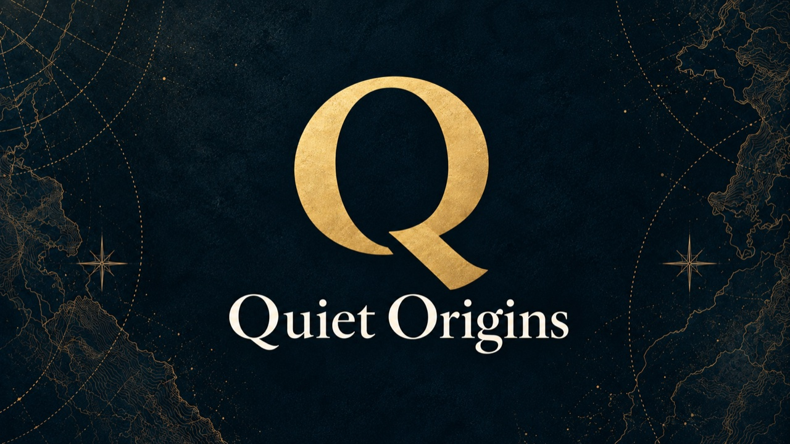
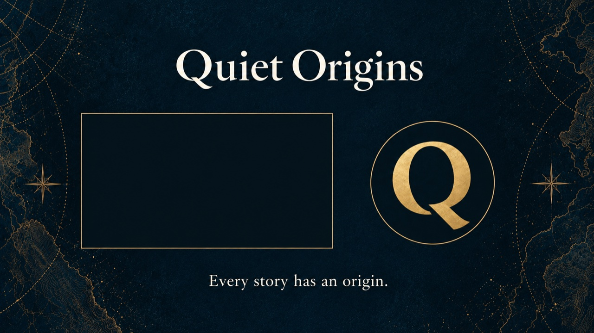

# Quiet Origins：共通オープニング・エンドカードの静止画ラフ v01

**同日の進展：** 本人の実行依頼で[音付き動画試作と本編接続版6本](../20261021_共通映像試作_v01/README.md)を制作済み。以下は静止画ラフ制作時点の記録。

2026-10-21。本人の「進めて下さい」を受け、直前に提案した静止画ラフ2点を制作。内蔵image_genを使用し、採用済みA案のQアイコン・バナーを参照した。**画像のラフであり、動画と音は未制作。**

## オープニング（約4秒の想定）



導入の問いかけ → 短いロゴ → 本編。0〜1秒にQを浮かべ、1〜2.5秒でタイトル、2.5〜4秒で静かに保持して本編へ。低く穏やかな響き＋小さな澄んだ一音を検討。語りは入れず、英日で共用する。

## エンドカード（約20秒の想定）



左は次の動画、右はチャンネル登録の想定。四角・丸は配置を確認する仮枠で、実際のクリック要素はYouTube Studioで別途設定する。最初の公開時に次の作品がなければ登録だけとし、動画枠を残したまま公開しない。文言は `Every story has an origin.`（すべての物語には、始まりがある）。出典・音声クレジットはこの前に残す。BGMは余韻を残して終える。

[YouTube公式](https://support.google.com/youtube/answer/6388789?hl=ja)では終了画面は動画末尾5〜20秒に配置できる。今回は20秒を設計上の想定とし、実際の配置・寸法は動画制作後にStudioで合わせる。今回、Studio操作や投稿は行っていない。

## 本制作時の扱い

- この2点は方向確認用の静止画。生成されたQは参考再描画のため、アニメーションでは採用済みQの実素材を使う。
- Q、タイトル、背景を分け、光とフェードを個別に調整する。画像全体をただ動かす方式を完成版とはしない。
- 本編v07・外部字幕・音声は変更していない。
- 指定SSD ESD-EPBへの同期は未実施。

## 保存・共有

Mac：`/Users/ryo/Desktop/新チャンネル/ブランド素材/オープニング_エンドカード_ラフ_v01_20261021`。`比較プレビュー.html` を開くと2点と動きの案を並べて確認できる。

[非公開Draft Release](https://github.com/yasukawa1980/youtube/releases/tag/untagged-4d5c0410565d4f028181)、Release ID **419223652**。4添付をREST再取得し、SHA-256一致を確認。原寸PNGはGitに入れず、Gitには縮小JPGと記録のみ。

| 添付 | Asset ID | bytes |
|---|---:|---:|
| Quiet_Origins_opening_concept_v01.png | 661570431 | 2,512,825 |
| Quiet_Origins_endcard_concept_v01.png | 661570524 | 2,203,763 |
| generation_prompts.json | 661570642 | 2,866 |
| preview.html | 661570710 | 2,169 |

```sh
gh api repos/yasukawa1980/youtube/releases/419223652 --jq '.assets[] | "\(.id) \(.name)"'
gh api -H 'Accept: application/octet-stream' repos/yasukawa1980/youtube/releases/assets/ASSET_ID > FILE_NAME
```

[生成プロンプト全文](generation_prompts.json)／[制作・共有記録](制作記録.json)。
