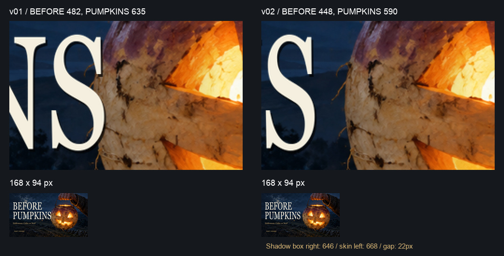
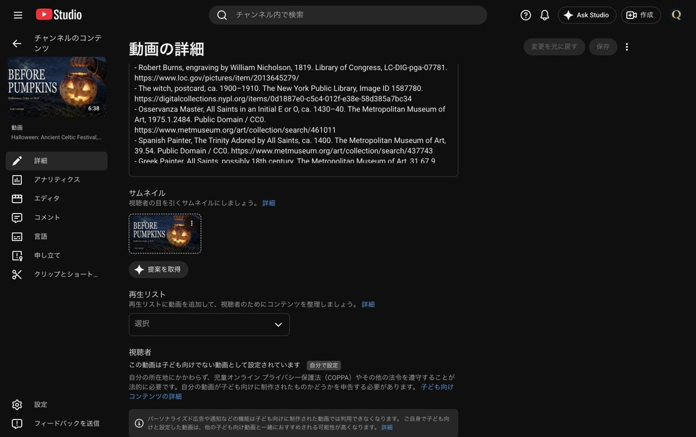
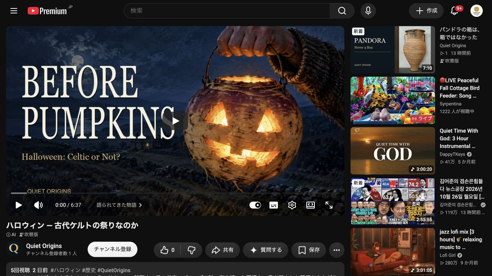

# 第2話ハロウィン：案1の重なり修正と差し替え完了

[Claudeの申し送り](wom02_サムネ差し替え依頼_20261026.md)に従い、案1の見出し幅を修正し、**2026-10-26 22:59 JST** に動画 `cKOVplspPvE` のサムネを保存した。新規画像生成なし。

## 修正と検品

- PUMPKINSの合成幅：635 → **590px**。BEFORE：482 → **448px**。同率（590/635、BEFOREは整数丸め）で詰めた。
- 左端x=54、y=145／301、高さ132pxを維持。背景・グラデーション・小見出し・ブランド位置と色は同じ。
- 幅600pxでは、文字の影を含む外接枠から皮の輪郭まで12pxだったため、590pxへ調整した。
- 最終版の保守的なすき間は **22px**。文字の影を含む合成枠の右端x=646（排他的）、同じ高さの範囲で明るい皮の最左端x=668（y=357）。絵画の輪郭は曖昧なため、測定は `R>=80、R>B×1.4、R>G×1.05` の色が横5px連続する境界を使用。y=301〜435を走査した。
- 原寸と168×94pxで目視し、最後のSとランタンが離れていることを確認。比較画像上段は該当部分を2倍、下段は168×94pxの実サイズ。
- v01を同じスクリプト条件で再現し、元JPGとのバイト一致を確認。JPEG圧縮前の見出し2枠以外の変更画素は0。元のv01ファイルを維持。

完成ファイル：[wom02_サムネ案1_v02_20261026.jpg](サムネ確認用/wom02/wom02_サムネ案1_v02_20261026.jpg)

| 項目 | 実測 |
|---|---|
| 形式・寸法 | JPG・1280×720 |
| 容量 | 377,641 bytes（1MB未満） |
| SHA-256 | `9035e8b8542a9c5102850d1cb51202eea96dbbd15a97b993087a0d153241ebc3` |

アップロード直前にもSHA-256を再計算し、上記と一致した。[検品記録](wom02_サムネ案1_v02検品_20261026.json)／[再現スクリプト](wom02_サムネ案1修正_v02_20261026.py)。

## Studioと公開ページ

- Studioで **Quiet Origins** とチャンネルID `UCfLJOojEY9VB3rvrjICk90Q` を確認してから対象動画を開いた。
- サムネイルの「変更」からv02をアップロードし、保存。操作直後の記録時刻：`2026-10-26T13:59:49.878Z`＝**2026-10-26 22:59:49 JST**。
- 保存後に詳細画面を再読み込み。左側の動画サムネ・設定欄とも新画像を表示し、保存ボタンが無効（未保存変更なし）であることを確認。
- タイトル・説明文は画面上のテキスト欄を変更前／保存前／再読み込み後に照合し一致。その他の設定・字幕・言語・音声・終了画面・チャプター・公開設定・AI使用・カテゴリ・A/Bテストは操作していない。
- 別ブラウザ（Codex in-app browser）の[公開再生ページ](https://www.youtube.com/watch?v=cKOVplspPvE)で、再生前のポスターに新サムネが表示された。別ブラウザもログイン状態であり、ログアウト確認ではない。確認時点で反映待ちはなかった。
- 作業後、ChromeのStudioを元の **Whispers of Japan**（`UCx4mLEohO3XCVxZajUynLzw`）へ戻し、表示を確認した。

[差し替え時刻・投稿文照合記録](wom02_サムネ差し替え検証_20261026.json)。画面証跡は長辺1280px以下・1MB以下。

## 比較の起点と次回確認予定

変更前の基準は[2026-10-26 19:15の記録](wom02_サムネ改善結果_20261026.md)：インプレッション22、視聴1。上段のクリック率は「—」、下段の別期間ファネルは0.0%。少数のため、これだけで変更効果を断定しない。

**次回比較予定：2026-11-02 22:59 JST以降（変更から7日後）。** 同じ動画の概要・リーチでインプレッション、クリック率、視聴回数と取得日時・表示期間を読むだけで記録する。10/31の季節需要をまたぐ点にも留意する。依頼どおり予定の記載のみで、自動実行は登録していない。

Mac納品先：`/Users/ryo/Desktop/新チャンネル/EP002_Halloween/サムネ改善_20261026/deliverables/`。原寸の生成素材は同じ親フォルダの `sources/` に保全。Gitには縮小JPGと記録・スクリプトだけを共有する。
