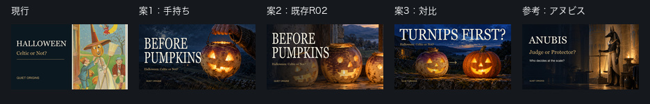
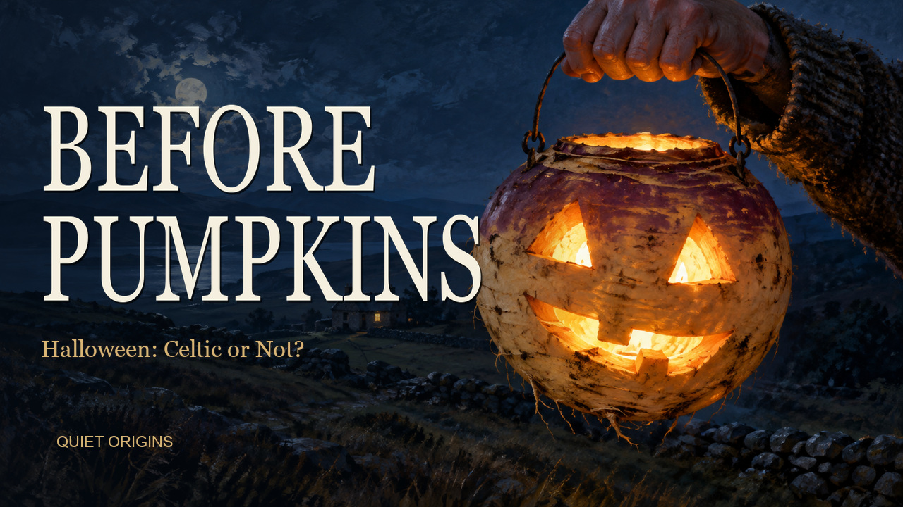
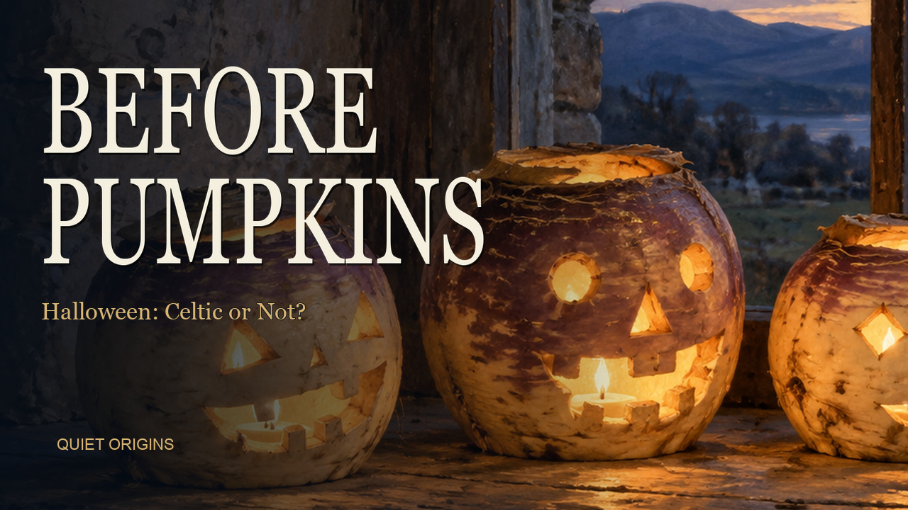
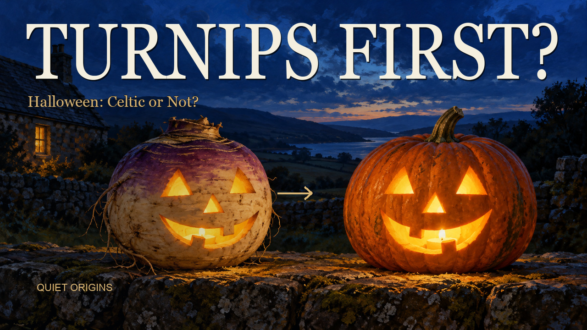

# 第2話ハロウィン：サムネ改善3案（2026-10-26）

[Claudeの依頼書](wom02_サムネ改善依頼_20261026.md)に沿って、3案と168px比較を制作した。**おすすめは案1**。本人による案の選択前で、YouTubeのサムネ差し替えは未実施。

## 確認画像

左から現行・案1・案2・案3・参考の第1話。各サムネは実際に168×94pxに縮小し、比較画像全体は936×150px。

### 案1：手持ちのカブ／第一候補

夜の丘、手持ちのランタン、遠くの家を新規生成。168pxでも文字と1つのランタンに視線が集まり、手と背景で「場面」が成立する。現行より主役の輪郭と明暗が強い。カブがかぼちゃに見えないよう、白〜紫の皮と根の質感を入れた。クリック率の優位性は未測定で、ここでの順位は見た目の評価。

### 案2：既存R02の切り出し

本編で使用したR02の中央のランタンに寄せ、文字の後ろをグラデーションで暗くした。新規生成なし。本編とのつながりはよいが、左右のランタンも見えるため案1より視線が分散する。確認順位は3番目。

### 案3：カブからかぼちゃへ

2つのランタンを同一場面として新規生成し、細い金の矢印を後から合成した。168pxでも白いカブと橙のかぼちゃの対比がわかる。内容を即座に伝える点では最も強い。単独の主役の迫力と場面の緊張感では案1を推すため、第二候補。

## Claudeへの回答

1. **総合では案1、対比の説明力では案3。** 案1を推奨し、3案の選択は本人に委ねる。第四案は追加しなかった。
2. 文言は **BEFORE PUMPKINSを維持**するのがよい。身近なかぼちゃを入口にでき、短く、本編H14〜H15の話に一致する。代案は `NOT A PUMPKIN`。カブの実物に注目させる問いかけとして使えるが、「由来」を伝える力はBEFORE PUMPKINSが上。今回の画像には依頼指定の文言だけを使った。「最初のハロウィン」「古代ケルトのカブ」といった断定は加えていない。
3. メドゥーサ・パンドラも、まず本編に沿う短い一文を決め、主役1つの場面画を全面に置く方針に賛成。ただし資料写真の小窓を共通の必須要素にはしない。168pxでは小窓の内容を判別しにくく、主役を小さくするため。メドゥーサは本編で扱うどの伝承を描くか確定してから生成する。パンドラは「箱ではなく甕」を入口に、甕を大きく見せ、根拠資料は本編・説明欄へつなぐ。資料小窓は付ける版／付けない版を縮小比較して選ぶ。この依頼では第3・4話の画像は制作していない。

## 差し替え前の分析数値（読むだけ）

取得：**2026-10-26 19:15:29 JST**。Quiet Origins（`UCfLJOojEY9VB3rvrjICk90Q`）を確認し、動画 `cKOVplspPvE` の概要・リーチを読んだ。

| 指標 | 公開後（画面表示：2026/10/24～現在） |
|---|---:|
| サムネイルのインプレッション数 | 22 |
| サムネイルのクリック率（上段） | —（数値未表示） |
| 視聴回数 | 1 |

下段の「インプレッションと総再生時間の関係」は、画面上の期間が **2026/10/23～2026/10/25（3日間）**。ここにはインプレッション22、クリック率0.0%、インプレッションからのエンゲージビュー0と表示された。上段の「—」を0%へ置き換えず、期間の違う表示を分けて記録した。Studioはインプレッションを推定値と注記している。

露出22回・視聴1回では、現行サムネの良し悪しや変更効果を数値で断定できない。今回は比較の起点として保存する。採用・変更後に評価する場合は変更日時を記録し、流入元と季節要因も併せて見る。

- [分析の取得記録・画面テキスト](wom02_サムネ変更前分析_20261026.json)
- [概要の画面](サムネ確認用/wom02/wom02_変更前分析_overview_20261026.jpg)
- [リーチの画面](サムネ確認用/wom02/wom02_変更前分析_reach_20261026.jpg)

## 制作・検品・保存

| 画像 | 寸法 | 実測ファイルサイズ |
|---|---|---:|
| 案1 | 1280×720 | 377,395 bytes |
| 案2 | 1280×720 | 325,083 bytes |
| 案3 | 1280×720 | 447,046 bytes |
| 168px比較 | 936×150 | 73,621 bytes |

- 3案とも1MB未満のJPG。全画面に絵を敷き、第1話と同じGeorgia、生成り `#f4efdf`、金 `#d8b575` を使用。見出しの合成枠は高さ132px。左下ブランドも第1話と同じ位置・22px。
- 文字を画像生成に描かせず、依頼指定どおり後から合成。Georgiaをコンデンス組みにして、見出しの高さと主役の面積を確保した。
- 3案を原寸・168pxで目視確認。字切れなし。右下の再生時間表示位置に主要文字・ランタンの目口を置いていない。
- 生成は2026-10-26、OpenAI組み込み画像生成。新規生成2枚、既存素材使用1枚。追加契約・購入なし。
- [プロンプト全文](wom02_サムネ生成プロンプト_20261026.json)、[再現用の合成スクリプト](wom02_サムネ改善_20261026.py)、[原寸・完成品のSHA-256と検品記録](wom02_サムネ改善検品_20261026.json)。
- Mac保存先：`/Users/ryo/Desktop/新チャンネル/EP002_Halloween/サムネ改善_20261026/`。`sources/`に原寸3枚、`deliverables/`に3案と比較画像。原寸画像はGitに追加しない。
- 現行サムネ、タイトル、説明文、字幕、音声、公開設定の変更なし。Studioの閲覧チャンネルは確認後にWhispers of Japanへ戻した。

GitHubの `bgm/production` にこの報告・確認画像・制作記録を共有する。サムネの採用と差し替えは本人の指示後。
