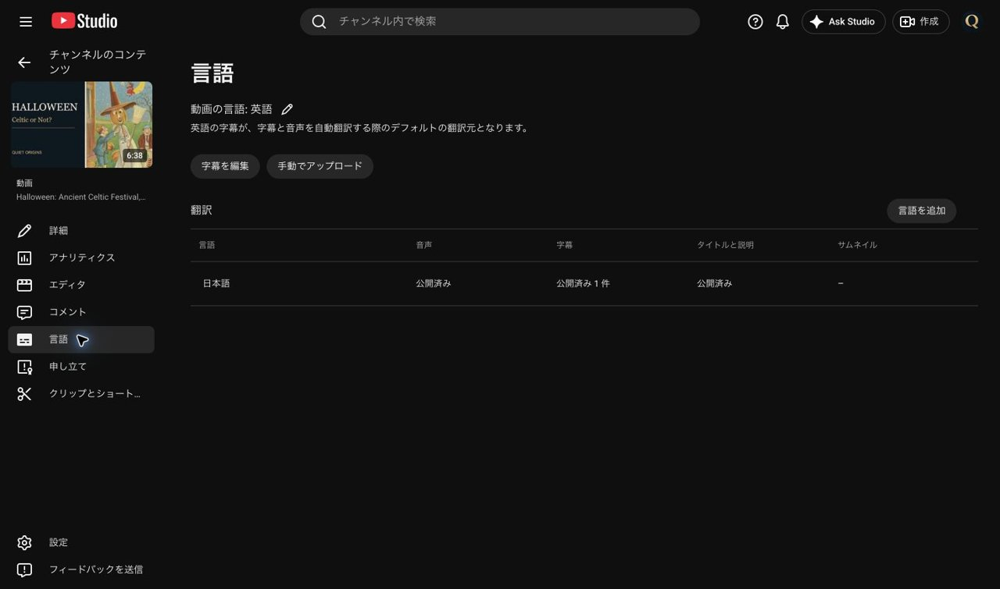
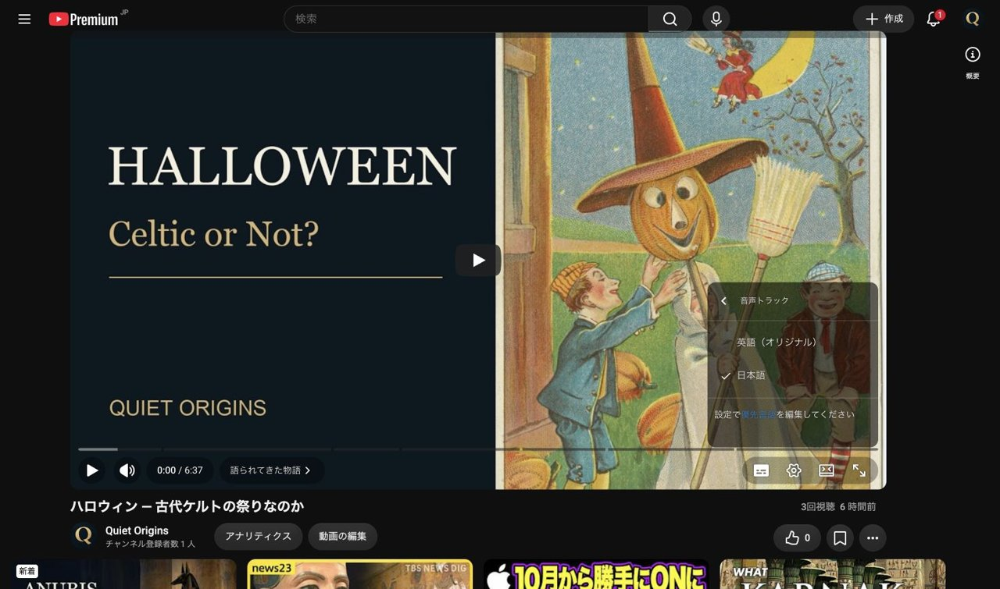

# 第2話「ハロウィン」日本語音声の再登録結果（2026-10-22）

本人の「直してもらえますか？」という依頼に基づき、Quiet Origins（チャンネルID `UCfLJOojEY9VB3rvrjICk90Q`）の第2話 `cKOVplspPvE` の日本語音声だけを再登録した。

## 入力確認と再登録

- 元ファイル：`確認版_v04_20261022/deliverables/EP002_audio_ja.m4a`。SHA-256 `fce47be278cb8761ebdd52cb30e13e26cf0895e141b103fd684e4e9cd90e39bc`、投稿時・Releaseの記録と一致。
- 元ファイルはAAC-LC、48kHz、ステレオ、397.666秒。最後までデコードに成功。本編は397.666667秒。原因の詳細はStudioに表示されず、M4A形式が原因とは断定していない。
- 同じ音声を24-bit PCM WAV、48kHz、ステレオ、本編と同じ397.666667秒・19,088,000サンプルに変換した。音声内容・音量の再編集や音声生成は行っていない。末尾の差は32サンプル（約0.667ミリ秒）の補完のみ。
- 新規WAV：`/Users/ryo/Desktop/新チャンネル/EP002_Halloween/日本語音声修復_20261022/EP002_audio_ja_v04_pcm24.wav`、114,528,114 bytes。SHA-256 `931174baff4e065732ef72c809e83ccf896fd06832598dbc03d4c8f7cee9d3bb`。
- 変換元に同じ末尾調整をした24-bit PCMとWAVのデコード結果のSHA-256が一致：`3bcf7bd36e66ab3d821a6f6571d01524b5e190df19501f399114f3d111f25cd8`。WAVも全編デコードに成功。元M4Aは保全。
- Studioで「処理失敗」を確認後、失敗トラックの削除とWAV追加を同じ詳細ダイアログ内で行った。追加直後の表示は「公開済み」だったが、「更新」後の再読み込みでは音声欄が空になった。削除と追加の同時保存が意図どおり反映されていないことを確認し、空の音声欄へ同じWAVを追加して更新した。WAVの送信操作は計2回。再度「処理失敗」が出たための繰り返しではない。
- 2回目の保存後にStudioを再読み込みし、日本語音声が「処理中...」、その後「処理中... 95%」へ進むことを確認。ダイアログ内の受付直後の表示を処理完了として扱っていない。

## 確認結果

**2026-10-22T23:14:50+09:00時点、Studioの日本語音声は「公開済み」。処理失敗は解消した。**

非公開の再生ページを再読み込みし、音声トラックの選択肢「英語（オリジナル）」「日本語」を確認。「日本語」が選択済みで、明示選択後の再生も0:00→0:12まで進むことを確認して停止した。全編の聴き直しは実施していない。

- 公開予約は2026/10/24 9:00、GMT+0900、プレミア公開オフのまま。予約より前の公開はしていない。
- 日本語字幕「公開済み1件」、日本語タイトル・説明「公開済み」を維持。
- 本編MP4・英語音声、字幕・翻訳・サムネイル・終了画面の変更操作は行っていない。第1話・ショート6本・他チャンネルは操作していない。購入・広告なし。

## 補足

作業中に最新リモートを取得した際、Claudeの[再登録依頼](wom02_日本語音声_再登録依頼_20261022.md)が追加されていることを確認した。今回の修復は、そのファイルを読む前に本人のチャットでの修復依頼から開始済みで、同依頼書の「元M4Aを1回」の手順とは異なる。実際の操作と回数を上記に記録した。

YouTube公式の[音声差し替え手順](https://support.google.com/youtube/answer/13338784?hl=en)は、既存トラックの削除後に新しい音声を追加する方法。処理失敗の原因自体は未特定。

## 確認画像

長辺1280px以下・各1MB以下。音声・動画本体・認証情報はGit共有に含めない。
