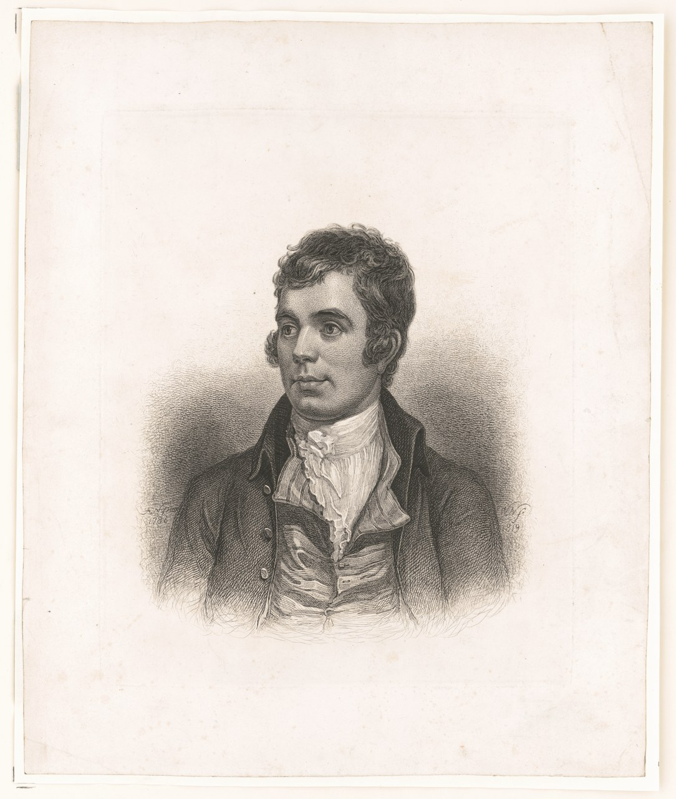
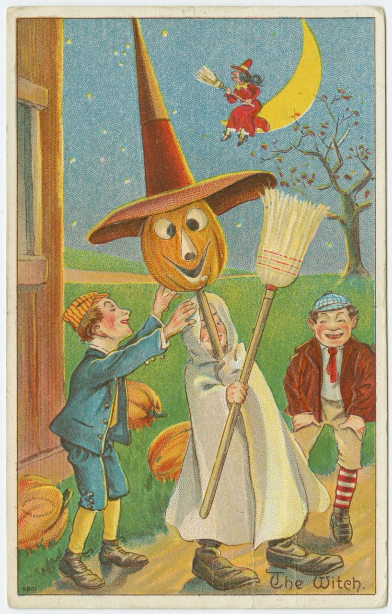
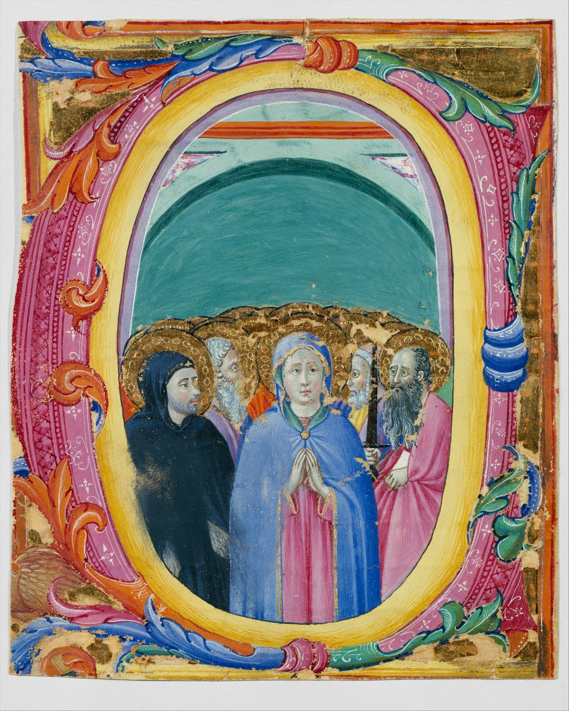
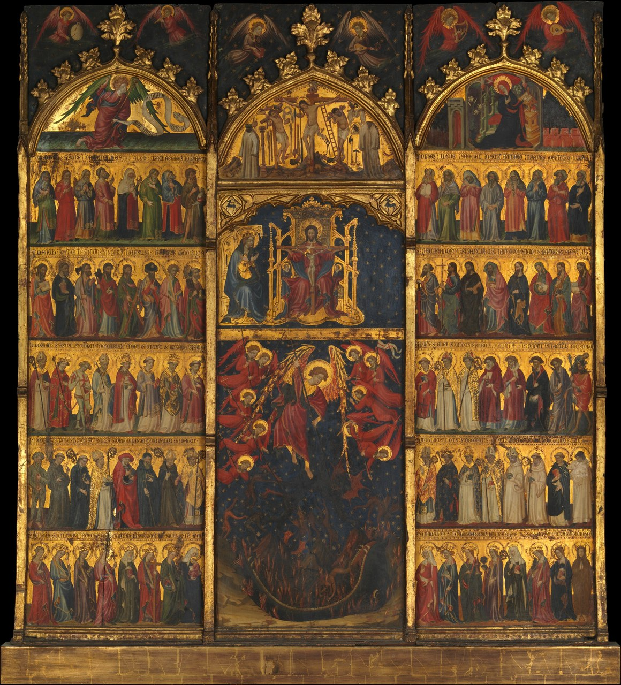
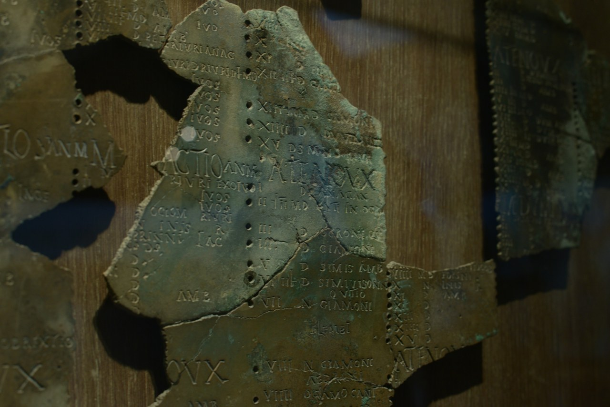
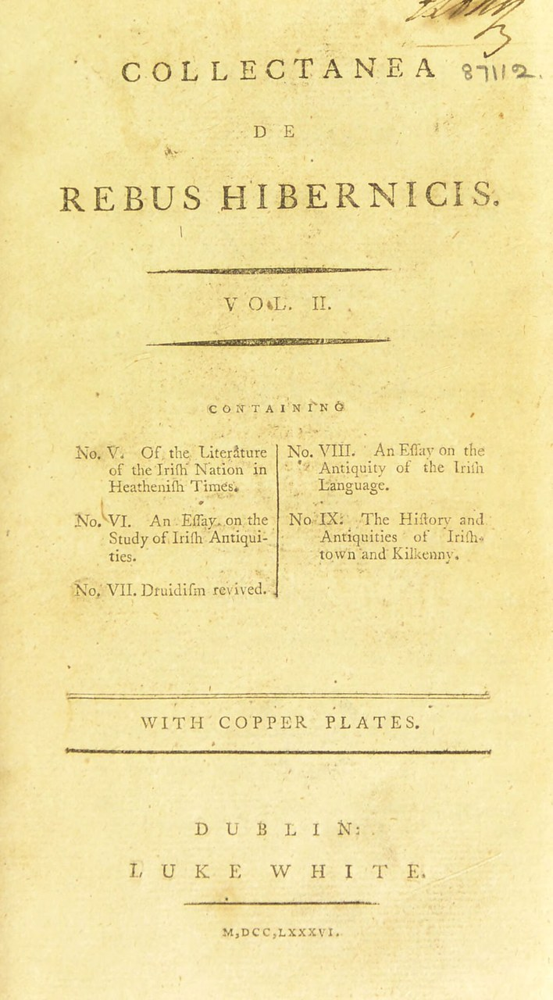
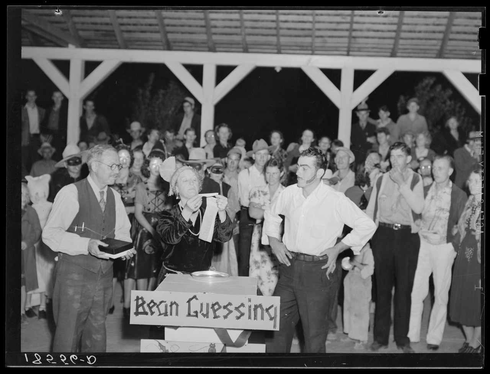

# 第2話「ハロウィン」素材候補・利用条件の確認

依頼：[`wom02_素材探し依頼_20261021.md`](wom02_素材探し依頼_20261021.md)。対象台本：[`wom02_テーマ設計.md`](wom02_テーマ設計.md)。**実際の確認・取得日は2026-10-21（日本時間）**。ファイル名の20261022は依頼指定に合わせたもの。

## 結果

**本採用候補6点＋指定年代外の予備1点を保存した。** バーンズの肖像、古い絵はがき、諸聖人2点、コリニー暦の部分写真、ヴァランシー著作の扉がそろった。全9項目を調べたが、挿絵、中世アイルランド写本、指定年代のパーティー写真、1833年の《Snap-Apple Night》、カブのランタンの実物資料写真は、今回の条件で採用できる画像を確定できなかった。これらは下記の保留・代用欄を参照。

「条件適合」は依頼書で指定された公開表示を確認したという意味。LoCのNo known restrictionsは館が既知の制限を把握していないという表示で、権利を許諾・保証する文言ではない。NYPLのA02は米国法に基づくPD判断で、他国については未判断という範囲をそのまま記録した。CC BY-SAは一般に商用利用を禁止するライセンスではないが、**今回の依頼では除外指定**なので採用していない。

- 原寸の取得画像：`/Users/ryo/Desktop/新チャンネル/EP002_Halloween/素材/`。7ファイル、合計367,611,531 bytes。画像を全画素読み込み、コピー後のSHA-256一致を確認。
- 確認JPG：`new-channel/サムネ確認用/wom02/A01_*`〜`A07_*`。全7点が長辺1280px以下、各1,000,000 bytes未満。既存の「余白の埋め方_案.jpg」は変更していない。
- 機械可読の台帳：[`research/wom02_素材台帳_20261021.json`](research/wom02_素材台帳_20261021.json)。原寸・確認JPGのサイズ、画素数、SHA-256を記録。
- 実施範囲は調査・ダウンロード・確認JPG作成。AI画像、図解、音声、動画は未制作。契約・購入なし。台本は変更していない。

## 依頼9項目の判定

| # | 探すもの | 結果 | 採用・代用方針 |
|---|---|---|---|
| 1 | バーンズの挿絵・肖像 | 肖像A01は条件適合。挿絵は保留 | H12は肖像。H13の占い描写は再現画候補R03で補う |
| 2 | 1900〜1920年代の絵はがき | A02を確保（約1900〜1910年） | H01・H15・H16の時代図像。NYPLの米国PD判断の範囲を明記 |
| 3 | 1900〜1930年の仮装・パーティー写真 | 指定年代の写真は未確定。A07は1938年の予備 | 1908年Kearney写真は保留。年代を示せる一般的な米国パーティー紹介に限りA07検討 |
| 4 | 諸聖人の絵・写本 | A03・A04、Met PD/CC0 | H09〜H11。A03を第一候補 |
| 5 | 中世アイルランド写本 | 確認したISOS配信画像は条件不適合 | H03〜H05は出典を確認した内容の図解・年表が必要。別国の写本を取り違えない |
| 6 | コリニー暦写真 | A05、写真自体がCC0 | H06。部分写真なので、全体構造を説明する場合は別途図解。年代の不一致に注意 |
| 7 | Snap-Apple Night（1833） | 採用画像を確定できず保留 | 所蔵館によるPD画像を確認できない。Metの複製版画は画像未公開 |
| 8 | ヴァランシー著作の扉 | A06、第2巻・1786年 | H07の著作紹介に使用可能。該当主張の本文の確認は別途必要 |
| 9 | カブのランタンの古い実物写真 | NMIの候補はBY-SAのため除外 | H14〜H15はカブの再現画R02候補 |

## 台本確定前に戻す確認事項

1. **H06／H-S03のコリニー暦の年代。** 台本案は「2世紀ごろ」だが、[Lugdunumの現行作品ページ](https://lugdunum.grandlyon.com/fr/Oeuvre-incontournable/2381-Calendrier-gaulois-de-Coligny)は「2e moitié du 1er siècle」（1世紀後半）と表示。[館のコレクション記録](https://collections-lugdunum.grandlyon.com/flora_portail/ark%3A/53354/0022381)はLUG br.001。資料による年代差をClaude側の出典確認工程で解決する。写真が見つかったことをもって台本の年代まで確認済みとしない。
2. **H07／H-S04の巻・年・本文。** A06の扉はVol. II、1786年。取得した画像からこの数字を読める。一方、[Wellcome書誌のContents](https://wellcomecollection.org/works/ukgp57xu)には、第3巻第2部no. XII、1783年に「Of All hallow eve」が挙がる。所蔵書誌、合本の扉、論考の個別刊年を区別する。今回取得した第2巻の扉は「死の神」の主張の裏づけにはならず、その本文やBalsabの記述は未確認。
3. **H16の1927年新聞記事。** A02もA07もその記事ではない。新聞名・日付・本文の出典確認は引き続き必要。1938年米国の写真に1927年カナダという札を付けない。
4. **H13の地域差。** 《Snap-Apple Night》はアイルランドの風習を描く作品で、バーンズのスコットランドをそのまま写した図ではない。将来採用する場合も地域・制作年を区別する。

## 保存済み画像の個別記録

以下の「利用条件原文」は判定に用いた表示の短い抜粋。ページURLは作品・権利確認の出典、画像URLは実際に取得した画像を示す。確認日は全点2026-10-21。クレジット案は出典を追跡できるように用意したもので、PD/CC0に新たな義務を加えるものではない。

MetのA03・A04は個別ページのPublic Domainに加え、公式コレクションAPIの`isPublicDomain: true`を確認。[Met Open Access方針](https://www.metmuseum.org/hubs/open-access)のCC0が適用される。API：[461011](https://collectionapi.metmuseum.org/public/collection/v1/objects/461011)、[437743](https://collectionapi.metmuseum.org/public/collection/v1/objects/437743)。

### A01 バーンズの肖像

| 項目 | 記録 |
|---|---|
| 判定 | 条件適合 |
| 所蔵・公開元 | Library of Congress, Prints and Photographs Division |
| 作品名 | [Robert Burns, head-and-shoulders portrait, facing left] |
| 作者・出版社 | William Nicholson (1781–1844), etcher |
| 年代 | 1819 |
| 作品番号 | 2013645279 / LC-DIG-pga-07781 |
| 作品ページ | [公式・個別ページ](https://www.loc.gov/pictures/item/2013645279/) |
| 取得画像 | [画像URL](https://tile.loc.gov/storage-services/master/pnp/pga/07700/07781u.tif) |
| 利用条件原文 | No known restrictions on publication. |
| 採用根拠 | LoC No known restrictions |
| 確認日 | 2026-10-21（日本時間） |
| 使用区間 | H12・H13 |
| 原寸保存先 | `/Users/ryo/Desktop/新チャンネル/EP002_Halloween/素材/burns_portrait.tif` |
| 原寸サイズ | 7740 × 9136 px / 212,355,788 bytes |
| 原寸SHA-256 | `ce28f1af838f07bf0b27deb514bee702114fcd6fb31b66e7fe3fca160c0e23b2` |
| 確認JPG | 1084 × 1280 px / 233,757 bytes |

使い方・留意点：詩の作者紹介に使える肖像。詩の挿絵・風習の目撃記録ではない。

クレジット案：William Nicholson, Robert Burns, 1819. Library of Congress, LC-DIG-pga-07781. [出典](https://www.loc.gov/pictures/item/2013645279/)

### A02 絵はがき The witch

| 項目 | 記録 |
|---|---|
| 判定 | 条件適合・地域限定の表記に留意 |
| 所蔵・公開元 | The New York Public Library, The Miriam and Ira D. Wallach Division of Art, Prints and Photographs: Picture Collection |
| 作品名 | The witch. |
| 作者・出版社 | Julius Bien & Co. (publisher) |
| 年代 | 1900–1910 (Approximate) |
| 作品番号 | Image ID 1587780 / barcode 33333200999387 / UUID 0d1887e0-c5c4-012f-e38e-58d385a7bc34 |
| 作品ページ | [公式・個別ページ](https://digitalcollections.nypl.org/items/0d1887e0-c5c4-012f-e38e-58d385a7bc34) |
| 取得画像 | [画像URL](https://iiif.nypl.org/iiif/3/1587780/full/max/0/default.jpg) |
| 利用条件原文 | The New York Public Library believes that this item is in the public domain under the laws of the United States |
| 採用根拠 | Public Domain（NYPLの米国法に基づく判断） |
| 確認日 | 2026-10-21（日本時間） |
| 使用区間 | H01・H15・H16 |
| 原寸保存先 | `/Users/ryo/Desktop/新チャンネル/EP002_Halloween/素材/nypl_witch.jpg` |
| 原寸サイズ | 2154 × 3369 px / 1,356,532 bytes |
| 原寸SHA-256 | `60dea212fd2631486f2868e18053ae4def2fa861734bbec2faca80d598ecca3c` |
| 確認JPG | 818 × 1280 px / 357,540 bytes |

使い方・留意点：現在の個別ページのRIGHTSを確認。続く説明では他国の著作権状態は判断していないと明記。全世界で権利処理済みとは扱わない。魔女・かぼちゃ頭の人物・子どもの図像。1927年の新聞記事やガイジングそのものの記録ではない。

クレジット案：The witch, ca. 1900–1910. From The New York Public Library. Image ID 1587780. [出典](https://digitalcollections.nypl.org/items/0d1887e0-c5c4-012f-e38e-58d385a7bc34)

### A03 諸聖人の写本装飾

| 項目 | 記録 |
|---|---|
| 判定 | 条件適合 |
| 所蔵・公開元 | The Metropolitan Museum of Art, Robert Lehman Collection |
| 作品名 | All Saints in an Initial E or O |
| 作者・出版社 | Osservanza Master (Italian, Siena) |
| 年代 | ca. 1430–40 |
| 作品番号 | 1975.1.2484 / API objectID 461011 |
| 作品ページ | [公式・個別ページ](https://www.metmuseum.org/art/collection/search/461011) |
| 取得画像 | [画像URL](https://images.metmuseum.org/CRDImages/rl/original/DT3619.jpg) |
| 利用条件原文 | Public Domain |
| 採用根拠 | Met Open Access / CC0 |
| 確認日 | 2026-10-21（日本時間） |
| 使用区間 | H09・H10・H11 |
| 原寸保存先 | `/Users/ryo/Desktop/新チャンネル/EP002_Halloween/素材/all_saints_initial.jpg` |
| 原寸サイズ | 2978 × 3722 px / 3,523,339 bytes |
| 原寸SHA-256 | `766375b08148a1ab5bbb02d83248efdd57186247963b6c0312a8d442f70c07b6` |
| 確認JPG | 1024 × 1280 px / 449,205 bytes |

使い方・留意点：諸聖人の日（11月1日）の聖務日課に関わるイニシャル。イタリアの写本装飾であり、アイルランドの写本としては使わない。API isPublicDomain=trueも確認。

クレジット案：Osservanza Master, All Saints in an Initial E or O, ca. 1430–40. The Metropolitan Museum of Art, Robert Lehman Collection, 1975 (1975.1.2484). Public Domain / CC0. [出典](https://www.metmuseum.org/art/collection/search/461011)

### A04 諸聖人と三位一体の絵

| 項目 | 記録 |
|---|---|
| 判定 | 条件適合 |
| 所蔵・公開元 | The Metropolitan Museum of Art |
| 作品名 | The Trinity Adored by All Saints |
| 作者・出版社 | Spanish Painter (ca. 1400) |
| 年代 | 約1400年（館の作者表示による。APIのobjectDateは空欄） |
| 作品番号 | 39.54 / API objectID 437743 |
| 作品ページ | [公式・個別ページ](https://www.metmuseum.org/art/collection/search/437743) |
| 取得画像 | [画像URL](https://images.metmuseum.org/CRDImages/ep/original/DP200558.jpg) |
| 利用条件原文 | Public Domain |
| 採用根拠 | Met Open Access / CC0 |
| 確認日 | 2026-10-21（日本時間） |
| 使用区間 | H09・H10・H11 |
| 原寸保存先 | `/Users/ryo/Desktop/新チャンネル/EP002_Halloween/素材/all_saints_triptych.jpg` |
| 原寸サイズ | 3490 × 3852 px / 4,034,262 bytes |
| 原寸SHA-256 | `93690bf1b31ed4b7459bacec00017dc9642a005744002dd57e9348e4ab106924` |
| 確認JPG | 1160 × 1280 px / 501,177 bytes |

使い方・留意点：板絵、テンペラと金。祝日の図像として使用。8世紀・837年の出来事を同時代に描いた作品ではない。API isPublicDomain=trueも確認。

クレジット案：Spanish Painter (ca. 1400), The Trinity Adored by All Saints. The Metropolitan Museum of Art, Fletcher Fund, 1939 (39.54). Public Domain / CC0. [出典](https://www.metmuseum.org/art/collection/search/437743)

### A05 コリニー暦の部分写真

| 項目 | 記録 |
|---|---|
| 判定 | 条件適合・台本年代は再確認 |
| 所蔵・公開元 | Lugdunum – Musée et théâtres romains, Lyon（被写体所蔵館） / Wikimedia Commons（写真公開元） |
| 作品名 | Calendriere gaulois de Coligny - Musée gallo-romain de Fourvière (détail) |
| 作者・出版社 | Ruthven（CommonsのAuthor欄。EXIF: Alexandre Albore） |
| 年代 | 写真 2018-10-19 / 暦は所蔵館の現行表示で1世紀後半 |
| 作品番号 | LUG br.001（所蔵館） / Commonsファイル名は作品ページURL参照 |
| 作品ページ | [公式・個別ページ](https://commons.wikimedia.org/wiki/File:Calendriere_gaulois_de_Coligny_-_Mus%C3%A9e_gallo-romain_de_Fourvi%C3%A8re_(d%C3%A9tail).jpg) |
| 取得画像 | [画像URL](https://upload.wikimedia.org/wikipedia/commons/8/8b/Calendriere_gaulois_de_Coligny_-_Mus%C3%A9e_gallo-romain_de_Fourvi%C3%A8re_%28d%C3%A9tail%29.jpg) |
| 利用条件原文 | CC0 1.0 Universal Public Domain Dedication |
| 採用根拠 | CC0（写真の個別ファイル） |
| 確認日 | 2026-10-21（日本時間） |
| 使用区間 | H06 |
| 原寸保存先 | `/Users/ryo/Desktop/新チャンネル/EP002_Halloween/素材/coligny_detail.jpg` |
| 原寸サイズ | 6016 × 4016 px / 3,831,096 bytes |
| 原寸SHA-256 | `7e94ca5e3ad749efcac420423605a2c22a9e23f663e1f2e6b02ca3696f2c37dd` |
| 確認JPG | 1280 × 854 px / 159,607 bytes |

使い方・留意点：依頼#6のCommons可の条件で採用。投稿者自身の写真（Own work）。暦全体ではなく斜めから写した断片の部分写真。館公式サイトの別写真（Copyright somnolet, Philippe）にはこのCC0を適用しない。

クレジット案：Coligny calendar (detail), Lugdunum, Lyon. Photo: Ruthven, 2018, via Wikimedia Commons. CC0. [出典](https://commons.wikimedia.org/wiki/File:Calendriere_gaulois_de_Coligny_-_Mus%C3%A9e_gallo-romain_de_Fourvi%C3%A8re_(d%C3%A9tail).jpg)

### A06 ヴァランシー著作の扉

| 項目 | 記録 |
|---|---|
| 判定 | 条件適合・著作紹介用 |
| 所蔵・公開元 | Wellcome Collection |
| 作品名 | Collectanea de rebus hibernicis, Vol. II, title page |
| 作者・出版社 | Charles Vallancey (1721–1812); Dublin: Luke White |
| 年代 | 1786（取得したVol. II扉のM,DCC,LXXXVI） / 書誌の全体範囲1786–1804、2nd ed. |
| 作品番号 | EPB/B/54038.v2 / b28770481_0002 / canvas 7 (b28770481_0002_0007) |
| 作品ページ | [公式・個別ページ](https://wellcomecollection.org/works/ukgp57xu) |
| 取得画像 | [画像URL](https://iiif.wellcomecollection.org/image/b28770481_0002_0007.jp2/full/1338,2420/0/default.jpg) |
| 利用条件原文 | Public Domain Mark. You can use this work for any purpose without restriction under copyright law. |
| 採用根拠 | Public Domain Mark |
| 確認日 | 2026-10-21（日本時間） |
| 使用区間 | H07・H08 |
| 原寸保存先 | `/Users/ryo/Desktop/新チャンネル/EP002_Halloween/素材/wellcome_title_candidate.jpg` |
| 原寸サイズ | 1338 × 2420 px / 366,514 bytes |
| 原寸SHA-256 | `a45b3a64b202edc2c2cbba2aa0e04ca6ecb4a1d43abdd8bbcdc5a2d996187a7a` |
| 確認JPG | 708 × 1280 px / 159,855 bytes |

使い方・留意点：取得した扉は第2巻。第3巻の「Of All hallow eve」の本文や神の主張の該当ページではない。扉の年を第3巻の刊行年に転用しない。公開スキャンの全画素JPEG。

クレジット案：Charles Vallancey, Collectanea de rebus hibernicis, Vol. II, title page, 1786. Wellcome Collection, EPB/B/54038.v2. Public Domain Mark. [出典](https://wellcomecollection.org/works/ukgp57xu)

### A07 1938年のパーティー写真（予備）

| 項目 | 記録 |
|---|---|
| 判定 | 条件適合だが指定年代外・予備 |
| 所蔵・公開元 | Library of Congress, Prints and Photographs Division |
| 作品名 | Halloween party at Shafter migrant camp, California |
| 作者・出版社 | Dorothea Lange |
| 年代 | 1938 Nov.（館の記載どおり） |
| 作品番号 | 2017770950 / LC-USF34-018556-D / fsa.8b15425 / LOT 356 |
| 作品ページ | [公式・個別ページ](https://www.loc.gov/pictures/item/2017770950/) |
| 取得画像 | [画像URL](https://tile.loc.gov/storage-services/master/pnp/fsa/8b15000/8b15400/8b15425u.tif) |
| 利用条件原文 | No known restrictions. |
| 採用根拠 | LoC No known restrictions |
| 確認日 | 2026-10-21（日本時間） |
| 使用区間 | H16 |
| 原寸保存先 | `/Users/ryo/Desktop/新チャンネル/EP002_Halloween/素材/shafter_party.tif` |
| 原寸サイズ | 13641 × 10413 px / 142,144,000 bytes |
| 原寸SHA-256 | `b919a541a446c5a62046355d73d4e06c26745a2b1dea3c1c4a5b884299255b90` |
| 確認JPG | 1280 × 977 px / 197,755 bytes |

使い方・留意点：希望の1900–1930年より後。米国カリフォルニアのパーティー風景で、1927年カナダの記事・仮装訪問・トリックオアトリートそのものの証拠には使わない。未加工の館配信TIFF（135.6MB版、さらに大きい別TIFFもある）。

クレジット案：Dorothea Lange, Halloween party at Shafter migrant camp, California, 1938. Library of Congress, LC-USF34-018556-D. [出典](https://www.loc.gov/pictures/item/2017770950/)

## 保留・除外した素材

この節の資料は**未ダウンロード・不採用**。画像URLとファイルSHA-256は未取得（該当ファイルなし）。参照ページや館の全体方針だけで個別画像がPDだと推測しなかった。

| ID | 資料・所蔵／公開元・年代・番号 | 原文・確認根拠 | 判定と理由 |
|---|---|---|---|
| B01 | [Halloween（NYPL）](https://digitalcollections.nypl.org/items/75e29c90-c53f-012f-2423-58d385a7bc34)。R. Westall画、W. Finden彫版。出版注記John Sharpe、1824-08-01（書誌の年代範囲は1800〜1910）。Image ID 1161184、TMS 444877、Portraits (Robert Burns).0109 | 現行RIGHTS：“we were unable to make a conclusive determination as to the copyright status of the item.” | **保留。** 古い版画でも館の現行判定が不明。PDの明記という採用条件を満たさない |
| B02 | [Wright–ScrivenのHalloween挿絵（Commons）](https://commons.wikimedia.org/wiki/File:J._M._Wright_-_Edward_Scriven_-_Robert_Burns_-_Halloween.JPG)。19世紀、版の年に1841／1856の揺れあり。私蔵本のスキャン・修復 | CommonsにはPD表示があるが、所蔵館のPD画像ではない。年を確定できない | **保留。** 依頼でCommonsを明示許容しているのはコリニー暦。バーンズ挿絵については所蔵館による公開という条件を満たさない。[Burns Museum記事](https://burnsmuseum.wordpress.com/2018/10/24/halloween/)の関連資料3.8350も画像再利用条件を確認できなかった |
| B03 | NYPL絵はがき：[On Hallowe'en.](https://digitalcollections.nypl.org/items/0f1e1d10-c5c4-012f-24bf-58d385a7bc34)、1900〜1930、Image 1587792／[Jolly Hallowe'en.](https://digitalcollections.nypl.org/items/10fb69a0-c5c4-012f-d5ae-58d385a7bc34)、1900〜1930、Image 1587804／[Hallow'een greeting.](https://digitalcollections.nypl.org/items/0d654690-c5c4-012f-8c2f-58d385a7bc34)、1908、The Rose Company、Image 1587782 | 現行の各RIGHTSはB01と同じ、著作権状態を確定できなかったという表記 | **保留。** 外部の紹介・転載サイトのPD表示を優先しない。A02だけが今回確認したこれらの候補中で館のPD判断を得られた |
| B04 | Halloween party at State Normal School, Kearney, Nebraska。Solomon D. Butcher、1908。LoC旧American Memory資料への参照あり、旧DOCID p10015。現行の個別作品番号は未確定 | [Women's History Museumの紹介](https://www.womenshistory.org/articles/boo-history-halloween)と[二次転載](https://picryl.com/media/halloween-party-at-state-normal-school-kearney-nebraska)は見つかったが、館の当該画像の個別権利欄を確認できなかった | **保留。** 転載サイトのPD表示だけでは採用しない。A07は写真の予備だが年代要件は未充足 |
| B05 | [Lebor na hUidre（ISOS／Royal Irish Academy）](https://www.isos.dias.ie/RIA/RIA_MS_23_E_25.html)、約1100年、RIA MS 23 E 25。[Book of Leinster（Trinity College Dublin）](https://www.tcd.ie/library/exhibitions/directors-choice/book-of-leinster/)、12世紀、TCD MS 1339 / H.2.18 | [ISOS Copyright](https://www.isos.dias.ie/copyright.html)：“Images may be used for the purpose of private study only”。転載には明示の許可が必要 | **除外。** 写本の古さとデジタル画像の公開条件は別。商用動画用のPD/CC0画像として確認できない |
| B06 | Daniel Maclise《Snap-Apple Night》原画1833。Commons掲載は私蔵品の二次画像。[Met版画](https://www.metmuseum.org/art/collection/search/644100)：James Scott、1845-01-01、49.40.212。[Met石版画](https://www.metmuseum.org/art/collection/search/420715)：Currier & Ives、1853、63.550.303 | Metの両記録は“No image available”。原画の所蔵館によるPD配信画像は確認できず | **保留。** 1845／1853年の複製版を1833年の原画と混同しない。検索画像や個人転載は採用しない |
| B07 | [Ghost turnip（National Museum of Ireland）](https://source.museum.ie/en-IE/Collections-Research/Collection/Top-things-to-see-in-the-Irish-Folklife-Collection/Artefact/Ghost-turnip/b202e8ea-0728-4b3d-b0f1-82660fe45ce9)、F1943.350。1943年寄贈、Donegalの1900年頃の風習を伝える資料 | [NMI Terms & Conditions](https://source.museum.ie/en-IE/Terms-Conditions)：“All National Museum of Ireland images are made available under Creative Commons BY-SA 2.0 licence.” | **除外。** 今回はSA不可。展示物は館のEileen Barnesが制作・彩色した石膏キャストで、1900年の生のカブがそのまま現存しているわけではない |
| B08 | [Collectanea第6巻（Bayerische Staatsbibliothek／MDZ）](https://digitale-sammlungen.de/de/details/bsb10282138)、1804、BSB10282138 | “Kein Urheberrechtsschutz - nur nicht kommerzielle Nutzung erlaubt” | **除外。** デジタル画像の非商用条件が不適合。書誌メタデータのCC0と画像の条件を混同しない。代わりにA06を採用 |

確認日：全行2026-10-21。調べた範囲における未確定であり、世の中に利用可能な画像が存在しないという結論ではない。

## H01〜H19への対応

| 区間 | 判定 | 今回の素材／必要な代用 |
|---|---|---|
| H01 | 使える素材あり・再現画は任意 | A02。丘とかがり火はR01候補 |
| H02 | 素材あり・構成用の図解は未制作 | A01・A03・A06の資料紹介。未確定の写本や新聞を実物風に捏造しない |
| H03 | 代用が必要 | 中世アイルランド写本はB05除外。確認した出典に基づく時代の図解 |
| H04 | 代用が必要 | R01候補。ただし「実在のタラの丘の復元」とは表示しない |
| H05 | 代用が必要 | 物語の記録と儀礼の目撃記録を区別する簡潔な図解 |
| H06 | 使える素材あり | A05の部分写真。暦の全体構成・月名を補足する図解は未制作。年代確認が先 |
| H07 | 使える素材あり・本文は要確認 | A06の第2巻扉。神の主張の該当ページではない |
| H08 | 代用が必要 | 論旨を示す図解。A06の再利用は背景の著作紹介まで |
| H09 | 使える素材あり | A03、またはA04。祝日を表す後世の図像 |
| H10 | 使える素材あり・図解は未制作 | A03と暦・呼称の図解 |
| H11 | 使える素材あり・図解は未制作 | A04またはA03、日付を並べる図解。影響関係を断定する矢印は避ける |
| H12 | 使える素材あり | A01の肖像。詩の本文を引用する場合の原典確認は別途 |
| H13 | 一部素材あり・占い場面は代用 | A01、R03候補。挿絵B01/B02と絵画B06は保留 |
| H14 | 代用が必要 | R02。生のカブをくりぬいた再現。NMI写真は使わない |
| H15 | 一部素材あり・カブ側は代用 | R02からA02へ。A02のかぼちゃ図像は風習の初出や移民経路の証拠ではない |
| H16 | 一部素材あり・指定年代写真は未確定 | A02。A07は1938年米国の一般的なパーティー風景として年代付きの予備。1927年の記事は別途確認 |
| H17 | 代用が必要 | 季節→祝日→占い→移民の層を重ねる図解。まだ作らない |
| H18 | 素材あり・図解は未制作 | A01〜A06の再提示と層の図解 |
| H19 | クレジット用情報あり | 本報告のURL・利用条件・台帳を参照。AI画像は現在0枚なので、最終制作の実態に合わせて表示を確定 |

## AI再現画の候補（未生成）

依頼の3案を、実物資料と混同しない用途に限定して残す。今回は史料画像と利用条件の確認までとし、生成プロンプトは以下の**未実行案**。画像ファイルとSHA-256はまだない。生成する場合は第1話と同じ組み込み画像生成のみ、合計4〜5枚以内。生成結果・実際に使ったプロンプト・ハッシュを追記する。

| ID | 用途 | 未実行プロンプト案 |
|---|---|---|
| R01 | H01・H04、夜の丘 | 16:9の落ち着いた歴史再現画。アイルランドの丘を想起させる起伏、夜、少数のかがり火、遠景の人影。特定の遺跡やタラの正確な復元にはしない。死の神、怪物、犠牲の儀式、現代のハロウィン飾りを描かない。文字なし。史料写真と区別できる絵画的な表現 |
| R02 | H14〜H15、カブのランタン | 16:9、19世紀の農家を想起させる素朴な窓辺。白っぽいカブ・ルタバガなどの根菜をくりぬいた小さなランタン数個、控えめな灯り、木と石の質感。オレンジ色のかぼちゃや現代のプラスチック製品を入れない。特定博物館の展示物を複製しない。文字なし。歴史資料そのものと誤認させない絵画的な再現 |
| R03 | H13、ナッツの恋占い | バーンズのHalloweenの原典描写を確認してから確定する。暫定案：16:9、18世紀末スコットランドの農家の炉辺を想起させる場面。成人の若者たちが少数のナッツを火のそばで焼き、笑いながら見守る。バーンズ本人や特定人物は描かない。古代儀式、宗教的祭壇、魔女の記号を入れない。文字なし、静かな絵画的再現 |

画面の札は制作時に `AI RECONSTRUCTION｜AIによる再現` を付ける。札自体を画像生成に描かせず、編集で正確に付ける。図解も今回の依頼では制作しない。

## 保存・共有の検証

- 原寸7ファイル：全画像を読み込み確認済み。指定Macフォルダへのコピー後にSHA-256一致を検証。
- 縮小JPG7ファイル：長辺1280px以下、各1MB未満、実画像を目視確認。原寸ファイルの改変なし。
- この報告・素材台帳・新規JPG7枚のみをGit共有対象とする。原寸・一時ファイル・HTMLの丸ごと保存はGitに含めない。
- 既存のローカル分岐履歴・未コミット作業を変更せず、最新の`origin/bgm/production`を起点にこの成果だけをコミットして共有する。コミット番号とpush成否は作業完了の応答で報告する。
