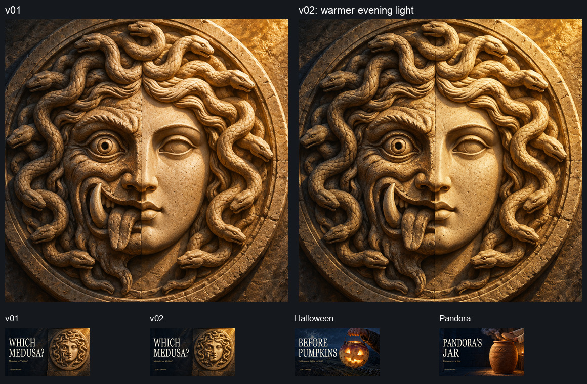
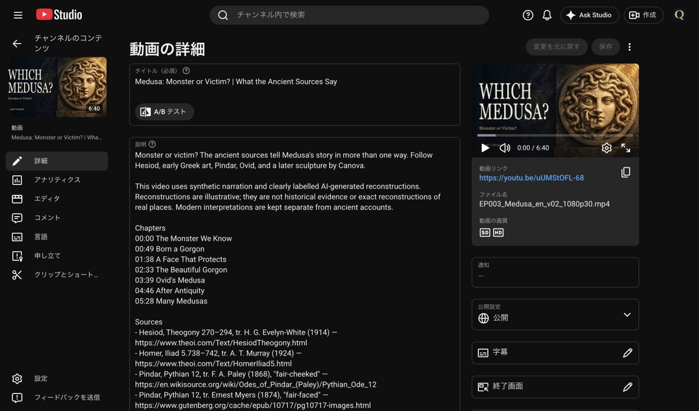
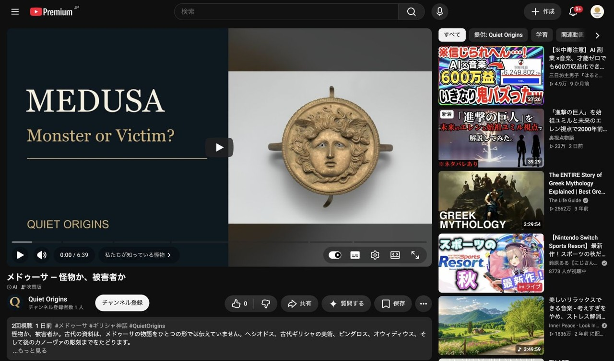

# 第3話メドゥーサ：案1の夕日調整と差し替え

[Claudeの依頼](wom03_サムネ差し替え依頼_20261027.md)に従い、案1「WHICH MEDUSA?」の光を調整して、**2026-10-27 00:57:22 JST**に動画 `uUMStOFL-68` のサムネを保存した。画像生成は0回。v01を保全し、背景の色・明るさだけを調整した。

## 修正・検品

- 1280×720の背景のうち **x>630・y<650** に限定したマスクを使用。左端55px、下端30pxで滑らかに変化させ、文字の後ろの左側・グラデーションを維持した。
- 元画像の輝度で光の当たる面を選び、右上ほど少し強く金〜橙へ調整。明部は各色の255までの余裕に応じて持ち上げ、暗部は最大3.5%深くした。顔・円形の縁・蛇の形、目・牙・舌、構図は変えていない。
- 背景の変更画素数は**386,692**。マスク外の変更画素数は**0**、文字合成後の範囲外変更画素数も**0**（いずれもJPEG圧縮前）。JPEG再圧縮による差分まで0とはしていない。
- RGBすべてが250以上となる白に近い画素の**新規増加0**。目・歯・舌の細部、石の凹凸と質感を目視し、金属・炎・橙一色に見えないことを確認した。
- 上段は顔の560×560pxを等倍で比較。下段はv01・v02・ハロウィン・パンドラを各168×94pxで並べた。v02は暖色の光が少し強くなり、左右の顔の差も維持している。
- 文字・位置・色は同じ。Georgia、見出し高さ132px、x54/y145・301、幅410/540px。補足「Monster or Victim?」、ブランドx80/y615・22pxも維持。
- 主役（浮き彫りの縁・顔・蛇）の保全領域x630と、文字の影を含む枠右端x466/x596の差は**164px/34px**。最小**34px**で16px以上。前回同様、実輪郭を自動抽出した値ではなく保守的な余白値。
- v01を元の条件で再合成し、保存済みv01 JPGとのバイト一致を確認。原寸と第2・4話の参照サムネのSHA-256も一致した。

完成：[wom03_サムネ案1_v02_20261027.jpg](サムネ確認用/wom03/wom03_サムネ案1_v02_20261027.jpg)

| 項目 | 実測 |
|---|---|
| 寸法・形式 | 1280×720 JPG |
| 容量 | 453,596 bytes（1MB未満） |
| SHA-256 | `92b03336ca7e6626e20b1d8c1351c4e42bfcd553b83b0caf39369819e7182648` |

アップロード直前のハッシュ再計算でも一致。[検品JSON](wom03_サムネ案1_v02検品_20261027.json)／[調整・比較スクリプト](wom03_サムネ案1修正_v02_20261027.py)。

## 保存確認

- Quiet Origins（`UCfLJOojEY9VB3rvrjICk90Q`）を確認してから対象動画へ移動。サムネの「変更」からv02を送信して保存した。
- 保存操作直後：`2026-10-26T15:57:22.945Z`＝**2026-10-27 00:57:22 JST**。
- 詳細画面を再読み込み後、左側サムネ・プレーヤーに新画像が表示され、保存ボタンが無効（未保存変更なし）であることを確認。
- タイトル・説明文は変更前・保存直前・再表示後で一致。字幕・音声・終了画面・チャプター・公開設定・AI使用・カテゴリ・他動画・A/Bテストは操作していない。
- StudioはWhispers of Japan（`UCx4mLEohO3XCVxZajUynLzw`）のダッシュボードへ戻し、表示を確認した。

### 公開再生ページ：反映確認は未完了

**2026-10-27 01:03:54 JST時点**、[公開再生ページ](https://www.youtube.com/watch?v=uUMStOFL-68)は旧A24画像を表示している。Chrome（既存ページの再読み込み、キャッシュ再検証、新しい動画リンクからのタブ）とCodex内ブラウザの両方で旧画像を観測した。どちらもログイン状態。ログアウトでの確認はしていない。

Studioの保存・再表示は成功しているが、**公開側に新画像が出たという確認はまだ取れていない**。反映遅延の可能性があるものの原因を断定しない。誤って変更を増やさないため、再アップロードや設定変更は行わず、次回は公開ページの表示だけを再確認する。

[保存日時・投稿文一致・公開側未確認の記録](wom03_サムネ差し替え検証_20261027.json)。画面証跡は長辺1280px以下・1MB未満。

## 比較の起点と次回予定

変更前の起点は[2026-10-27 00:36の記録](wom03_サムネ改善結果_20261027.md)：上部「2026/10/25〜現在・公開後」、インプレッション153・視聴2、CTR「—」。下部は別期間なので混ぜない。

**公開日訂正：** Claudeの最新依頼で、以前の「10/27 09:00公開」は記載誤り、10/23の予約変更により**10/25公開**だったことが明示された。Studioの「10/25〜現在・公開後」と一致する。以前の分析記録は観測当時の記録として残し、ここで解消したことを記録する。

**次回比較予定：2026-11-03 00:57:22 JST以降（差し替えから7日後）。** 第2話の予定11/2 22:59以降、第4話の予定11/3 00:17以降も満たすため、3本まとめて概要・リーチのインプレッション・CTR・視聴回数を、取得日時・表示期間つきで読むだけで記録してよい。少数データや季節需要をサムネの効果と断定しない。今回は予定の記載のみで、自動実行は登録していない。

Mac保存先：`/Users/ryo/Desktop/新チャンネル/EP003_Medusa/サムネ改善_20261027/`。採用原寸は`sources/`、圧縮前の背景・マスク・完成画像は`v02/`、確認JPGは`deliverables/`。原寸PNGをGitに追加せず、確認JPG・スクリプト・記録だけを制作ブランチへ共有する。
