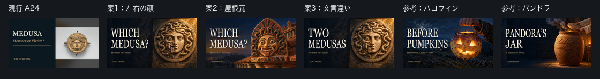

# 第3話メドゥーサ：サムネ3案の制作結果（2026-10-27 Codex）

[Claudeの依頼](wom03_サムネ改善依頼_20261027.md)に沿って3案を制作した。**本人の選定待ち。今回、Studioのサムネ・タイトル・説明文・その他の設定は変更していない。** 対象動画はQuiet Origins `uUMStOFL-68`。

## 候補と推奨

| 案 | 絵・見出し | 確認用 | 容量 |
|---|---|---|---:|
| 1 | 左右で恐ろしい顔と穏やかな顔がつながる石の浮き彫り／WHICH MEDUSA? | [案1](サムネ確認用/wom03/wom03_サムネ案1_20261027.jpg) | 444,948 bytes |
| 2 | 屋根に取り付けられた彩色テラコッタのゴルゴン／WHICH MEDUSA? | [案2](サムネ確認用/wom03/wom03_サムネ案2_20261027.jpg) | 402,457 bytes |
| 3 | 案1と同一背景／TWO MEDUSAS | [案3](サムネ確認用/wom03/wom03_サムネ案3_20261027.jpg) | 443,403 bytes |

**推奨は案1。** 168pxでも左の大きな目・牙・舌と、右の穏やかな顔の差が残る。細かな時代まではサムネだけで伝わらないが、「同じ名前なのに顔が違う」という問いは見出しと合わせて伝えられる。現行A24より顔が大きく、第2・4話と全面画・生成りの大きな字・金色の補足がそろう。

最初に視線を引く目の強さだけなら、案2の丸い両目と彩色も強い。ただし案2は「恐ろしいゴルゴン」の一つの姿に寄る。本編の結論とのつながりを含めると、案1→案2→案3を推す。これは目視による制作上の判断で、CTRの実証結果ではない。

### 文言への回答

「WHICH MEDUSA?」を推す。資料によって異なる姿を見せる本編に合い、タイトルの「Monster or Victim?」を単に反復しない。「TWO MEDUSAS」は簡潔で左右の対比に合うが、メドゥーサの版が二つだけである、または二人の別人物であるようにも読める。本編は二つに限定していない。別案を一つ挙げるなら **MANY MEDUSAS**。今回は指定の3案を作り、追加案は生成・合成していない。

補足は全案「Monster or Victim?」を維持。小さい表示では補助的なので、題材名MEDUSAは見出しで読めるようにした。

### 彫刻としての見え方

案1・3は円形の縁と広い石の壁面に顔・蛇がつながる浮き彫り。案2は扇形の瓦の背板、下の台座、屋根との接合と奥の瓦列が見える。原寸・168pxとも、生きた人の顔や生首ではなく、物に付いた造形として読める。首・肩・胴体・血・切り口はない。

左右を統合した案1・3は**時代ごとの表現を比較するための創作構成**であり、この姿の古代作品が実在するという主張ではない。案2も特定の所蔵品の複製ではない。二つの目の高さ・鼻・歯の輪郭を目視し、余分な目や溶けた歯などの破綻は見られなかった。右眼の瞳は左眼より浅い石彫表現で、左右の表情差として残した。

## 制作・検品

- 組み込み画像生成を**2回**使用し、背景2枚を採用。修正の再生成なし。案1・3は同一背景。全文プロンプト・生成日・サービスは[プロンプトJSON](wom03_サムネ生成プロンプト_20261027.json)に記録。
- 3案とも1280×720 JPG、1MB未満。比較は1120×150、各セル168×94px。画像内文字は生成させず、既存の第2話用処理で後から合成した。
- Georgiaの生成り `#f4efdf`、高さ132px、x54/y145・301。案1・2の幅410/540px、案3は300/540px。疑問符はGeorgiaの字形。補足は金 `#d8b575`、ブランドはx80/y615・22px。
- 見出しの後ろは第2・4話と同じ左側グラデーション。右下の時間表示位置から目・口を外した。
- 神殿内部の出来事・人物・斬首場面を描いていない。案2の神殿は人物のいない外観で、屋根装飾の取り付け位置を示す。

| 案 | 上段の保守的すき間 | 下段の保守的すき間 | 最小 |
|---|---:|---:|---:|
| 1 | 164px | 34px | 34px |
| 2 | 164px | 34px | 34px |
| 3 | 274px | 34px | 34px |

見出し帯y145〜436で顔・蛇だけでなく浮き彫りの縁・瓦の背板もx630より右にあることを目視した。影を含む文字枠右端（上段x466または356、下段x596）から保全領域左端x630までを測定。**実輪郭の自動抽出ではなく保守値**で、全案が指定16px以上。[余白検品画像](サムネ確認用/wom03/wom03_サムネ余白検品_20261027.jpg)／[寸法・SHA-256・測定記録](wom03_サムネ改善検品_20261027.json)。

## 変更前のStudio数値（閲覧のみ）

取得：**2026-10-27 00:36:36 JST**。Quiet Origins（`UCfLJOojEY9VB3rvrjICk90Q`）を確認してから対象動画の概要・リーチを閲覧した。

| 箇所・表示期間 | インプレッション | CTR | 視聴 |
|---|---:|---|---:|
| 上部：2026/10/25〜現在・公開後 | 153 | —（未表示） | 2 |
| 下部ファネル：2026/10/24〜2026/10/25（2日間） | 147 | 0.0% | インプレッションからのエンゲージビュー0 |

上部CTRの「—」を0%として扱わず、2÷153をCTRとして算出しない。下部は期間・指標が異なるため分けて記録。データが少なく、新旧サムネの効果比較はまだできない。

**日付の不一致：** 申し送りは「2026/10/27 09:00公開」だが、Studioの表示期間は「2026/10/25〜現在・公開後」。今回の記録では実際の画面表示を採用し、公開日時や設定を推測で修正していない。

[分析記録・画面テキスト](wom03_サムネ変更前分析_20261027.json)／[概要画面](サムネ確認用/wom03/wom03_変更前分析_overview_20261027.jpg)／[リーチ画面](サムネ確認用/wom03/wom03_変更前分析_reach_20261027.jpg)。作業後はStudioをWhispers of Japan（`UCx4mLEohO3XCVxZajUynLzw`）へ戻し、ダッシュボード表示を確認した。

## 保存先・次の工程

[文字合成スクリプト](wom03_サムネ改善_20261027.py)、プロンプト、検品記録、確認JPGを`bgm/production`へ共有する。現行A24・第2話・第4話のサムネは変更せず、ハッシュ一致を確認した。

Mac原寸：`/Users/ryo/Desktop/新チャンネル/EP003_Medusa/サムネ改善_20261027/sources/`。同じ親フォルダの`deliverables/`に確認JPG、親フォルダに結果・記録・プロンプトを保存。生成原寸はGitに追加しない。

次は本人が案を選んだ後、別の依頼で必要な微修正とStudio差し替えを行う。
