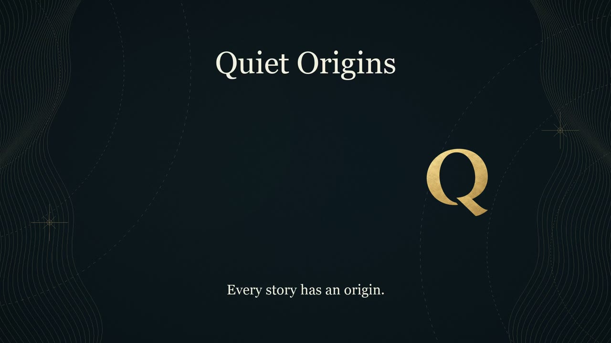
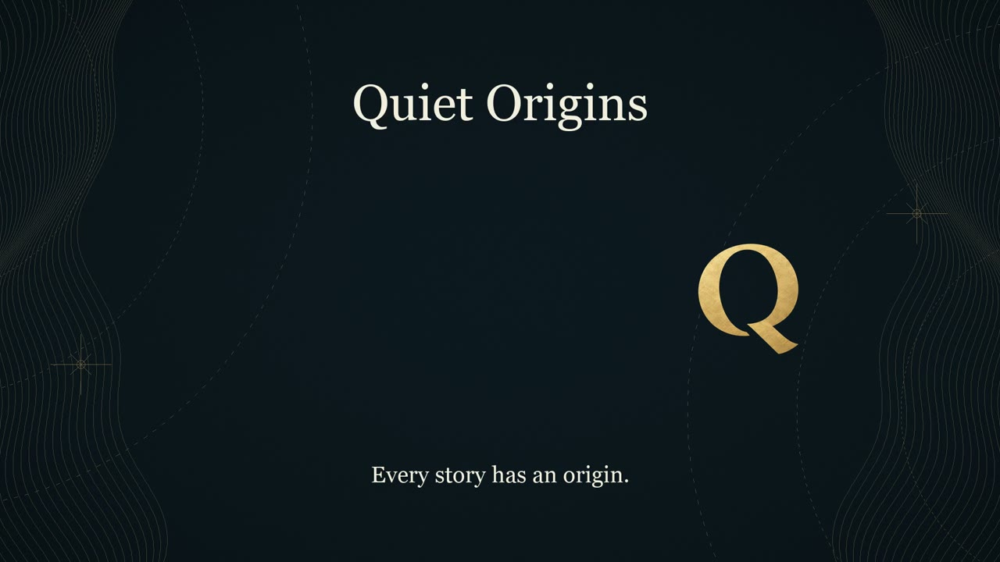

# 第3話「メドゥーサ」確認版v02 制作結果（2026-10-23）

**Claudeの修正依頼 `0fbd21c`・台本v04を反映。英日399.566667秒（6分39.57秒）、11,987フレーム、1080p30。** [再生・取得案内](wom03_確認版_v02_20261023/README.md)。

## 修正した2点

- M18に英日それぞれ、承認済みの高評価・チャンネル登録のお願いを一文追加。既存と同じHeart速度0.82／冥鳴ひまりC設定。新規合成は追加した各一文のみで、M18の既存4文も再利用。強調・効果音・画面文字追加なし。
- [エンドカード共通版v02](branding/20261023_エンドカード共通版_v02/README.md)を10秒で制作。元と同じ配置・文字・色・線の模様・左側の余白。背景の光の時間だけ短縮し、元の最後1秒を元の速さで再生。映像は元々フェードしないので、その終わり方を維持。音は元の最後5秒のフェードを保つ接続とし、最後4.7秒のWAVは元とサンプル一致。第1話・第2話は変更していない。

総尺は **403.666667 − 10 ＋ 5.9 ＝ 399.566667秒**。M18のクレジットを20.1秒→26秒へ延長。エンドカード開始は **389.566667秒**、終了まで正確に10秒。YouTube終了画面はこの区間に配置する（未投稿・未設定）。

## 実測検査

| 項目 | 結果 |
|---|---|
| 総尺 | 11,987フレーム×1,600＝**19,179,200サンプル**。MP4・M4A・48kHz/24bit WAVが同尺 |
| M01〜M17 | 0〜363.566667秒の英日通常版の圧縮映像・AACパケットがv01と一致。最初10,907映像フレーム、17,451,200音声サンプル。完成MP4のデコード音声差分0。WAV PCMも一致 |
| 字幕の保全 | M01〜M17のSRT本文・時刻・連番が一致。M18のみ更新。英92件・日86件、全台本と空白以外一致、最短1.4秒以上、英42字／日23字以内、2行以内 |
| 字幕配置 | M18全字幕をFontSize14／26で描画し、文字y≤700との重なりなし。既存区間はv01の検査を引き継ぐ |
| 音量・ピーク | 英語 -16.12 LUFS / -3.34 dBTP、日本語 -16.07 LUFS / -3.43 dBTP |
| BGM | v01の音量補正値・間の+4dB設定を維持。既存区間の全サンプルを保全し、M18だけ同じ設定で延長。全編の再正規化なし |
| 動画4本 | 全編デコード・正確な1/30秒PTS。英日通常版は同一映像ストリーム。字幕入り版の音声は通常版と同一 |
| エンドカード | 完成MP4最後300フレームが共通版v02と全画素一致 |
| 無音 | −60dB基準で1秒以上0件 |
| サムネ | A24・A04の両案をv01から保全。Claude推奨はA24、本人最終判断待ち |

[映像・音声・保全ハッシュ](wom03_確認版_v02_20261023/records/qc_v02.json)／[音声接続記録](wom03_確認版_v02_20261023/records/audio_revision_v02.json)／[共通版の映像・音声SHA-256と変更内容](wom03_確認版_v02_20261023/records/endcard_v02.json)。字幕焼き込み版は確認用の再エンコードで、既存区間の圧縮映像一致検査は通常版に対して実施。

## 保存・共有と本人確認

Mac：`/Users/ryo/Desktop/新チャンネル/EP003_Medusa/確認版_v02_20261023`。v01の制作物・Releaseは保全。

新規[非公開Draft Release](https://github.com/yasukawa1980/youtube/releases/tag/untagged-aa53da2ce46effd1c9c9)、Release ID **421322526**。全56添付、823,624,758bytesをRelease ID指定RESTで再取得し、サイズ・SHA-256を照合。[添付一覧](wom03_確認版_v02_20261023/README.md)。資料・スクリプトは `bgm/production` に本報告と同じコミットで共有。

M18の全字幕中点・共通版の最初と最後の画像は目視確認済み。本人による試聴は未実施：**M18のお願いの読み方（英日）、10秒エンドカードの終わり方**。v01から未確認の英語固有名詞・日本語の神統記・M12の調子も確認対象。音を聴いた／全編視聴済みとはしていない。

YouTubeへの投稿・予約・公開、Release公開、追加契約・購入は未実施。
