# Quiet Origins 第3話「メドゥーサ」素材候補・利用条件の確認

確認・取得日：**2026-10-22（日本時間）**。依頼：[wom03_素材探し依頼_20261022.md](wom03_素材探し依頼_20261022.md)。台本案：[wom03_テーマ設計.md](wom03_テーマ設計.md)。ユーザー指定の `channel/` に相当する現行配置は `new-channel/`。

## 結果

**Met所蔵の異なる26作品を保存。全作品で公式APIの `isPublicDomain: true` を確認し、公式作品ページのPublic Domain表示とMet Open AccessのCC0方針を照合した。** 原寸・別角度は作品数とは別に数える。取得画像の主題・代表写真を目視確認し、各原寸は全画素読み込みと保存後のハッシュ照合を実施した。

コルフ島アルテミス神殿の破風は、今回調べた範囲で写真自体がPD/CC0のものを確定できず、**条件適合写真なし**。代替はA07またはA20だが、いずれも別の作品なので、M05のコルフを具体的に描写する文章は差し替えが必要。三姉妹全員／追跡する姉妹の図像も未確保で、B05は走るゴルゴン1体の杯A05を確保した。

- [確認画像一覧1](サムネ確認用/wom03/一覧_01.jpg)／[一覧2](サムネ確認用/wom03/一覧_02.jpg)／[一覧3](サムネ確認用/wom03/一覧_03.jpg)
- [機械可読の素材台帳](research/wom03_素材台帳_20261022.json)：すべての原寸・別角度写真のURL、画素数、bytes、SHA-256、保存先。
- 原寸保存先：`/Users/ryo/Desktop/新チャンネル/EP003_Medusa/素材/`。Gitには原寸を入れない。
- 調査・画像取得・縮小確認画像・記録まで。AI再現画、図解、音声、映像は未制作。台本案自体は変更していない。購入・契約・投稿なし。

## 依頼12項目の判定

| 依頼ID | 探すもの | 結果・候補 |
|---|---|---|
| B01 | 眠るメドゥーサ、Met 45.11.1 | **確保：A01**。M09専用。年代と「最も早い例の一つ」も確認 |
| B02 | カノーヴァ、Met 67.110.1 | **確保：A02**。M14専用。全体と顔の別角度も保存 |
| B03 | ゴルゴネイオン屋根瓦 | **確保：A03・A04**。A17は後期の顔の比較用 |
| B04 | コルフ島の破風写真 | **条件適合なし**。A07・A20が別作品としての代替。コルフの姿を示すものではない |
| B05 | 走るゴルゴン・追う姉妹の壺 | **一部確保：A05**（杯の内面、1体）。三姉妹全員／追跡する姉妹は未確保。A20は石彫の予備 |
| B06 | 古代のペガサス | **確保：A21**（青銅鏡）。A06は誕生場面だが切断表現あり。コリントス貨幣は採用画像を確定せず |
| B07 | 盾・杯のゴルゴネイオン | **確保：A26（盾の浮彫）・A08（杯）**。A09〜A11は関連する容器・防具の予備 |
| B08 | アイギスのアテナ | **確保：A14**。A12・A13は壺絵の予備 |
| B09 | アウロス奏者の壺 | **確保：A15**。A23は演奏直後の予備 |
| B10 | 古典期以降の美しい顔 | **確保：A17（前5世紀後半）・A16（前2世紀）・A25（宝石）**。A18・A19も比較用 |
| B11 | 『変身物語』の古い刊本・挿絵 | **確保：A22**、テンペスタの1606年挿絵。性暴力場面ではない。切断表現のため使用注意。本文の古刊本は未取得 |
| B12 | 蛇を伴う顔、冒頭用 | **確保：A24**、ローマ時代の車の装飾。A04も予備。M01で使ったものは後半に再使用しない |

## 指定された事実確認と台本への申し送り

### 1. 魔除けの働き：記述あり

[Met「Medusa in Ancient Greek Art」](https://www.metmuseum.org/essays/medusa-in-ancient-greek-art)、Madeleine Glennon、2017-03-01、本文第1段落に記載。該当文の部分引用（全文ではない）：

> “she is an apotropaic symbol used to protect from and ward off the negative”

一般的な解釈として悪いものを防ぐ力を述べている。**テーマ設計の「Metで未確認」は解消**。「Many scholars think」という留保を保っても矛盾しない。さらに[A04の公式作品ページ](https://www.metmuseum.org/art/collection/search/253581)も、神殿の装飾としての守護の役割を明記する。「作品ページにははっきり書かれていない」と一括する必要はない。

### 2. Met 45.11.1：「最も早い例の一つ」と年代を確認

[A01公式ページ](https://www.metmuseum.org/art/collection/search/254523)、冒頭解説に以下の部分引用：

> “one of the earliest in which Medusa's face is that of a beautiful young woman”

現行の作品欄は **ca. 450–440 BCE**。依頼書のca. 450–440 B.C.と同じ年代。最初・唯一とは書かれていない。作者欄は **Attributed to Polygnotos（ポリュグノトスに帰属）** なので、札も断定を避ける。

M09の「近づく」はやや穏やかな言い方。実際の図像は髪をつかみ、刃を首元に置いた斬首直前の場面。眠る顔を見せる場合も、流血や首元への強調は避ける。

### 3. Met 67.110.1：ロンダニーニとの関係を確認

[A02公式ページ](https://www.metmuseum.org/art/collection/search/204758)、冒頭の長文解説に以下の部分引用：

> “was based on another famous antiquity, the marble mask known as the Rondanini Medusa (Glyptothek, Munich)”

メドゥーサの顔が古代のロンダニーニの面をもとにした旨が明記される。Met所蔵版は **1804–6年**。1797–1801年の先行版・ヴァチカン版の年代と混同しない。

### 素材の使い方で直す必要がある点

- **M05**：A07は陶製台、A20は墓碑断片。コルフ神殿の破風として見せない。具体的な破風・子どもの描写を残すなら別途、条件適合写真の再調査が必要。今回の代替で進める場合の文意案は「紀元前6世紀の陶器や石彫には、大きな目や牙を持つゴルゴンが現れます」。台本への適用は未実施。
- **M03**：A05はゴルゴン1体。三姉妹というナレーションの背景にはできるが、「三姉妹を描いた作品」という札にはしない。
- **M04**：A21の乗り手はベレロポン。ペガサスの古代図像として使い、ペルセウスや誕生の実景にはしない。A06なら誕生場面だが切断箇所を含む。
- **M10**：前5世紀後半を示すA17と、後代のA16・A25を区別する。同時代にも怪物的な顔が残るA18があり、単純な一方向の変化と決めつけない。
- **A20の年代**：現行館記録・APIは550–525 BCE。以前の[Met教材](https://www.metmuseum.org/-/media/files/learn/for-educators/publications-for-educators/greek.pdf)のca. 500–490 B.C.とは異なる。今回は現行作品記録を使う。
- ヘシオドス・ホメロス・ピンダロス・オウィディウス・『ビブリオテーケー』の原文・翻訳・行番号の照合は今回の指定3点とは別工程で、**確認済みとはしない**。特にM12の訳語・罰の主体は原典確認を残す。

## 重複を避けた配置案

採用の確定ではなく、同じ素材を1回だけ使うための割当案。別角度、トリミング、全体と細部も同じ作品として扱う。同一区間で全体→拡大と連続して見せることは依頼書のM09・M14の構成に従い、別区間では再登場させない。

| 区間 | 今回の割当案／残作業 |
|---|---|
| M01 | A24。洞窟の再現画は未制作 |
| M02 | 資料導入・エーゲ海の再現画候補。実物の写本は未取得 |
| M03 | A05。夜の海・岩場の再現画は未制作 |
| M04 | A21（または使用注意A06のどちらか）。牧場の再現画は未制作 |
| M05 | A07（またはA20）。コルフを描写する台本の調整が必要 |
| M06 | A03 → A08 → A26。屋根瓦・杯・盾をそれぞれ別作品で説明 |
| M07 | A14。A12・A13は差し替え予備 |
| M08 | A15。A23は差し替え予備 |
| M09 | A01（全体→顔、同一区間内のみ） |
| M10 | A17 → A16。必要なら未使用のA25・A18・A19を追加。時代札を明示 |
| M11 | A22（使用注意）。後世の挿絵と明示 |
| M12 | 人物のいない神殿の再現画候補。未制作 |
| M13 | 文献の時間軸図解。未制作 |
| M14 | A02（全体→顔、同一区間内のみ） |
| M15 | 特定作品を複製しない美術館の再現画候補。未制作 |
| M16 | 記号・線画で4つの姿を整理。既出の作品写真を再掲しない。未制作 |
| M17 | 島の夕景の再現映像候補。未制作 |
| M18 | クレジット。採用された作品のみ本台帳から転記 |

## 保留・除外記録

調査した範囲での結果。「なし」は世界中に存在しないという意味ではない。下記は候補26作品の数に含めない。

| 対象 | 確認先・表示 | 結果 |
|---|---|---|
| コルフ破風の全体写真 | [The Gorgon at Corfu Museum](https://commons.wikimedia.org/wiki/File:The_Gorgon_at_Corfu_Museum.jpg)、GFDL／CC BY-SAの複数版 | 写真自体がPD/CC0ではないため除外 |
| コルフ破風のゴルゴン写真 | [Dr.K.撮影](https://commons.wikimedia.org/wiki/File:Gorgon_at_the_Artemis_temple_in_Corfu.jpg)、CC BY-SA 4.0 | 除外。彫刻の古さと写真の条件を分けた |
| コルフ破風の顔の拡大 | [Close up of Gorgon](https://commons.wikimedia.org/wiki/File:Close_up_of_Gorgon_at_the_pediment_of_Artemis_temple_in_Corfu.jpg)、CC BY-SA 3.0 | 除外 |
| コルフ神殿遺構 | [Temple of Artemis in Corfu](https://commons.wikimedia.org/wiki/File:Temple_of_Artemis_in_Corfu.jpg)、写真CC BY-SA 4.0、被写体PD | 除外。被写体のみのPD表示を写真の許可と取り違えない。破風の写真でもない |
| Metのスタテル候補 | [255254](https://www.metmuseum.org/art/collection/search/255254)、No image available | 採用画像なし。ペガサスは青銅鏡A21で代替 |
| WaltersのMedusa、54.884 | [個別ページ](https://art.thewalters.org/object/54.884/)の画像はCreative Commons Zero。[利用条件](https://thewalters.org/about/policies/rights-reproductions/)も参照 | CC0表示を確認したが、原寸ダウンロードがHTTP 403で取得できなかったため未採用・未保存。SHA-256なし。A24で代替 |
| Getty Head of Medusa | [公式ページ](https://www.getty.edu/art/collection/object/107SKT) | テキスト取得でJavaScript要求となり個別画像・権利の確認を完了せず。未採用 |

## AI再現画・映像の候補（未生成）

Claudeの制作依頼で確定するため、ここでは用途だけを記録する。プロンプトの実行・素材生成はしていない。

| 区間 | 候補と制約 |
|---|---|
| M01 | 人物のいない静かな洞窟入口と石像。古代史料そのものとは表示しない |
| M02 | エーゲ海の島の遠景。架空の文字列を実在の古文書として作らない |
| M03 | 夜の海と岩場。海の神々の世界を想起させる抽象的な再現 |
| M04 | 春の花が咲く牧場。人物なし |
| M12 | 人物のいない夕暮れの神殿の柱・閉じた扉。性暴力の場面や二人の人物を描かない |
| M15 | 展示室で古代の像を見る静かな後ろ姿。特定の現代作品・人物・商標を複製しない |
| M17 | 夕暮れの島と海。締めくくり用の穏やかな映像 |

AIで斬首場面・切られた首は作らない。実制作時は史料と再現を明示して区別する。

## 個別の保存記録

全作品の所蔵館はThe Metropolitan Museum of Art。各画像の条件は**Public Domain / CC0**。[公式Open Access方針](https://www.metmuseum.org/hubs/open-access)は作品の画像にもCC0を適用すると明記している。[CC0本文](https://creativecommons.org/publicdomain/zero/1.0/)。写真を含む公開画像の条件をこの方針と個別作品のPDフラグで確認した。CC BY・CC BY-SA・非商用・不明の画像は保存済み候補に含めない。

ここで「原寸」は館から取得した配信ファイルを未リサイズで保存したものを指し、撮影マスターや最大公開解像度を保証する意味ではない。A03はAPIの512×384px版に加え公式作品ページ配信の1200×900px版を保存し、後者を代表とした。大きな拡大が必要ならA04を優先する。

以下は代表原寸の記録。別角度も全て素材台帳にURL・寸法・SHA-256を記録。同じ作品の別写真は候補点数を増やすためには数えていない。クレジットは追跡用の案で、CC0に追加の義務を設けるものではない。

### A01 眠るメドゥーサのペリケ

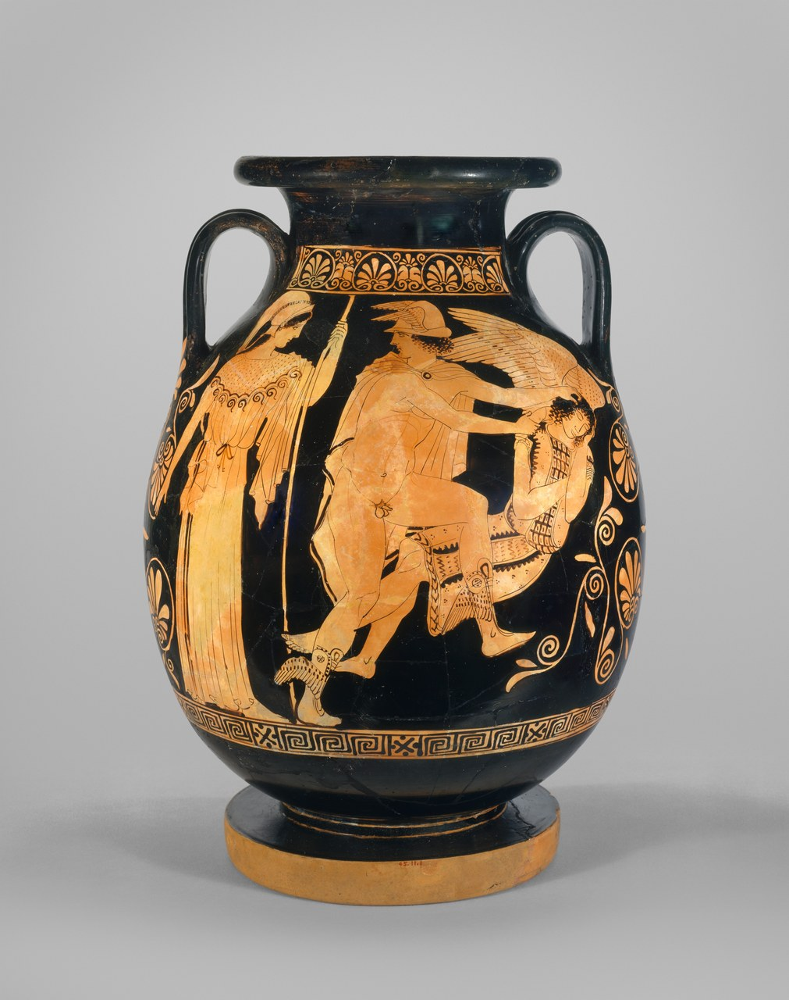

| 項目 | 記録 |
|---|---|
| 判定 | 条件適合（用途・注意点は下記） |
| 依頼項目／使用区間 | B01 ／ M09 |
| 作品名 | Terracotta pelike (jar) |
| 作者／文化 | Polygnotos ／ Greek, Attic |
| 年代 | ca. 450–440 BCE |
| 素材 | Terracotta |
| 所蔵館 | The Metropolitan Museum of Art |
| 作品番号／API ID | 45.11.1 ／ 254523 |
| 作品ページ | [Met公式](https://www.metmuseum.org/art/collection/search/254523) |
| 権利確認 | Public Domain表示、[公式API](https://collectionapi.metmuseum.org/public/collection/v1/objects/254523) isPublicDomain=true |
| 利用条件 | [Met Open Access / CC0](https://www.metmuseum.org/hubs/open-access) |
| 確認・取得日 | 2026-10-22（日本時間） |
| 取得画像 | [代表原寸URL](https://images.metmuseum.org/CRDImages/gr/original/DT352033.jpg) |
| 原寸保存先 | `/Users/ryo/Desktop/新チャンネル/EP003_Medusa/素材/A01_met_254523_v00.jpg` |
| 原寸サイズ | 3159 × 4000 px ／ 1,836,020 bytes |
| 原寸SHA-256 | `5011b3858173fc56e4e26eac78400520a145d8db3aeb04efcb71c324db1b9290` |
| 確認JPG | 1011 × 1280 px ／ 187,619 bytes |
| 原寸の別写真を含む保存数 | 3ファイル（作品数は1点） |

使い方・注意点：第一候補。全体→顔の拡大は同一区間内で行う。首を切る直前の刃と髪をつかむ手が描かれる。使用注意：刀や首元には寄らない。追加画像1・2も同じ作品で、別区間用の別素材には数えない。

クレジット案：Polygnotos, Terracotta pelike (jar), ca. 450–440 BCE. The Metropolitan Museum of Art, Rogers Fund, 1945 (45.11.1). Public Domain / CC0. [Source](https://www.metmuseum.org/art/collection/search/254523)

### A02 カノーヴァ：メドゥーサの首を持つペルセウス

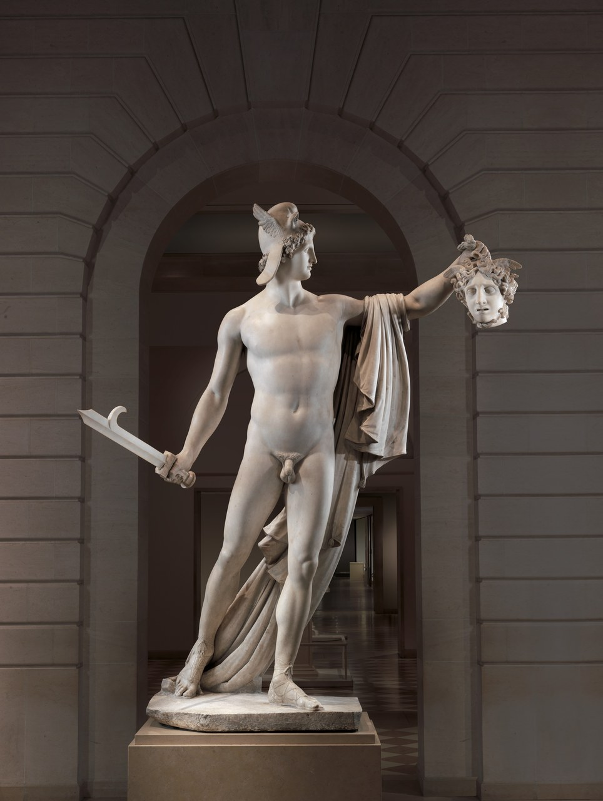

| 項目 | 記録 |
|---|---|
| 判定 | 条件適合（用途・注意点は下記） |
| 依頼項目／使用区間 | B02 ／ M14 |
| 作品名 | Perseus with the Head of Medusa |
| 作者／文化 | Antonio Canova ／  |
| 年代 | 1804–6 |
| 素材 | Marble |
| 所蔵館 | The Metropolitan Museum of Art |
| 作品番号／API ID | 67.110.1 ／ 204758 |
| 作品ページ | [Met公式](https://www.metmuseum.org/art/collection/search/204758) |
| 権利確認 | Public Domain表示、[公式API](https://collectionapi.metmuseum.org/public/collection/v1/objects/204758) isPublicDomain=true |
| 利用条件 | [Met Open Access / CC0](https://www.metmuseum.org/hubs/open-access) |
| 確認・取得日 | 2026-10-22（日本時間） |
| 取得画像 | [代表原寸URL](https://images.metmuseum.org/CRDImages/es/original/DP249451.jpg) |
| 原寸保存先 | `/Users/ryo/Desktop/新チャンネル/EP003_Medusa/素材/A02_met_204758_v00.jpg` |
| 原寸サイズ | 3013 × 4000 px ／ 1,442,115 bytes |
| 原寸SHA-256 | `52c8c643cada7d823d9093e7ff35e6501e71674635d5cdac69ce23a08473aa46` |
| 確認JPG | 964 × 1280 px ／ 139,003 bytes |
| 原寸の別写真を含む保存数 | 4ファイル（作品数は1点） |

使い方・注意点：第一候補。全体と追加画像3の顔を同じ連続区間で扱う。裸体と切られた頭部を含むが、鮮血の描写はない。使用注意：切り口を拡大しない。1804–06年のMet版であり、ヴァチカン版そのものではない。

クレジット案：Antonio Canova, Perseus with the Head of Medusa, 1804–6. The Metropolitan Museum of Art, Fletcher Fund, 1967 (67.110.1). Public Domain / CC0. [Source](https://www.metmuseum.org/art/collection/search/204758)

### A03 メドゥーサの頭部を持つエトルリアの屋根瓦

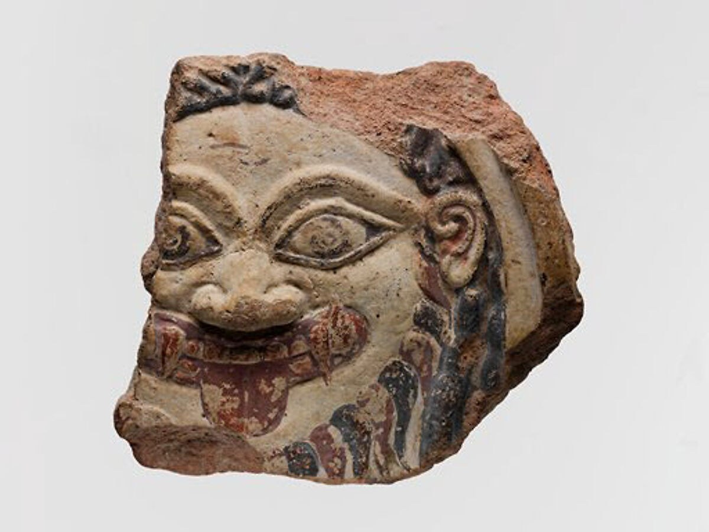

| 項目 | 記録 |
|---|---|
| 判定 | 条件適合（用途・注意点は下記） |
| 依頼項目／使用区間 | B03 ／ M06 |
| 作品名 | Terracotta antefix with the head of Medusa |
| 作者／文化 | 作者名の記載なし ／ Etruscan |
| 年代 | 6th century BCE |
| 素材 | Terracotta, paint |
| 所蔵館 | The Metropolitan Museum of Art |
| 作品番号／API ID | 27.122.14 ／ 252929 |
| 作品ページ | [Met公式](https://www.metmuseum.org/art/collection/search/252929) |
| 権利確認 | Public Domain表示、[公式API](https://collectionapi.metmuseum.org/public/collection/v1/objects/252929) isPublicDomain=true |
| 利用条件 | [Met Open Access / CC0](https://www.metmuseum.org/hubs/open-access) |
| 確認・取得日 | 2026-10-22（日本時間） |
| 取得画像 | [代表原寸URL](https://collectionapi.metmuseum.org/api/collection/v1/iiif/252929/540645/main-image) |
| 原寸保存先 | `/Users/ryo/Desktop/新チャンネル/EP003_Medusa/素材/A03_met_252929_v01.jpg` |
| 原寸サイズ | 1200 × 900 px ／ 113,642 bytes |
| 原寸SHA-256 | `198082e99980e22c9b3f5558fecb809574422c3ee2faad9f7dd7a797b32beace` |
| 確認JPG | 1200 × 900 px ／ 115,294 bytes |
| 原寸の別写真を含む保存数 | 2ファイル（作品数は1点） |

使い方・注意点：第一候補。27.122.14。エトルリアの作品で、コルフ神殿出土品ではない。保存色と恐ろしい表情が明瞭。APIのoriginal配信は512×384px、公式作品ページの画像配信は1200×900px。後者を代表に選定した。より大きい原寸は未確定で、大幅な拡大にはA04を優先。

クレジット案：Etruscan, Terracotta antefix with the head of Medusa, 6th century BCE. The Metropolitan Museum of Art, Fletcher Fund, 1927 (27.122.14). Public Domain / CC0. [Source](https://www.metmuseum.org/art/collection/search/252929)

### A04 彩色ゴルゴネイオン屋根瓦

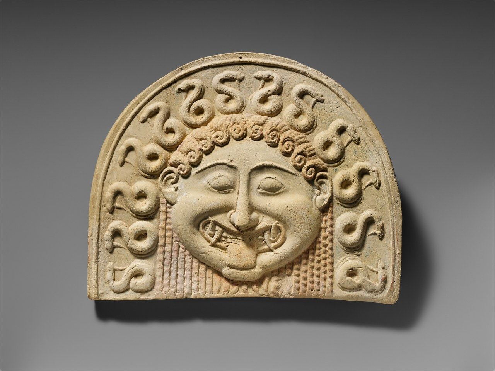

| 項目 | 記録 |
|---|---|
| 判定 | 条件適合（用途・注意点は下記） |
| 依頼項目／使用区間 | B03/B12 ／ M06（予備） |
| 作品名 | Terracotta painted gorgoneion antefix (roof tile) |
| 作者／文化 | 作者名の記載なし ／ Greek, South Italian, Tarentine |
| 年代 | ca. 540 BCE |
| 素材 | Terracotta, paint |
| 所蔵館 | The Metropolitan Museum of Art |
| 作品番号／API ID | 39.11.9 ／ 253581 |
| 作品ページ | [Met公式](https://www.metmuseum.org/art/collection/search/253581) |
| 権利確認 | Public Domain表示、[公式API](https://collectionapi.metmuseum.org/public/collection/v1/objects/253581) isPublicDomain=true |
| 利用条件 | [Met Open Access / CC0](https://www.metmuseum.org/hubs/open-access) |
| 確認・取得日 | 2026-10-22（日本時間） |
| 取得画像 | [代表原寸URL](https://images.metmuseum.org/CRDImages/gr/original/DP233549.jpg) |
| 原寸保存先 | `/Users/ryo/Desktop/新チャンネル/EP003_Medusa/素材/A04_met_253581_v00.jpg` |
| 原寸サイズ | 4000 × 3000 px ／ 2,700,670 bytes |
| 原寸SHA-256 | `e54a2b731e1fde4cddc26cf6bcaa3da2e9b2b6faee1e17176f4dcda1348b5fca` |
| 確認JPG | 1280 × 960 px ／ 192,904 bytes |
| 原寸の別写真を含む保存数 | 1ファイル（作品数は1点） |

使い方・注意点：顔の周囲に蛇が巡るアルカイック期の作例。B12の予備にもなるが、使う区間はM01かM06の片方に限定。現行公式解説が守護の象徴と明記。

クレジット案：Greek, South Italian, Tarentine, Terracotta painted gorgoneion antefix (roof tile), ca. 540 BCE. The Metropolitan Museum of Art, Harris Brisbane Dick Fund, 1939 (39.11.9). Public Domain / CC0. [Source](https://www.metmuseum.org/art/collection/search/253581)

### A05 走るゴルゴンを描いたシアナ杯

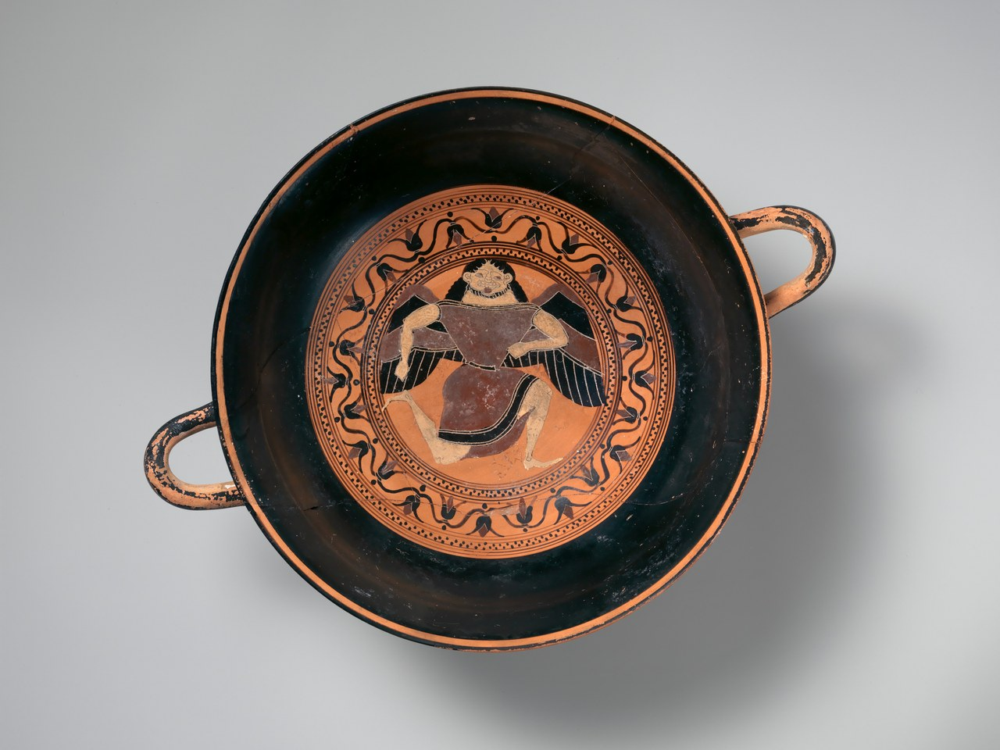

| 項目 | 記録 |
|---|---|
| 判定 | 条件適合（用途・注意点は下記） |
| 依頼項目／使用区間 | B05 ／ M03 |
| 作品名 | Terracotta kylix: Siana cup (drinking cup) |
| 作者／文化 | C Painter ／ Greek, Attic |
| 年代 | ca. 575 BCE |
| 素材 | Terracotta |
| 所蔵館 | The Metropolitan Museum of Art |
| 作品番号／API ID | 01.8.6 ／ 246931 |
| 作品ページ | [Met公式](https://www.metmuseum.org/art/collection/search/246931) |
| 権利確認 | Public Domain表示、[公式API](https://collectionapi.metmuseum.org/public/collection/v1/objects/246931) isPublicDomain=true |
| 利用条件 | [Met Open Access / CC0](https://www.metmuseum.org/hubs/open-access) |
| 確認・取得日 | 2026-10-22（日本時間） |
| 取得画像 | [代表原寸URL](https://images.metmuseum.org/CRDImages/gr/original/DP-12521-005.jpg) |
| 原寸保存先 | `/Users/ryo/Desktop/新チャンネル/EP003_Medusa/素材/A05_met_246931_v00.jpg` |
| 原寸サイズ | 4000 × 3000 px ／ 2,018,994 bytes |
| 原寸SHA-256 | `589974fdd3f90f3ce8d49e542a8349f90d763805960997804188c37f0e7b5972` |
| 確認JPG | 1280 × 960 px ／ 167,914 bytes |
| 原寸の別写真を含む保存数 | 8ファイル（作品数は1点） |

使い方・注意点：内面の走るゴルゴン1体を使う（追加画像2に細部）。三姉妹全員や姉妹の追跡場面ではない。外面はアキレウスとトロイロス／ポリュクセネ等で、ゴルゴン姉妹と誤認しない。

クレジット案：C Painter, Terracotta kylix: Siana cup (drinking cup), ca. 575 BCE. The Metropolitan Museum of Art, Purchase, 1901 (01.8.6). Public Domain / CC0. [Source](https://www.metmuseum.org/art/collection/search/246931)

### A06 逃げるペルセウスと誕生するペガサスの油壺

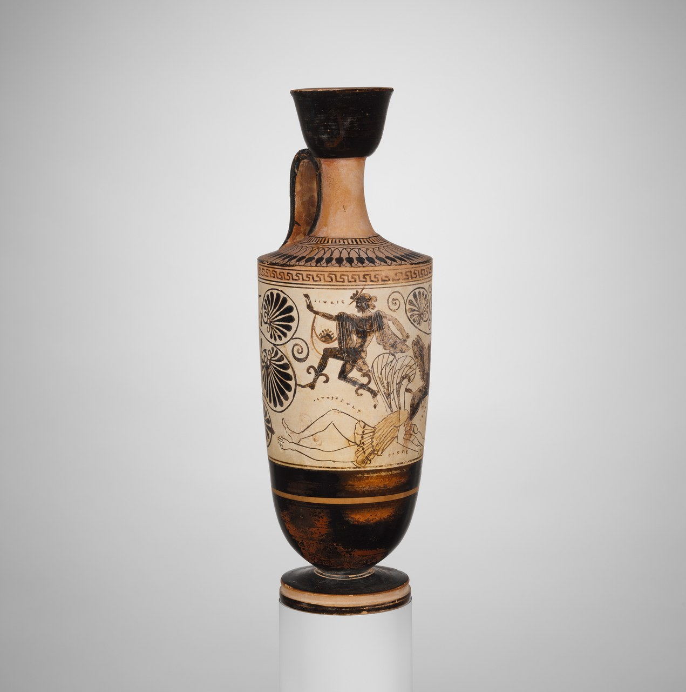

| 項目 | 記録 |
|---|---|
| 判定 | 条件適合（用途・注意点は下記） |
| 依頼項目／使用区間 | B06 ／ M04（予備） |
| 作品名 | Terracotta lekythos (oil flask) |
| 作者／文化 | Diosphos Painter ／ Greek, Attic |
| 年代 | ca. 500 BCE |
| 素材 | Terracotta |
| 所蔵館 | The Metropolitan Museum of Art |
| 作品番号／API ID | 06.1070 ／ 247488 |
| 作品ページ | [Met公式](https://www.metmuseum.org/art/collection/search/247488) |
| 権利確認 | Public Domain表示、[公式API](https://collectionapi.metmuseum.org/public/collection/v1/objects/247488) isPublicDomain=true |
| 利用条件 | [Met Open Access / CC0](https://www.metmuseum.org/hubs/open-access) |
| 確認・取得日 | 2026-10-22（日本時間） |
| 取得画像 | [代表原寸URL](https://images.metmuseum.org/CRDImages/gr/original/DP117188.jpg) |
| 原寸保存先 | `/Users/ryo/Desktop/新チャンネル/EP003_Medusa/素材/A06_met_247488_v00.jpg` |
| 原寸サイズ | 3973 × 4000 px ／ 1,641,738 bytes |
| 原寸SHA-256 | `3a4b04033fb86fd1c20c078762c0500f1bae8a657c152a1473931079987a67a1` |
| 確認JPG | 1271 × 1280 px ／ 115,050 bytes |
| 原寸の別写真を含む保存数 | 3ファイル（作品数は1点） |

使い方・注意点：使用注意：首のないメドゥーサの身体と、首元から現れるペガサス。追加画像2は展開写真で内容を確認しやすいが、首元が目立つため第一候補はA21。姉妹を描いた壺ではない。

クレジット案：Diosphos Painter, Terracotta lekythos (oil flask), ca. 500 BCE. The Metropolitan Museum of Art, Rogers Fund, 1906 (06.1070). Public Domain / CC0. [Source](https://www.metmuseum.org/art/collection/search/247488)

### A07 ゴルゴネイオンを描いた陶製台

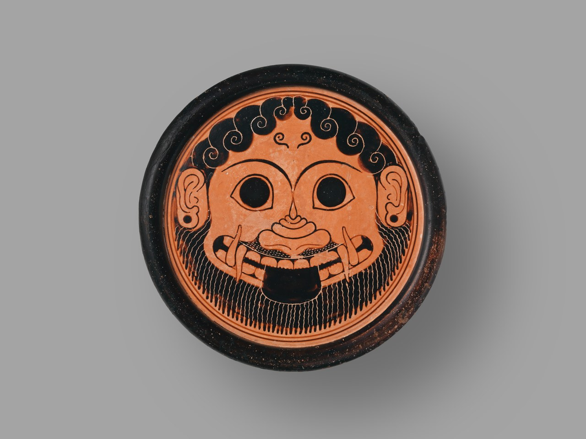

| 項目 | 記録 |
|---|---|
| 判定 | 条件適合（用途・注意点は下記） |
| 依頼項目／使用区間 | B04代替 ／ M05 |
| 作品名 | Terracotta stand |
| 作者／文化 | Ergotimos ／ Greek, Attic |
| 年代 | ca. 570 BCE |
| 素材 | Terracotta |
| 所蔵館 | The Metropolitan Museum of Art |
| 作品番号／API ID | 31.11.4 ／ 253342 |
| 作品ページ | [Met公式](https://www.metmuseum.org/art/collection/search/253342) |
| 権利確認 | Public Domain表示、[公式API](https://collectionapi.metmuseum.org/public/collection/v1/objects/253342) isPublicDomain=true |
| 利用条件 | [Met Open Access / CC0](https://www.metmuseum.org/hubs/open-access) |
| 確認・取得日 | 2026-10-22（日本時間） |
| 取得画像 | [代表原寸URL](https://images.metmuseum.org/CRDImages/gr/original/DP-12501-003.jpg) |
| 原寸保存先 | `/Users/ryo/Desktop/新チャンネル/EP003_Medusa/素材/A07_met_253342_v00.jpg` |
| 原寸サイズ | 4000 × 3000 px ／ 1,774,682 bytes |
| 原寸SHA-256 | `8b8cdaa3d23dc8529cb22af66d449394844dc58a2aa819b1c095b5cf0fa191aa` |
| 確認JPG | 1280 × 960 px ／ 148,009 bytes |
| 原寸の別写真を含む保存数 | 3ファイル（作品数は1点） |

使い方・注意点：コルフの代替となるアルカイック期の顔。アッティカの陶製台で、破風でも屋根瓦でもない。これを使う場合はコルフを実見させる台本・札を変更する。

クレジット案：Ergotimos, Terracotta stand, ca. 570 BCE. The Metropolitan Museum of Art, Fletcher Fund, 1931 (31.11.4). Public Domain / CC0. [Source](https://www.metmuseum.org/art/collection/search/253342)

### A08 ゴルゴネイオンのある眼杯

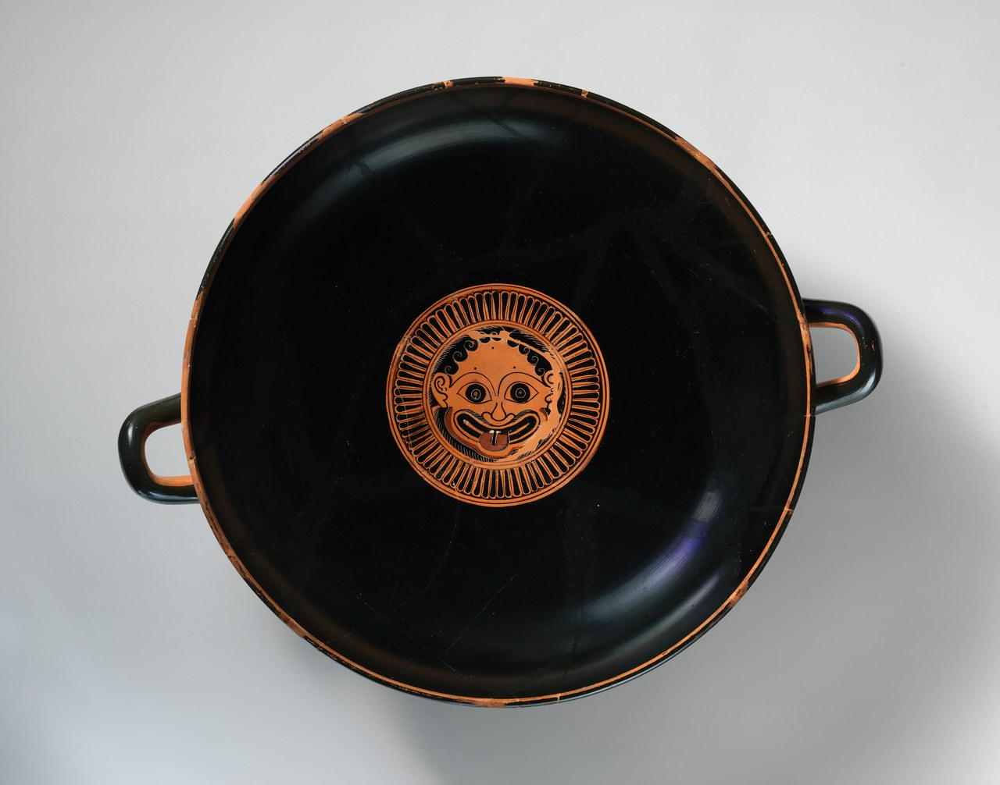

| 項目 | 記録 |
|---|---|
| 判定 | 条件適合（用途・注意点は下記） |
| 依頼項目／使用区間 | B07 ／ M06 |
| 作品名 | Terracotta kylix: eye-cup (drinking cup) |
| 作者／文化 | Nikosthenes ／ Greek, Attic |
| 年代 | ca. 530 BCE |
| 素材 | Terracotta |
| 所蔵館 | The Metropolitan Museum of Art |
| 作品番号／API ID | 14.136 ／ 248906 |
| 作品ページ | [Met公式](https://www.metmuseum.org/art/collection/search/248906) |
| 権利確認 | Public Domain表示、[公式API](https://collectionapi.metmuseum.org/public/collection/v1/objects/248906) isPublicDomain=true |
| 利用条件 | [Met Open Access / CC0](https://www.metmuseum.org/hubs/open-access) |
| 確認・取得日 | 2026-10-22（日本時間） |
| 取得画像 | [代表原寸URL](https://images.metmuseum.org/CRDImages/gr/original/DP274983.jpg) |
| 原寸保存先 | `/Users/ryo/Desktop/新チャンネル/EP003_Medusa/素材/A08_met_248906_v00.jpg` |
| 原寸サイズ | 4000 × 3145 px ／ 1,161,735 bytes |
| 原寸SHA-256 | `e7094a37076df43acd1fa5e0e38a44d6e39d75d5b0ab50af32adf3a910f05297` |
| 確認JPG | 1280 × 1006 px ／ 121,123 bytes |
| 原寸の別写真を含む保存数 | 5ファイル（作品数は1点） |

使い方・注意点：杯の内側の顔が明瞭。外面は別題材。ゴルゴンの顔が飲み干すと現れる構造の説明用。

クレジット案：Nikosthenes, Terracotta kylix: eye-cup (drinking cup), ca. 530 BCE. The Metropolitan Museum of Art, Rogers Fund, 1914 (14.136). Public Domain / CC0. [Source](https://www.metmuseum.org/art/collection/search/248906)

### A09 兜を着けた頭部形の香油壺

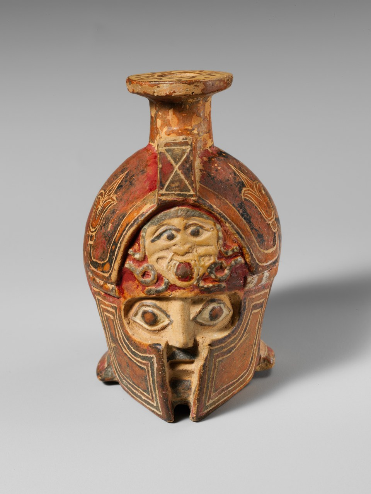

| 項目 | 記録 |
|---|---|
| 判定 | 条件適合（用途・注意点は下記） |
| 依頼項目／使用区間 | B07関連 ／ M06（予備） |
| 作品名 | Terracotta aryballos in the form of a helmeted head |
| 作者／文化 | 作者名の記載なし ／ East Greek |
| 年代 | ca. 600–575 BCE |
| 素材 | Terracotta |
| 所蔵館 | The Metropolitan Museum of Art |
| 作品番号／API ID | 41.162.74 ／ 254246 |
| 作品ページ | [Met公式](https://www.metmuseum.org/art/collection/search/254246) |
| 権利確認 | Public Domain表示、[公式API](https://collectionapi.metmuseum.org/public/collection/v1/objects/254246) isPublicDomain=true |
| 利用条件 | [Met Open Access / CC0](https://www.metmuseum.org/hubs/open-access) |
| 確認・取得日 | 2026-10-22（日本時間） |
| 取得画像 | [代表原寸URL](https://images.metmuseum.org/CRDImages/gr/original/DP232670.jpg) |
| 原寸保存先 | `/Users/ryo/Desktop/新チャンネル/EP003_Medusa/素材/A09_met_254246_v00.jpg` |
| 原寸サイズ | 3000 × 4000 px ／ 1,366,790 bytes |
| 原寸SHA-256 | `37cd42c1ad3418bf2dd178a60b8966f589c42d08d665f87ed842a74a032a8f20` |
| 確認JPG | 960 × 1280 px ／ 148,126 bytes |
| 原寸の別写真を含む保存数 | 4ファイル（作品数は1点） |

使い方・注意点：兜の額にゴルゴネイオン。実物の兜ではなく、兜形の陶器である。盾や杯そのものの代わりとは表示しない。

クレジット案：East Greek, Terracotta aryballos in the form of a helmeted head, ca. 600–575 BCE. The Metropolitan Museum of Art, Rogers Fund, 1941 (41.162.74). Public Domain / CC0. [Source](https://www.metmuseum.org/art/collection/search/254246)

### A10 取っ手の下にゴルゴンの顔を持つ青銅壺

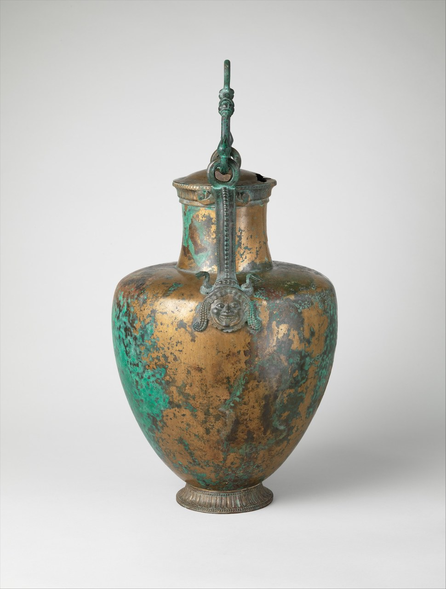

| 項目 | 記録 |
|---|---|
| 判定 | 条件適合（用途・注意点は下記） |
| 依頼項目／使用区間 | B07関連 ／ M06（予備） |
| 作品名 | Bronze neck-amphora (jar) with lid and bail handle |
| 作者／文化 | 作者名の記載なし ／ Greek |
| 年代 | last quarter of the 6th century BCE |
| 素材 | Bronze |
| 所蔵館 | The Metropolitan Museum of Art |
| 作品番号／API ID | 60.11.2a, b ／ 255060 |
| 作品ページ | [Met公式](https://www.metmuseum.org/art/collection/search/255060) |
| 権利確認 | Public Domain表示、[公式API](https://collectionapi.metmuseum.org/public/collection/v1/objects/255060) isPublicDomain=true |
| 利用条件 | [Met Open Access / CC0](https://www.metmuseum.org/hubs/open-access) |
| 確認・取得日 | 2026-10-22（日本時間） |
| 取得画像 | [代表原寸URL](https://images.metmuseum.org/CRDImages/gr/original/DP356253.jpg) |
| 原寸保存先 | `/Users/ryo/Desktop/新チャンネル/EP003_Medusa/素材/A10_met_255060_v01.jpg` |
| 原寸サイズ | 2949 × 3893 px ／ 1,276,358 bytes |
| 原寸SHA-256 | `7b148ad511e7e973dbbe4d0a7c13ab6154448e70ec2a5132a0a66fd9ac949488` |
| 確認JPG | 970 × 1280 px ／ 126,127 bytes |
| 原寸の別写真を含む保存数 | 3ファイル（作品数は1点） |

使い方・注意点：側面写真1を代表に選定。取っ手の根元の顔を確認できる。実際の青銅製容器で、盾ではない。

クレジット案：Greek, Bronze neck-amphora (jar) with lid and bail handle, last quarter of the 6th century BCE. The Metropolitan Museum of Art, Rogers Fund, 1960 (60.11.2a, b). Public Domain / CC0. [Source](https://www.metmuseum.org/art/collection/search/255060)

### A11 ゴルゴネイオンを持つ青銅の脛当て

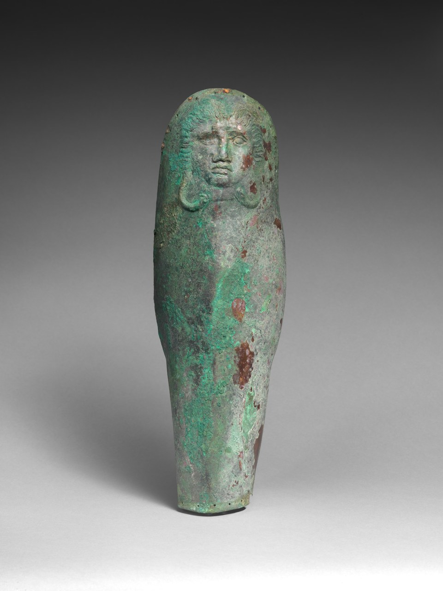

| 項目 | 記録 |
|---|---|
| 判定 | 条件適合（用途・注意点は下記） |
| 依頼項目／使用区間 | B07関連 ／ M06（予備） |
| 作品名 | Bronze greave (shin guard) |
| 作者／文化 | 作者名の記載なし ／ Greek, South Italian |
| 年代 | 4th century BCE |
| 素材 | Bronze |
| 所蔵館 | The Metropolitan Museum of Art |
| 作品番号／API ID | 1991.171.45 ／ 256033 |
| 作品ページ | [Met公式](https://www.metmuseum.org/art/collection/search/256033) |
| 権利確認 | Public Domain表示、[公式API](https://collectionapi.metmuseum.org/public/collection/v1/objects/256033) isPublicDomain=true |
| 利用条件 | [Met Open Access / CC0](https://www.metmuseum.org/hubs/open-access) |
| 確認・取得日 | 2026-10-22（日本時間） |
| 取得画像 | [代表原寸URL](https://images.metmuseum.org/CRDImages/gr/original/DP-12501-009.jpg) |
| 原寸保存先 | `/Users/ryo/Desktop/新チャンネル/EP003_Medusa/素材/A11_met_256033_v00.jpg` |
| 原寸サイズ | 3000 × 4000 px ／ 1,793,162 bytes |
| 原寸SHA-256 | `7486344f48d654e765acc6e0dbb7d860ffdeba851b82e2907996a2981c68b78e` |
| 確認JPG | 960 × 1280 px ／ 129,451 bytes |
| 原寸の別写真を含む保存数 | 3ファイル（作品数は1点） |

使い方・注意点：追加画像2に顔。防具の例だが盾ではない。紀元前4世紀の穏やかな顔なので、初期の恐ろしい表情の例とは区別。

クレジット案：Greek, South Italian, Bronze greave (shin guard), 4th century BCE. The Metropolitan Museum of Art, Gift of Mr. and Mrs. Jonathan P. Rosen, 1991 (1991.171.45). Public Domain / CC0. [Source](https://www.metmuseum.org/art/collection/search/256033)

### A12 アンドキデスのアンフォラ

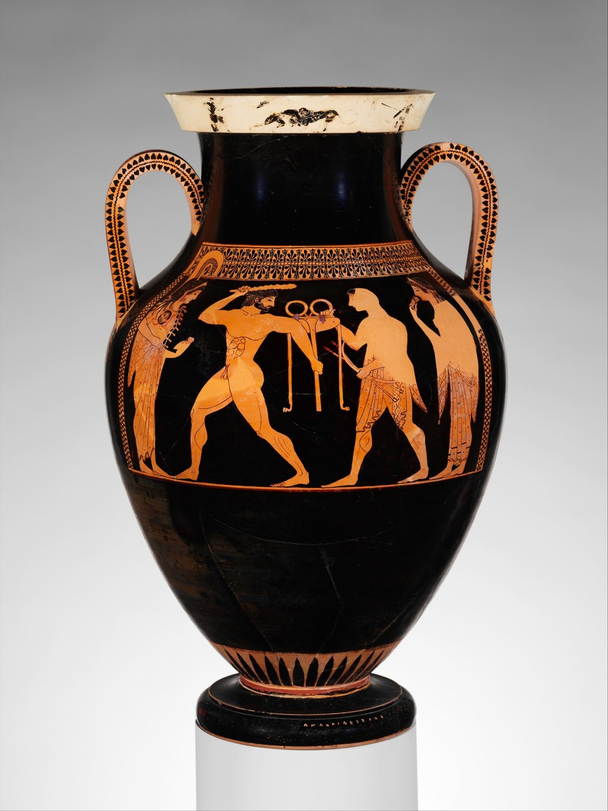

| 項目 | 記録 |
|---|---|
| 判定 | 条件適合（用途・注意点は下記） |
| 依頼項目／使用区間 | B08 ／ M07（予備） |
| 作品名 | Terracotta amphora (jar) |
| 作者／文化 | Andokides ／ Greek, Attic |
| 年代 | ca. 530 BCE |
| 素材 | Terracotta |
| 所蔵館 | The Metropolitan Museum of Art |
| 作品番号／API ID | 63.11.6 ／ 255154 |
| 作品ページ | [Met公式](https://www.metmuseum.org/art/collection/search/255154) |
| 権利確認 | Public Domain表示、[公式API](https://collectionapi.metmuseum.org/public/collection/v1/objects/255154) isPublicDomain=true |
| 利用条件 | [Met Open Access / CC0](https://www.metmuseum.org/hubs/open-access) |
| 確認・取得日 | 2026-10-22（日本時間） |
| 取得画像 | [代表原寸URL](https://images.metmuseum.org/CRDImages/gr/original/DP116936.jpg) |
| 原寸保存先 | `/Users/ryo/Desktop/新チャンネル/EP003_Medusa/素材/A12_met_255154_v00.jpg` |
| 原寸サイズ | 2882 × 3842 px ／ 1,138,079 bytes |
| 原寸SHA-256 | `e580c1a9aaa6afdc104f74f555614badd1f3523dbeee86315a9656f20eb7324f` |
| 確認JPG | 960 × 1280 px ／ 165,100 bytes |
| 原寸の別写真を含む保存数 | 2ファイル（作品数は1点） |

使い方・注意点：Metのメドゥーサ解説がアイギス図像として挙げる作品。主題はヘラクレスとアポロンの三脚争奪で、メドゥーサ討伐ではない。顔の細部が小さく、説明用にはA14を優先。

クレジット案：Andokides, Terracotta amphora (jar), ca. 530 BCE. The Metropolitan Museum of Art, Purchase, Joseph Pulitzer Bequest, 1963 (63.11.6). Public Domain / CC0. [Source](https://www.metmuseum.org/art/collection/search/255154)

### A13 アテナと金羊毛の場面の柱状クラテル

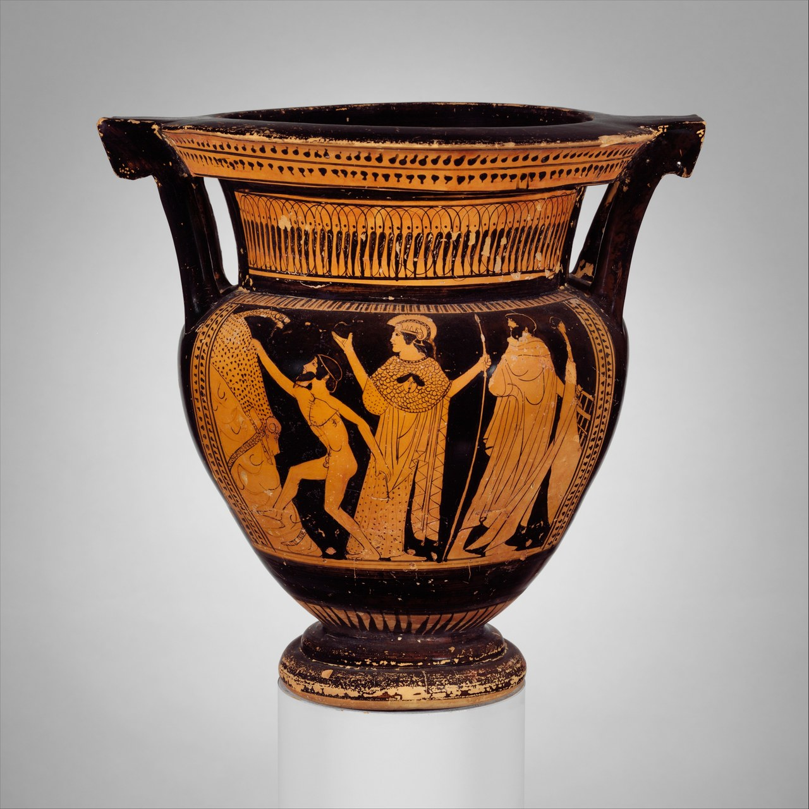

| 項目 | 記録 |
|---|---|
| 判定 | 条件適合（用途・注意点は下記） |
| 依頼項目／使用区間 | B08 ／ M07（予備） |
| 作品名 | Terracotta column-krater (bowl for mixing wine and water) |
| 作者／文化 | Orchard Painter ／ Greek, Attic |
| 年代 | ca. 470–460 BCE |
| 素材 | Terracotta |
| 所蔵館 | The Metropolitan Museum of Art |
| 作品番号／API ID | 34.11.7 ／ 253427 |
| 作品ページ | [Met公式](https://www.metmuseum.org/art/collection/search/253427) |
| 権利確認 | Public Domain表示、[公式API](https://collectionapi.metmuseum.org/public/collection/v1/objects/253427) isPublicDomain=true |
| 利用条件 | [Met Open Access / CC0](https://www.metmuseum.org/hubs/open-access) |
| 確認・取得日 | 2026-10-22（日本時間） |
| 取得画像 | [代表原寸URL](https://images.metmuseum.org/CRDImages/gr/original/DP153296.jpg) |
| 原寸保存先 | `/Users/ryo/Desktop/新チャンネル/EP003_Medusa/素材/A13_met_253427_v00.jpg` |
| 原寸サイズ | 3605 × 3604 px ／ 1,637,124 bytes |
| 原寸SHA-256 | `16ccb5ff3ba703f9eaec04ec838870405495e26846b7f34b41e853d66ccef264` |
| 確認JPG | 1280 × 1280 px ／ 267,381 bytes |
| 原寸の別写真を含む保存数 | 2ファイル（作品数は1点） |

使い方・注意点：アテナを伴うイアソンの物語。メドゥーサ討伐ではない。胸元のアイギスの説明に限定し、人物名を取り違えない。

クレジット案：Orchard Painter, Terracotta column-krater (bowl for mixing wine and water), ca. 470–460 BCE. The Metropolitan Museum of Art, Harris Brisbane Dick Fund, 1934 (34.11.7). Public Domain / CC0. [Source](https://www.metmuseum.org/art/collection/search/253427)

### A14 アイギスを着けたアテナの大理石上半身

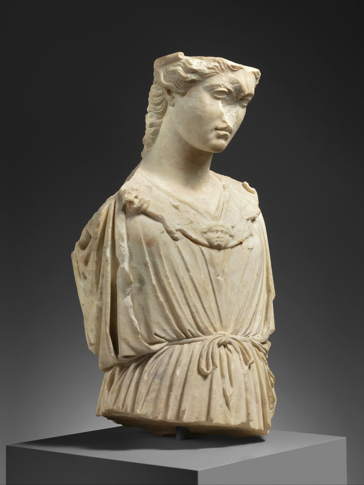

| 項目 | 記録 |
|---|---|
| 判定 | 条件適合（用途・注意点は下記） |
| 依頼項目／使用区間 | B08 ／ M07 |
| 作品名 | Marble head and torso of Athena |
| 作者／文化 | 作者名の記載なし ／ Roman |
| 年代 | 1st–2nd century CE |
| 素材 | Marble, Pentelic |
| 所蔵館 | The Metropolitan Museum of Art |
| 作品番号／API ID | 24.97.15 ／ 251476 |
| 作品ページ | [Met公式](https://www.metmuseum.org/art/collection/search/251476) |
| 権利確認 | Public Domain表示、[公式API](https://collectionapi.metmuseum.org/public/collection/v1/objects/251476) isPublicDomain=true |
| 利用条件 | [Met Open Access / CC0](https://www.metmuseum.org/hubs/open-access) |
| 確認・取得日 | 2026-10-22（日本時間） |
| 取得画像 | [代表原寸URL](https://images.metmuseum.org/CRDImages/gr/original/DP357289.jpg) |
| 原寸保存先 | `/Users/ryo/Desktop/新チャンネル/EP003_Medusa/素材/A14_met_251476_v00.jpg` |
| 原寸サイズ | 2920 × 3894 px ／ 1,127,214 bytes |
| 原寸SHA-256 | `55b5836efaa32d2813634fb68391ef73d468f07a4c843e261d09205ab3b46040` |
| 確認JPG | 960 × 1280 px ／ 124,780 bytes |
| 原寸の別写真を含む保存数 | 4ファイル（作品数は1点） |

使い方・注意点：第一候補。胸元中央のゴルゴンの頭を確認できる。ローマ時代1–2世紀の作品で、ホメロスと同時代の彫刻ではない。

クレジット案：Roman, Marble head and torso of Athena, 1st–2nd century CE. The Metropolitan Museum of Art, Fletcher Fund, 1924 (24.97.15). Public Domain / CC0. [Source](https://www.metmuseum.org/art/collection/search/251476)

### A15 アウロスを吹く少女の油壺

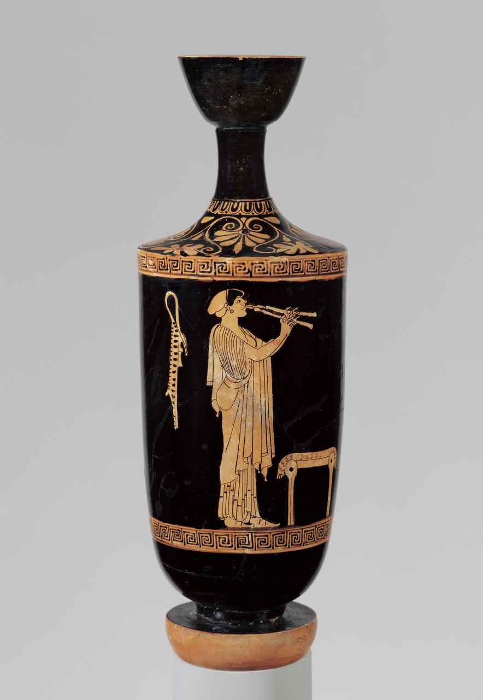

| 項目 | 記録 |
|---|---|
| 判定 | 条件適合（用途・注意点は下記） |
| 依頼項目／使用区間 | B09 ／ M08 |
| 作品名 | Terracotta lekythos (oil flask) |
| 作者／文化 | Brygos Painter ／ Greek, Attic |
| 年代 | ca. 480 BCE |
| 素材 | Terracotta |
| 所蔵館 | The Metropolitan Museum of Art |
| 作品番号／API ID | 24.97.28 ／ 251489 |
| 作品ページ | [Met公式](https://www.metmuseum.org/art/collection/search/251489) |
| 権利確認 | Public Domain表示、[公式API](https://collectionapi.metmuseum.org/public/collection/v1/objects/251489) isPublicDomain=true |
| 利用条件 | [Met Open Access / CC0](https://www.metmuseum.org/hubs/open-access) |
| 確認・取得日 | 2026-10-22（日本時間） |
| 取得画像 | [代表原寸URL](https://images.metmuseum.org/CRDImages/gr/original/TOAH_DP102417.jpg) |
| 原寸保存先 | `/Users/ryo/Desktop/新チャンネル/EP003_Medusa/素材/A15_met_251489_v00.jpg` |
| 原寸サイズ | 2121 × 3072 px ／ 884,371 bytes |
| 原寸SHA-256 | `120f845705b901061e6e5454e6c3b3c71dc3a7cb2c6b61e43c34335cb14bbc29` |
| 確認JPG | 884 × 1280 px ／ 103,768 bytes |
| 原寸の別写真を含む保存数 | 2ファイル（作品数は1点） |

使い方・注意点：第一候補。二本の管と奏者が明瞭。人物はアテナやメドゥーサとは同定されていない。ピンダロスの場面を直接描いた作品としては使わない。

クレジット案：Brygos Painter, Terracotta lekythos (oil flask), ca. 480 BCE. The Metropolitan Museum of Art, Fletcher Fund, 1924 (24.97.28). Public Domain / CC0. [Source](https://www.metmuseum.org/art/collection/search/251489)

### A16 美しいメドゥーサの円形浮彫

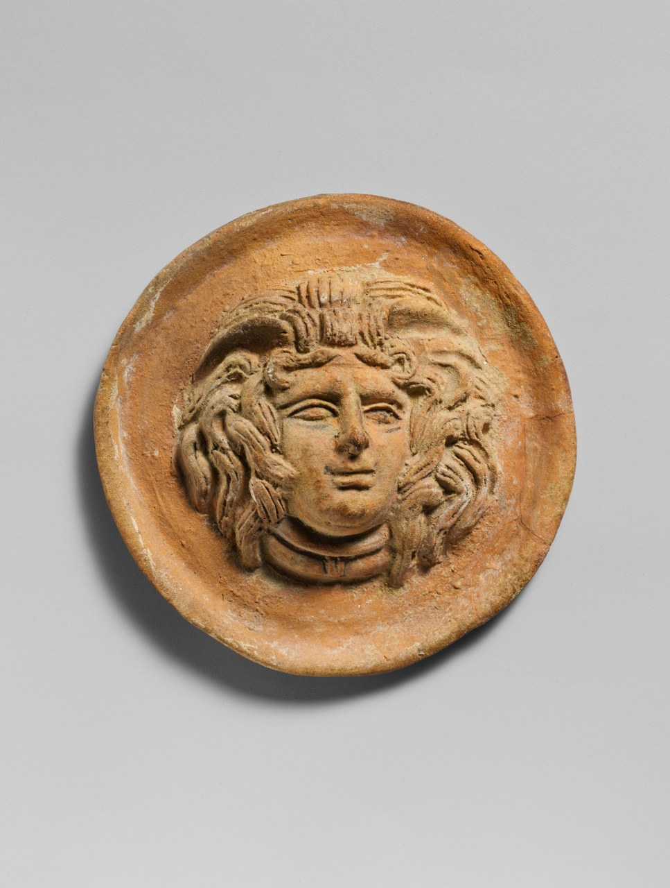

| 項目 | 記録 |
|---|---|
| 判定 | 条件適合（用途・注意点は下記） |
| 依頼項目／使用区間 | B10 ／ M10 |
| 作品名 | Terracotta reilef roundel with head of Medusa |
| 作者／文化 | 作者名の記載なし ／ Greek |
| 年代 | 2nd century BCE |
| 素材 | Terracotta |
| 所蔵館 | The Metropolitan Museum of Art |
| 作品番号／API ID | 98.8.30 ／ 246742 |
| 作品ページ | [Met公式](https://www.metmuseum.org/art/collection/search/246742) |
| 権利確認 | Public Domain表示、[公式API](https://collectionapi.metmuseum.org/public/collection/v1/objects/246742) isPublicDomain=true |
| 利用条件 | [Met Open Access / CC0](https://www.metmuseum.org/hubs/open-access) |
| 確認・取得日 | 2026-10-22（日本時間） |
| 取得画像 | [代表原寸URL](https://images.metmuseum.org/CRDImages/gr/original/DP229135.jpg) |
| 原寸保存先 | `/Users/ryo/Desktop/新チャンネル/EP003_Medusa/素材/A16_met_246742_v00.jpg` |
| 原寸サイズ | 3022 × 4000 px ／ 2,974,362 bytes |
| 原寸SHA-256 | `04692f9006642a74c15aef3d6524788352b110f698176ca5e157ae2d58918ad9` |
| 確認JPG | 967 × 1280 px ／ 192,174 bytes |
| 原寸の別写真を含む保存数 | 1ファイル（作品数は1点） |

使い方・注意点：第一候補。紀元前2世紀のヘレニズム期。額の小さな翼が識別点。紀元前5世紀の実例として表示しない。公式英題のreilefは原文の綴りを維持。

クレジット案：Greek, Terracotta reilef roundel with head of Medusa, 2nd century BCE. The Metropolitan Museum of Art, Gift of F. W. Rhinelander, 1898 (98.8.30). Public Domain / CC0. [Source](https://www.metmuseum.org/art/collection/search/246742)

### A17 穏やかな顔のゴルゴネイオン屋根瓦

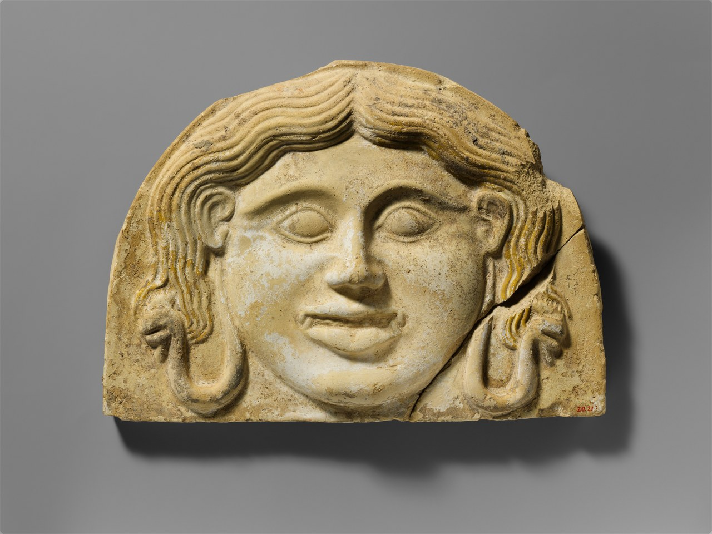

| 項目 | 記録 |
|---|---|
| 判定 | 条件適合（用途・注意点は下記） |
| 依頼項目／使用区間 | B10 ／ M10 |
| 作品名 | Terracotta gorgoneion antefix (roof tile) |
| 作者／文化 | 作者名の記載なし ／ Greek, South Italian, Tarentine |
| 年代 | 2nd half of the 5th century BCE |
| 素材 | Terracotta |
| 所蔵館 | The Metropolitan Museum of Art |
| 作品番号／API ID | 20.215 ／ 250968 |
| 作品ページ | [Met公式](https://www.metmuseum.org/art/collection/search/250968) |
| 権利確認 | Public Domain表示、[公式API](https://collectionapi.metmuseum.org/public/collection/v1/objects/250968) isPublicDomain=true |
| 利用条件 | [Met Open Access / CC0](https://www.metmuseum.org/hubs/open-access) |
| 確認・取得日 | 2026-10-22（日本時間） |
| 取得画像 | [代表原寸URL](https://images.metmuseum.org/CRDImages/gr/original/DP233548.jpg) |
| 原寸保存先 | `/Users/ryo/Desktop/新チャンネル/EP003_Medusa/素材/A17_met_250968_v00.jpg` |
| 原寸サイズ | 4000 × 3000 px ／ 2,870,495 bytes |
| 原寸SHA-256 | `7bd80fb261684586b5f2d67f6bcb1b60640d822546e90b262b87bdae523a1078` |
| 確認JPG | 1280 × 960 px ／ 198,760 bytes |
| 原寸の別写真を含む保存数 | 1ファイル（作品数は1点） |

使い方・注意点：第一候補。紀元前5世紀後半の作例として、M10の年代を支える比較画像に適する。A03とは別作品。

クレジット案：Greek, South Italian, Tarentine, Terracotta gorgoneion antefix (roof tile), 2nd half of the 5th century BCE. The Metropolitan Museum of Art, Rogers Fund, 1920 (20.215). Public Domain / CC0. [Source](https://www.metmuseum.org/art/collection/search/250968)

### A18 ゴルゴネイオン形の金製ペンダント

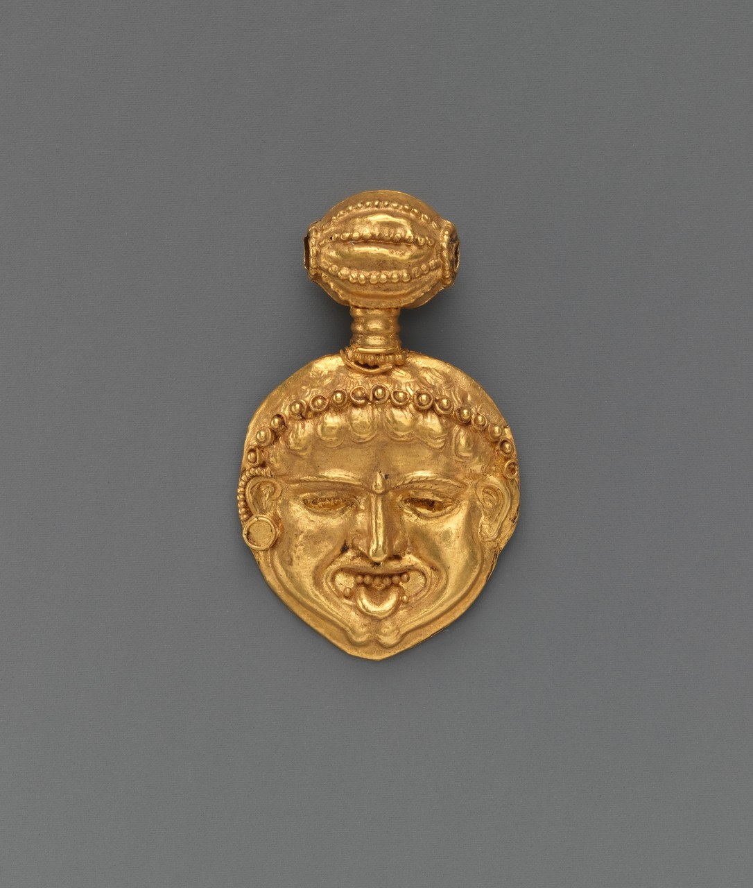

| 項目 | 記録 |
|---|---|
| 判定 | 条件適合（用途・注意点は下記） |
| 依頼項目／使用区間 | B10関連 ／ M10（予備） |
| 作品名 | Gold pendant in the form of a gorgoneion (Gorgon's face) |
| 作者／文化 | 作者名の記載なし ／ Greek, Cypriot |
| 年代 | ca. 450 BCE |
| 素材 | Gold |
| 所蔵館 | The Metropolitan Museum of Art |
| 作品番号／API ID | 74.51.3397b ／ 242831 |
| 作品ページ | [Met公式](https://www.metmuseum.org/art/collection/search/242831) |
| 権利確認 | Public Domain表示、[公式API](https://collectionapi.metmuseum.org/public/collection/v1/objects/242831) isPublicDomain=true |
| 利用条件 | [Met Open Access / CC0](https://www.metmuseum.org/hubs/open-access) |
| 確認・取得日 | 2026-10-22（日本時間） |
| 取得画像 | [代表原寸URL](https://images.metmuseum.org/CRDImages/gr/original/DP-12501-004.jpg) |
| 原寸保存先 | `/Users/ryo/Desktop/新チャンネル/EP003_Medusa/素材/A18_met_242831_v00.jpg` |
| 原寸サイズ | 3393 × 4000 px ／ 3,319,697 bytes |
| 原寸SHA-256 | `4b91ffc0f0f31a39b3523daa3e27a32d93f65440897a040120b1041b3b88a89b` |
| 確認JPG | 1086 × 1280 px ／ 202,659 bytes |
| 原寸の別写真を含む保存数 | 2ファイル（作品数は1点） |

使い方・注意点：紀元前450年頃にも怪物的な顔が続く比較例。「古い恐ろしい顔が一斉に消えた」という単純な進化図にはしない。

クレジット案：Greek, Cypriot, Gold pendant in the form of a gorgoneion (Gorgon's face), ca. 450 BCE. The Metropolitan Museum of Art, The Cesnola Collection, Purchased by subscription, 1874–76 (74.51.3397b). Public Domain / CC0. [Source](https://www.metmuseum.org/art/collection/search/242831)

### A19 メドゥーサの顔を付けた両把手壺

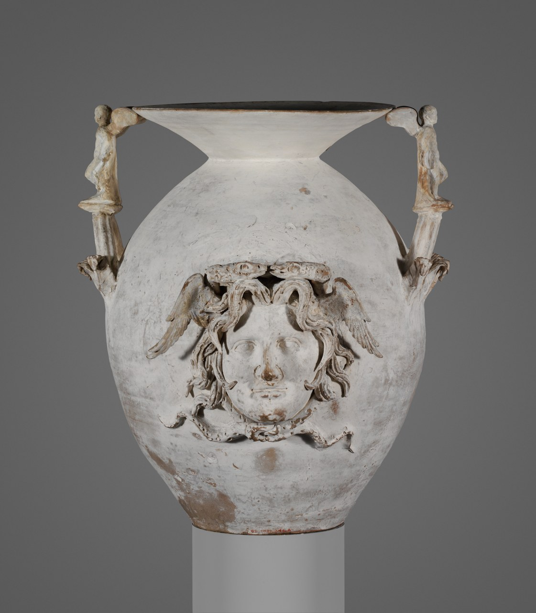

| 項目 | 記録 |
|---|---|
| 判定 | 条件適合（用途・注意点は下記） |
| 依頼項目／使用区間 | B10 ／ M10（予備） |
| 作品名 | Terracotta two-handled vase |
| 作者／文化 | 作者名の記載なし ／ Greek, South Italian, Apulian, Canosan |
| 年代 | late 4th–early 3rd century BCE |
| 素材 | Terracotta |
| 所蔵館 | The Metropolitan Museum of Art |
| 作品番号／API ID | 06.1021.246a, b ／ 247408 |
| 作品ページ | [Met公式](https://www.metmuseum.org/art/collection/search/247408) |
| 権利確認 | Public Domain表示、[公式API](https://collectionapi.metmuseum.org/public/collection/v1/objects/247408) isPublicDomain=true |
| 利用条件 | [Met Open Access / CC0](https://www.metmuseum.org/hubs/open-access) |
| 確認・取得日 | 2026-10-22（日本時間） |
| 取得画像 | [代表原寸URL](https://images.metmuseum.org/CRDImages/gr/original/DP118059.jpg) |
| 原寸保存先 | `/Users/ryo/Desktop/新チャンネル/EP003_Medusa/素材/A19_met_247408_v00.jpg` |
| 原寸サイズ | 3503 × 4000 px ／ 2,315,420 bytes |
| 原寸SHA-256 | `1ab63371fe2c298cfedb2bcc0b4df971a09d1f0afd7ec0d03c8f916bb88d70ad` |
| 確認JPG | 1121 × 1280 px ／ 149,184 bytes |
| 原寸の別写真を含む保存数 | 2ファイル（作品数は1点） |

使い方・注意点：紀元前4世紀末–3世紀初頭。持ち手のエロス像は失われた原物に代わる石膏製と館が説明。器全体を完全な古代原状としない。

クレジット案：Greek, South Italian, Apulian, Canosan, Terracotta two-handled vase, late 4th–early 3rd century BCE. The Metropolitan Museum of Art, Rogers Fund, 1906 (06.1021.246a, b). Public Domain / CC0. [Source](https://www.metmuseum.org/art/collection/search/247408)

### A20 カリアデス墓碑の走るゴルゴン

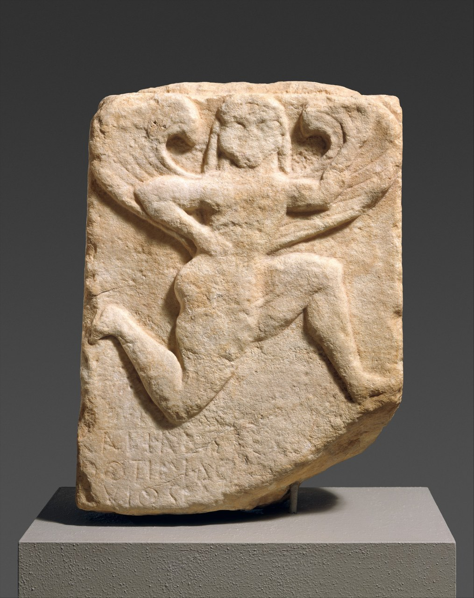

| 項目 | 記録 |
|---|---|
| 判定 | 条件適合（用途・注意点は下記） |
| 依頼項目／使用区間 | B04代替/B05関連 ／ M05（予備） |
| 作品名 | Part of the marble stele (grave marker) of Kalliades |
| 作者／文化 | 作者名の記載なし ／ Greek, Attic |
| 年代 | 550–525 BCE |
| 素材 | Marble |
| 所蔵館 | The Metropolitan Museum of Art |
| 作品番号／API ID | 55.11.4 ／ 254818 |
| 作品ページ | [Met公式](https://www.metmuseum.org/art/collection/search/254818) |
| 権利確認 | Public Domain表示、[公式API](https://collectionapi.metmuseum.org/public/collection/v1/objects/254818) isPublicDomain=true |
| 利用条件 | [Met Open Access / CC0](https://www.metmuseum.org/hubs/open-access) |
| 確認・取得日 | 2026-10-22（日本時間） |
| 取得画像 | [代表原寸URL](https://images.metmuseum.org/CRDImages/gr/original/DT324254.jpg) |
| 原寸保存先 | `/Users/ryo/Desktop/新チャンネル/EP003_Medusa/素材/A20_met_254818_v00.jpg` |
| 原寸サイズ | 2952 × 3722 px ／ 2,768,293 bytes |
| 原寸SHA-256 | `24c32deb526f7002f4bfadb09640dda5851e9f09645d5285c498463a7bb75ee9` |
| 確認JPG | 1015 × 1280 px ／ 296,364 bytes |
| 原寸の別写真を含む保存数 | 1ファイル（作品数は1点） |

使い方・注意点：走る／飛ぶゴルゴンの石彫。コルフの破風とは別物。現行作品ページの年代は550–525 BCE。旧教材のca. 500–490 B.C.と異なるため現行値を採用。

クレジット案：Greek, Attic, Part of the marble stele (grave marker) of Kalliades, 550–525 BCE. The Metropolitan Museum of Art, Rogers Fund, 1955 (55.11.4). Public Domain / CC0. [Source](https://www.metmuseum.org/art/collection/search/254818)

### A21 ペガサスとベレロポンを刻んだ青銅鏡

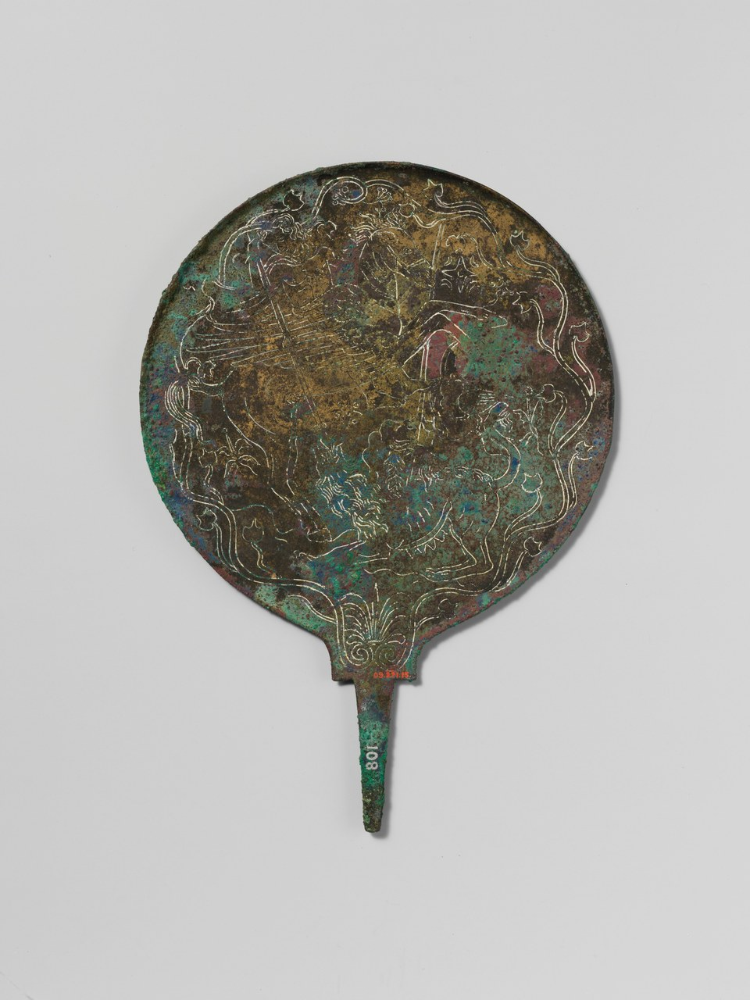

| 項目 | 記録 |
|---|---|
| 判定 | 条件適合（用途・注意点は下記） |
| 依頼項目／使用区間 | B06 ／ M04 |
| 作品名 | Bronze mirror |
| 作者／文化 | 作者名の記載なし ／ Etruscan |
| 年代 | ca. 350–325 BCE |
| 素材 | Bronze |
| 所蔵館 | The Metropolitan Museum of Art |
| 作品番号／API ID | 09.221.15 ／ 248152 |
| 作品ページ | [Met公式](https://www.metmuseum.org/art/collection/search/248152) |
| 権利確認 | Public Domain表示、[公式API](https://collectionapi.metmuseum.org/public/collection/v1/objects/248152) isPublicDomain=true |
| 利用条件 | [Met Open Access / CC0](https://www.metmuseum.org/hubs/open-access) |
| 確認・取得日 | 2026-10-22（日本時間） |
| 取得画像 | [代表原寸URL](https://images.metmuseum.org/CRDImages/gr/original/DP254638.jpg) |
| 原寸保存先 | `/Users/ryo/Desktop/新チャンネル/EP003_Medusa/素材/A21_met_248152_v00.jpg` |
| 原寸サイズ | 3000 × 4000 px ／ 1,636,444 bytes |
| 原寸SHA-256 | `30b9f40fade01f1f881193d3dc6625e6c9109a0274ae0963df4676d0341e37df` |
| 確認JPG | 960 × 1280 px ／ 161,709 bytes |
| 原寸の別写真を含む保存数 | 3ファイル（作品数は1点） |

使い方・注意点：第一候補。古代のペガサス図像。乗り手はベレロポンで、ペルセウスではない。キマイラ退治の場面を誕生場面と説明しない。線刻が淡いため実装時に拡大表示の可読性確認が必要。

クレジット案：Etruscan, Bronze mirror, ca. 350–325 BCE. The Metropolitan Museum of Art, Rogers Fund, 1909 (09.221.15). Public Domain / CC0. [Source](https://www.metmuseum.org/art/collection/search/248152)

### A22 テンペスタ：変身物語の挿絵、第41図

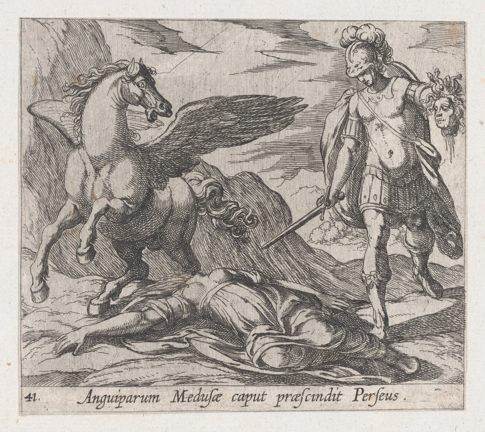

| 項目 | 記録 |
|---|---|
| 判定 | 条件適合（用途・注意点は下記） |
| 依頼項目／使用区間 | B11 ／ M11 |
| 作品名 | Plate 41: Perseus Killing Medusa (Anguiparum Meduse caput praescundit Perseus), from Ovid's 'Metamorphoses' |
| 作者／文化 | Antonio Tempesta ／  |
| 年代 | 1606 |
| 素材 | Etching |
| 所蔵館 | The Metropolitan Museum of Art |
| 作品番号／API ID | 51.501.3892 ／ 401129 |
| 作品ページ | [Met公式](https://www.metmuseum.org/art/collection/search/401129) |
| 権利確認 | Public Domain表示、[公式API](https://collectionapi.metmuseum.org/public/collection/v1/objects/401129) isPublicDomain=true |
| 利用条件 | [Met Open Access / CC0](https://www.metmuseum.org/hubs/open-access) |
| 確認・取得日 | 2026-10-22（日本時間） |
| 取得画像 | [代表原寸URL](https://images.metmuseum.org/CRDImages/dp/original/DP864703.jpg) |
| 原寸保存先 | `/Users/ryo/Desktop/新チャンネル/EP003_Medusa/素材/A22_met_401129_v00.jpg` |
| 原寸サイズ | 1652 × 1473 px ／ 1,324,788 bytes |
| 原寸SHA-256 | `dd6eafbf9a7fa3e875d34bbee08d2c5e816665ecbcc487e63fb0d1cb38b6c578` |
| 確認JPG | 1280 × 1141 px ／ 598,807 bytes |
| 原寸の別写真を含む保存数 | 1ファイル（作品数は1点） |

使い方・注意点：1606年のエッチング。使用注意：切断された頭部と胴体、首元を含む。性暴力の場面ではない。全体を短く提示し、切り口を拡大しない。古代の刊本や本文そのものではなく、後世の挿絵と表示。

クレジット案：Antonio Tempesta, Plate 41: Perseus Killing Medusa (Anguiparum Meduse caput praescundit Perseus), from Ovid's 'Metamorphoses', 1606. The Metropolitan Museum of Art, The Elisha Whittelsey Collection, The Elisha Whittelsey Fund, 1951 (51.501.3892). Public Domain / CC0. [Source](https://www.metmuseum.org/art/collection/search/401129)

### A23 アウロスを持つ青年の杯

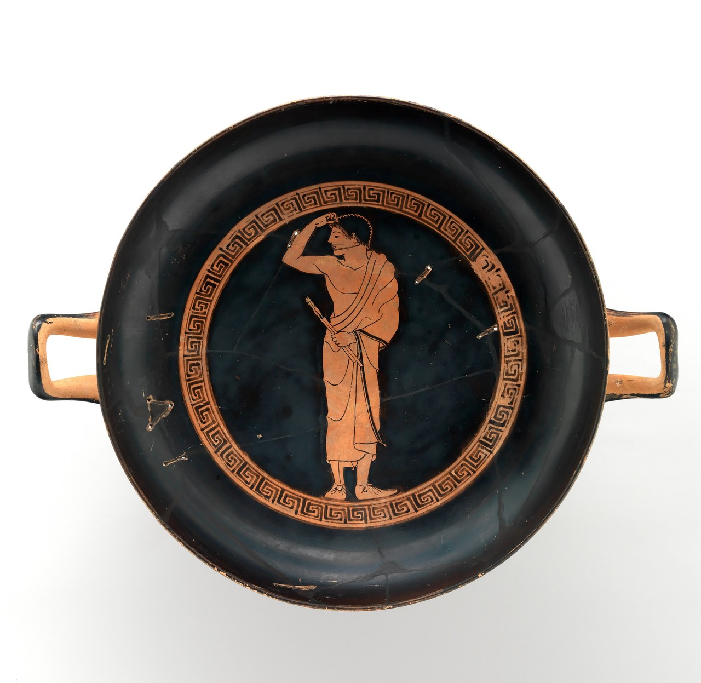

| 項目 | 記録 |
|---|---|
| 判定 | 条件適合（用途・注意点は下記） |
| 依頼項目／使用区間 | B09 ／ M08（予備） |
| 作品名 | Terracotta kylix (drinking cup) |
| 作者／文化 | Antiphon Painter ／ Greek, Attic |
| 年代 | ca. 490 BCE |
| 素材 | Terracotta |
| 所蔵館 | The Metropolitan Museum of Art |
| 作品番号／API ID | 96.9.36 ／ 246136 |
| 作品ページ | [Met公式](https://www.metmuseum.org/art/collection/search/246136) |
| 権利確認 | Public Domain表示、[公式API](https://collectionapi.metmuseum.org/public/collection/v1/objects/246136) isPublicDomain=true |
| 利用条件 | [Met Open Access / CC0](https://www.metmuseum.org/hubs/open-access) |
| 確認・取得日 | 2026-10-22（日本時間） |
| 取得画像 | [代表原寸URL](https://images.metmuseum.org/CRDImages/gr/original/DP307500.jpg) |
| 原寸保存先 | `/Users/ryo/Desktop/新チャンネル/EP003_Medusa/素材/A23_met_246136_v00.jpg` |
| 原寸サイズ | 4000 × 3896 px ／ 1,940,502 bytes |
| 原寸SHA-256 | `6de7e31e8a361e0833c8655f528e07004332b303dacdb8a9428f3ff36777da66` |
| 確認JPG | 1280 × 1247 px ／ 181,126 bytes |
| 原寸の別写真を含む保存数 | 4ファイル（作品数は1点） |

使い方・注意点：吹き終えた青年と館が説明する作例。演奏中と断定しない。内面を選び、演奏中の見やすさではA15を優先。

クレジット案：Antiphon Painter, Terracotta kylix (drinking cup), ca. 490 BCE. The Metropolitan Museum of Art, Purchase, 1896 (96.9.36). Public Domain / CC0. [Source](https://www.metmuseum.org/art/collection/search/246136)

### A24 メドゥーサの頭部を持つ車の轅の青銅装飾

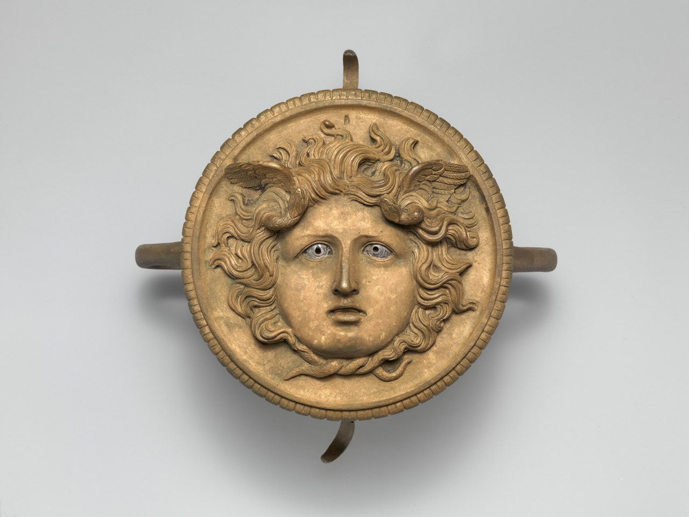

| 項目 | 記録 |
|---|---|
| 判定 | 条件適合（用途・注意点は下記） |
| 依頼項目／使用区間 | B12 ／ M01 |
| 作品名 | Bronze ornament from a chariot pole |
| 作者／文化 | 作者名の記載なし ／ Roman |
| 年代 | 1st–2nd century CE |
| 素材 | Bronze, silver, copper |
| 所蔵館 | The Metropolitan Museum of Art |
| 作品番号／API ID | 18.75 ／ 250666 |
| 作品ページ | [Met公式](https://www.metmuseum.org/art/collection/search/250666) |
| 権利確認 | Public Domain表示、[公式API](https://collectionapi.metmuseum.org/public/collection/v1/objects/250666) isPublicDomain=true |
| 利用条件 | [Met Open Access / CC0](https://www.metmuseum.org/hubs/open-access) |
| 確認・取得日 | 2026-10-22（日本時間） |
| 取得画像 | [代表原寸URL](https://images.metmuseum.org/CRDImages/gr/original/DP-12515-001.jpg) |
| 原寸保存先 | `/Users/ryo/Desktop/新チャンネル/EP003_Medusa/素材/A24_met_250666_v00.jpg` |
| 原寸サイズ | 4000 × 3000 px ／ 1,830,891 bytes |
| 原寸SHA-256 | `46ba3bcd6e8de44b03a1ea66b3686294d578632d49acc31e5536b747a5255398` |
| 確認JPG | 1280 × 960 px ／ 138,508 bytes |
| 原寸の別写真を含む保存数 | 2ファイル（作品数は1点） |

使い方・注意点：第一候補。蛇と翼を伴う顔が大きく明瞭。ローマ時代1–2世紀。儀礼用戦車の装飾だった可能性と館が説明。M10等に再使用しない。

クレジット案：Roman, Bronze ornament from a chariot pole, 1st–2nd century CE. The Metropolitan Museum of Art, Rogers Fund, 1918 (18.75). Public Domain / CC0. [Source](https://www.metmuseum.org/art/collection/search/250666)

### A25 メドゥーサ頭部のカーネリアン陰刻宝石

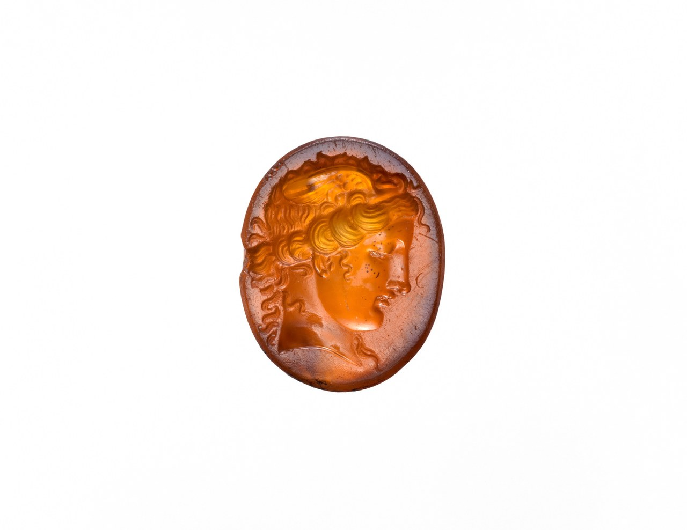

| 項目 | 記録 |
|---|---|
| 判定 | 条件適合（用途・注意点は下記） |
| 依頼項目／使用区間 | B10 ／ M10（予備） |
| 作品名 | Carnelian Intaglio |
| 作者／文化 | 作者名の記載なし ／ Greek |
| 年代 | 3rd–1st century BCE |
| 素材 | Carnelian |
| 所蔵館 | The Metropolitan Museum of Art |
| 作品番号／API ID | 48.12.4 ／ 254604 |
| 作品ページ | [Met公式](https://www.metmuseum.org/art/collection/search/254604) |
| 権利確認 | Public Domain表示、[公式API](https://collectionapi.metmuseum.org/public/collection/v1/objects/254604) isPublicDomain=true |
| 利用条件 | [Met Open Access / CC0](https://www.metmuseum.org/hubs/open-access) |
| 確認・取得日 | 2026-10-22（日本時間） |
| 取得画像 | [代表原寸URL](https://images.metmuseum.org/CRDImages/gr/original/DP-12519-001.jpg) |
| 原寸保存先 | `/Users/ryo/Desktop/新チャンネル/EP003_Medusa/素材/A25_met_254604_v00.jpg` |
| 原寸サイズ | 4000 × 3088 px ／ 1,071,591 bytes |
| 原寸SHA-256 | `b7b0dedeb01d23a3e4a5894ffd7ecf9b3015e9758a16d2b40d4e94a6091d3a50` |
| 確認JPG | 1280 × 988 px ／ 66,205 bytes |
| 原寸の別写真を含む保存数 | 4ファイル（作品数は1点） |

使い方・注意点：ヘレニズム期、紀元前3–1世紀。穏やかな横顔。宝石の陰刻と写真の光の向きによる見え方を保ち、生成で細部を補わない。

クレジット案：Greek, Carnelian Intaglio, 3rd–1st century BCE. The Metropolitan Museum of Art, Gift of Rupert L. Joseph, 1948 (48.12.4). Public Domain / CC0. [Source](https://www.metmuseum.org/art/collection/search/254604)

### A26 ゴルゴンの盾を持つアキレウスの浮彫断片

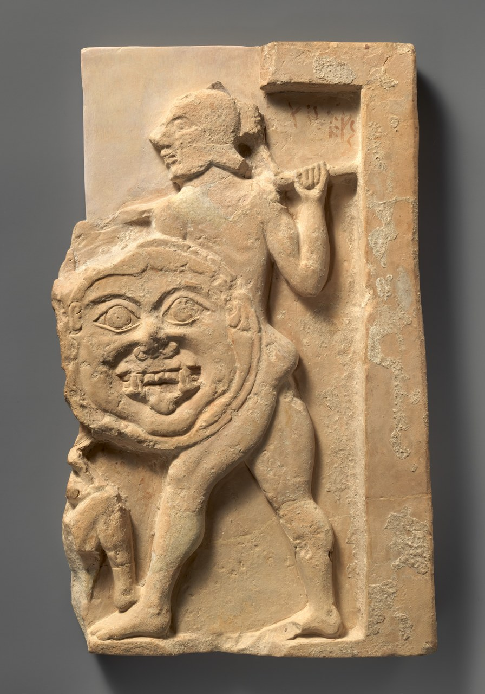

| 項目 | 記録 |
|---|---|
| 判定 | 条件適合（用途・注意点は下記） |
| 依頼項目／使用区間 | B07 ／ M06 |
| 作品名 | Fragment of a terracotta relief |
| 作者／文化 | 作者名の記載なし ／ Greek, Attic |
| 年代 | ca. 600 BCE |
| 素材 | Terracotta |
| 所蔵館 | The Metropolitan Museum of Art |
| 作品番号／API ID | 42.11.33 ／ 254476 |
| 作品ページ | [Met公式](https://www.metmuseum.org/art/collection/search/254476) |
| 権利確認 | Public Domain表示、[公式API](https://collectionapi.metmuseum.org/public/collection/v1/objects/254476) isPublicDomain=true |
| 利用条件 | [Met Open Access / CC0](https://www.metmuseum.org/hubs/open-access) |
| 確認・取得日 | 2026-10-22（日本時間） |
| 取得画像 | [代表原寸URL](https://images.metmuseum.org/CRDImages/gr/original/DP-12666-001.jpg) |
| 原寸保存先 | `/Users/ryo/Desktop/新チャンネル/EP003_Medusa/素材/A26_met_254476_v00.jpg` |
| 原寸サイズ | 2800 × 4000 px ／ 3,227,852 bytes |
| 原寸SHA-256 | `98f364fff5066688da6f188cd954baa21e91877c64a22ecb3a710db9db571ffb` |
| 確認JPG | 896 × 1280 px ／ 230,597 bytes |
| 原寸の別写真を含む保存数 | 2ファイル（作品数は1点） |

使い方・注意点：盾の図像の第一候補。アキレウスと倒れたアマゾンの場面。メドゥーサ討伐ではない。戦闘後の図像を含むが、確認画像では目立つ流血はない。

クレジット案：Greek, Attic, Fragment of a terracotta relief, ca. 600 BCE. The Metropolitan Museum of Art, Samuel D. Lee Fund, 1942 (42.11.33). Public Domain / CC0. [Source](https://www.metmuseum.org/art/collection/search/254476)

## 保存・共有の検証

- 異なる作品 **26点**。原寸・別写真 **72ファイル、合計118,897,038 bytes**。各画像の全画素読み込みとMac保存後のSHA-256一致を検証。
- 代表確認JPG26枚と一覧3枚、計29枚。すべて長辺1280px以下・1,000,000 bytes未満。代表26点を目視確認。
- 代表と別写真の重複を作品IDで管理し、割当案の同一区間内の全体→細部以外に同じ作品を再掲しない。
- 本報告・素材台帳・確認JPG29枚のみをGit共有対象とする。原寸、HTML全文、作業キャッシュは含めない。
- 分岐したローカル履歴と既存の未コミット作業を保全し、最新のリモート制作ブランチを起点に本成果だけを適用して共有する。push成否・コミット番号は完了応答で報告する。
