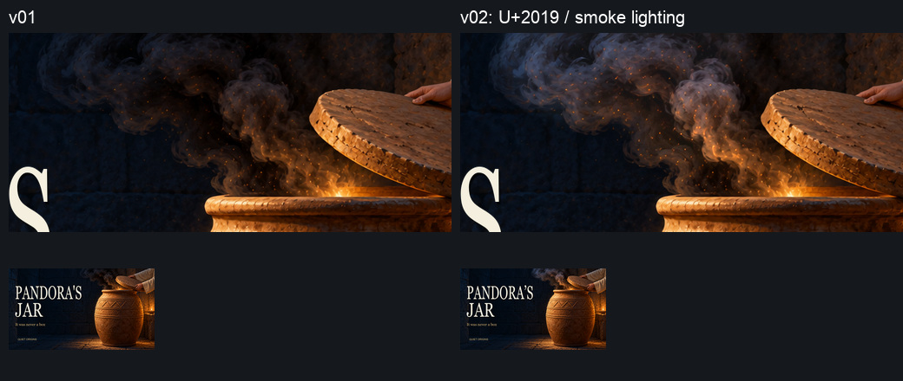
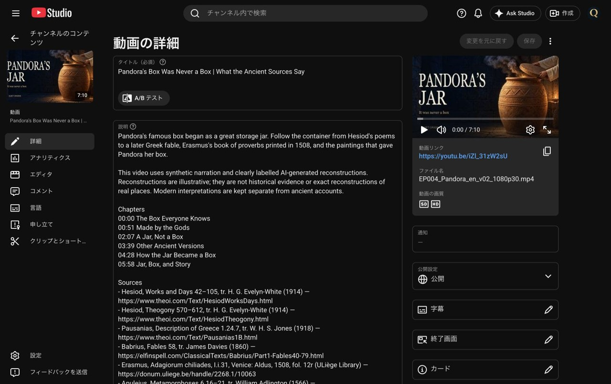
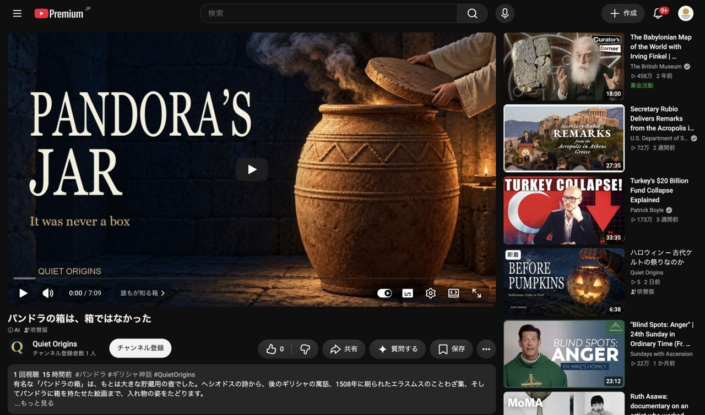

# 第4話パンドラ：案3の修正・差し替え完了

[Claudeの依頼](wom04_サムネ差し替え依頼_20261027.md)に沿い、案3を修正し、**2026-10-27 00:17:53 JST**に動画 `iZl_31zW2sU` のサムネを保存した。画像の生成し直しは0回。v01は保全した。

## 修正と検品

- 見出しを `PANDORA'S`（U+0027）から **`PANDORA’S`（U+2019）** に変更。Georgia、幅590px、高さ132px、x54/y145を維持した。JAR・補足・ブランドは同じ。
- 採用済み原寸背景を1280×720へ同条件で切り出し、煙だけを限定マスクで調整。範囲はx610〜965/y0〜166内の多角形で、全座標を[検品JSON](wom04_サムネ案3_v02検品_20261027.json)に記録した。手・袖・蓋・壺本体・口の光を範囲から外した。
- マスクを内側へ15px縮めてからσ7pxでぼかし、元の多角形外では必ず0とした。元の煙の模様を残して明るさを上げ、上側は灰色、下側は暖色へ寄せた。火の粉の追加はなし。炎・白雲・顔などの新しい形を描き足していない。
- 背景の変更画素は**39,993画素**。煙マスク外の変更画素は**0**。最終合成でも煙＋上段見出し枠以外の変更画素は**0**。この保証は**JPEG圧縮前**の画素比較であり、JPEGの再圧縮差分まで0という意味ではない。
- 元の条件でv01を再合成し、保存済みv01 JPGとバイト一致を確認。原寸と168×94pxで、煙が石壁から見分けやすくなり、文字を妨げないことを目視した。
- 主役と文字のすき間は上段**94px**、下段**445px**。上段は主役（手・蓋・壺）の保全領域左端x740と影を含む文字枠右端x646の差による保守値。下段は前回同様の壺の暖色境界x751と文字枠右端x306との差。指定16px以上を維持。

完成：[wom04_サムネ案3_v02_20261027.jpg](サムネ確認用/wom04/wom04_サムネ案3_v02_20261027.jpg)

| 項目 | 実測値 |
|---|---|
| 寸法・形式 | 1280×720 JPG |
| 容量 | 371,802 bytes（1MB未満） |
| SHA-256 | `f4b9caac8ff667ced0c156ad79f105f77d0ac2b92a00ab7a3886a12199c6928b` |

アップロード直前にSHA-256を再計算し一致した。[再現スクリプト](wom04_サムネ案3修正_v02_20261027.py)／[原寸・v01・v02・比較画像のハッシュと測定記録](wom04_サムネ案3_v02検品_20261027.json)。

## Studioと公開ページの確認

- StudioでQuiet Originsと `UCfLJOojEY9VB3rvrjICk90Q` を確認してから対象動画へ移動。
- 「サムネイル→変更」で完成版をアップロードし保存。操作直後の記録は `2026-10-26T15:17:53.281Z`＝**2026-10-27 00:17:53 JST**。
- 保存ボタンの無効化を確認後、詳細画面を再読み込み。左の動画サムネ・プレーヤーとも修正版が表示され、未保存変更なし。
- タイトル・説明文は保存前、保存直前、再読み込み後で一致。字幕・日本語音声・終了画面・チャプター・公開設定・AI使用・カテゴリ・他動画・A/Bテストは操作していない。
- **00:19:43 JST**、Chromeの[公開再生ページ](https://www.youtube.com/watch?v=iZl_31zW2sU)で再生前のポスターに修正版を確認した。Chromeはログイン状態。日本語タイトルとAI表示も確認できた。
- 先に確認したCodex内ブラウザでは旧画像が表示された。Chromeの公開ページでは新画像を確認済みだが、すべてのブラウザで同時に切り替わったとは扱わない。ログアウト状態での確認はしていない。
- StudioをWhispers of Japan（`UCx4mLEohO3XCVxZajUynLzw`）へ戻し、ダッシュボードの表示を確認した。

[差し替え時刻・投稿文照合記録](wom04_サムネ差し替え検証_20261027.json)。画面証跡は長辺1280px以下・1MB未満。

## 比較予定・保存先

変更前の起点は[2026-10-26 23:39の記録](wom04_サムネ改善結果_20261026.md)：インプレッション15・視聴1、上部CTRは「—」。下部ファネルは別期間の0.0%で、混ぜて扱わない。

**次回比較予定：2026-11-03 00:17:53 JST以降（差し替えから7日後）。** 概要・リーチの同じ画面でインプレッション・クリック率・視聴回数を、取得日時・表示期間つきで読むだけで記録する。第2話の予定（11/2 22:59以降）も、この時刻以降にまとめて確認してよい。少数データや時期による変化をサムネの効果と断定しない。依頼どおり予定のみ記載し、自動実行は登録していない。

Mac保存先：`/Users/ryo/Desktop/新チャンネル/EP004_Pandora/サムネ改善_20261026/`。生成原寸は`sources/`、圧縮前の調整背景・マスク・完成画像は`v02/`、JPG納品は`deliverables/`。原寸PNGはGitへ追加せず、確認JPG・スクリプト・記録を制作ブランチへ共有する。
