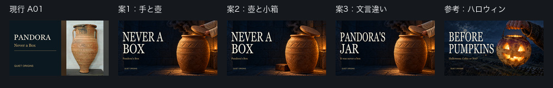

# 第4話パンドラ：サムネ3案の制作結果（2026-10-26 Codex）

[Claudeの申し送り](wom04_サムネ改善依頼_20261026.md)に従い、3案と比較画像を制作した。**本人の選定待ち。今回、Studioのサムネ・タイトル・説明文などは変更していない。** 対象はQuiet Origins、第4話 `iZl_31zW2sU`。

## 候補と推奨

| 案 | 場面・文字 | 確認用JPG | 実測容量 |
|---|---|---|---:|
| 1 | 手が壺を開ける／NEVER A BOX／Pandora's Box | [案1](サムネ確認用/wom04/wom04_サムネ案1_20261026.jpg) | 365,164 bytes |
| 2 | 巨大な壺と小さな木箱／NEVER A BOX／Pandora's Box | [案2](サムネ確認用/wom04/wom04_サムネ案2_20261026.jpg) | 363,198 bytes |
| 3 | 案1と同じ背景／PANDORA'S JAR／It was never a box | [案3](サムネ確認用/wom04/wom04_サムネ案3_20261026.jpg) | 367,298 bytes |

**Codexの推奨順は3→1→2。これは168pxでの見え方による制作上の判断で、クリック率の実証結果ではない。**

1. 案3はパンドラの名を見出しで読め、壺を開ける動きと題材が一緒に伝わる。広い口、背の高い胴、厚い蓋を見せたので、花瓶やかぼちゃではなく貯蔵壺として読める。右下の再生時間表示から口・手・光を離している。
2. 「NEVER A BOX」は意外性を短く伝える強さがある。ただし168pxでは小さい「Pandora's Box」だけで題材を伝えるのが難しい。動画タイトルと一緒なら補えるが、画像単体では「PANDORA'S JAR」を推す。案1と3は同一背景なので、文言の差を見比べられる。
3. 案2は大きさの対比が明快だが、168pxでは小箱が小さく、壺を開ける手の動きほど目に留まらない。古代の壺とルネサンス風木箱は概念上の比較で、同時代の実景を復元した絵ではない。

全面の絵、左側のみの暗いグラデーション、生成りのGeorgia見出し、金色の補足・左下ブランドを第2話とそろえた。比較画像では現行A01の写真＋帯からの変化も確認できる。

## 制作・検品

- 全候補1280×720 JPG、1MB未満。比較は936×150、各セル168×94。原寸画像はGitに入れていない。
- 見出しは高さ132px、最大2行。案1・2の横幅は530/290px、案3は590/250px。ブランドはx80,y615、22px。文字は後から合成した。
- 手と着衣の袖だけを描き、顔・胴体・裸の腕を描いていない。災いは暗い煙と火の粉で表現。壺内には小さな暖色の光。特定のルーヴル所蔵品の正確な複製・復元ではない。
- 組み込み画像生成を3回使用、背景2枚を採用。初回は不要な木箱、露出した前腕、壺の切れを修正し、案1・3用の背景を確定。その背景から人物なし・小箱ありの案2を作成した。追加契約・購入なし。

| 案 | 上段の文字影→主役保全領域の間隔 | 下段の文字影→壺の暖色境界 | 保守的な最小間隔 |
|---|---:|---:|---:|
| 1 | 154px | 405px | 154px |
| 2 | 154px | 405px | 154px |
| 3 | 94px | 445px | 94px |

上段は手・蓋・壺がx740より右に収まることを目視し、文字の影を含む外接枠からx740までを測定した**保守値**。正確な輪郭の自動抽出値ではない。煙は硬い主役輪郭に含めない。下段はy301〜435の暖色連続8pxの境界（x751）を走査した。全案で指定の16px以上を確認。[余白検品画像](サムネ確認用/wom04/wom04_サムネ余白検品_20261026.jpg)と[測定条件・SHA-256記録](wom04_サムネ改善検品_20261026.json)を参照。

## 変更前のStudio数値

取得：**2026-10-26 23:39:31 JST**。Quiet Origins（`UCfLJOojEY9VB3rvrjICk90Q`）を確認して閲覧。作業後はWhispers of Japan（`UCx4mLEohO3XCVxZajUynLzw`）のダッシュボードへの復帰を確認した。

| 表示箇所・期間 | インプレッション | クリック率 | 視聴 |
|---|---:|---|---:|
| 上部指標：2026/10/26〜現在・公開後 | 15 | —（未表示、0%とは扱わない） | 1 |
| 下部ファネル：2026/10/25（1日間） | 10 | 0.0% | インプレッションからのエンゲージビュー0 |

下部は表示期間・指標が異なるため、上部と混ぜない。1÷15をCTRとして算出しない。データが少なく、現行の良し悪しや新案の効果を判断できる段階ではない。[取得記録・画面テキスト](wom04_サムネ変更前分析_20261026.json)、[概要画面](サムネ確認用/wom04/wom04_変更前分析_overview_20261026.jpg)、[リーチ画面](サムネ確認用/wom04/wom04_変更前分析_reach_20261026.jpg)。

## 第3話メドゥーサへの提案（意見のみ・未制作）

[本編設計](wom03_テーマ設計.md)のM05〜M06、**アルカイック期の「守りの顔」**を第一候補にする。神殿の屋根・入口の建築装飾、または盾に付くゴルゴネイオンを大きく見せ、夕方の斜光で目・口・輪郭を読ませる一場面がよい。168pxでは顔の特徴と視線が強く、周囲の建築を少し残せば役割も示せる。

ただしゴルゴネイオンを一律に「メドゥーサ本人」と特定せず、守護・厄除けについても本編に合わせ「そう解釈されることが多い」と扱う。史料写真の精密な再現と誤解させない絵画表現にする。

ヘシオドスの「生まれつきのゴルゴン」は一枚で時代・伝承の違いまで伝えにくい。オウィディウスの神殿は既存のM12同様に無人の場面なら扱えるが、168pxでは建物だけではメドゥーサの話だと伝わりにくい。今回はこの提案のみで、メドゥーサ画像は生成していない。

## 保存・再現

- [全文プロンプト・サービス・生成日](wom04_サムネ生成プロンプト_20261026.json)
- [原寸・候補・参照サムネのSHA-256と検品値](wom04_サムネ改善検品_20261026.json)
- [文字合成・比較作成スクリプト](wom04_サムネ改善_20261026.py)（第2話の共通処理を使用）
- Mac原寸：`/Users/ryo/Desktop/新チャンネル/EP004_Pandora/サムネ改善_20261026/sources/`
- Mac確認用：同フォルダの`deliverables/`。結果・プロンプト・検品記録も同フォルダへ保存。
- 現行A01と第2話の確定サムネは変更せず、SHA-256で確認した。新規成果のみを`bgm/production`へ共有する。

次は本人が案を選んだ後、別の依頼で差し替えを行う。
