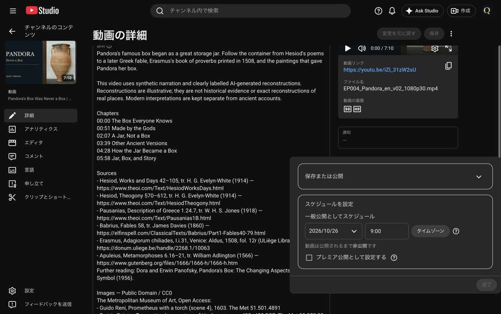
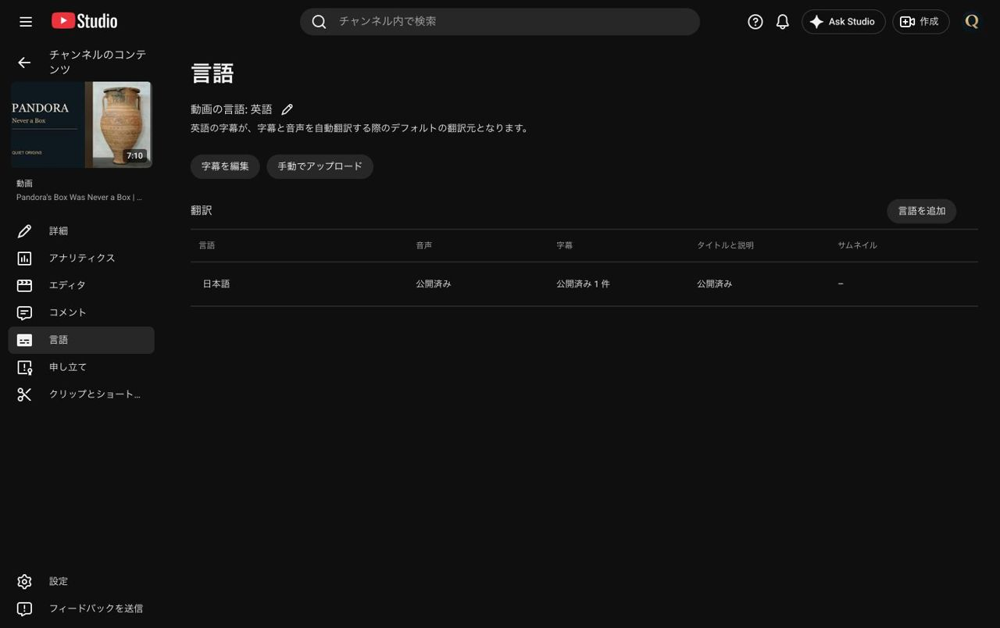

# Quiet Origins 第4話パンドラ 投稿結果（2026-10-23）

Claudeのv02合格 `wom04_Claude確認_v02_20261023.md` と本人の「確認が済みました。依頼通りに予約」により、`wom04_投稿依頼_EP004_20261023.md` に沿って投稿した。

- チャンネル：**Quiet Origins / @QuietOriginsJP / UCfLJOojEY9VB3rvrjICk90Q**
- 動画ID：**`iZl_31zW2sU`**
- URL：https://youtu.be/iZl_31zW2sU
- 公開予約：**2026-10-26（月）09:00 JST（GMT+0900）**
- プレミア公開：オフ。最初は非公開で保存し、全設定・処理完了後に予約を保存。開き直して日時を再確認した。

## 使用した承認済みファイル

Mac `EP004_Pandora/確認版_v02_20261023/deliverables/` の英語MP4、日本語WAV、日英SRT、A01サムネの5ファイル。Release **`421630198`** のSHA256一覧（Asset **`668549344`**）をRESTで取得し、アップロード前に全ファイルのSHA256一致を確認。使ったパス・バイト数・SHA256は `records/posting_EP004_20261023.json`。

## 設定と確認

| 項目 | 確認結果 |
|---|---|
| 英語タイトル | Pandora's Box Was Never a Box \| What the Ancient Sources Say |
| 投稿情報 | `wom04_投稿情報_EP004_確定版_20261023.md` を使用。旧upload_infoは不使用 |
| 英語説明 | **3512文字**、保存後の画面テキストと全文一致 |
| 日本語タイトル | パンドラの箱は、箱ではなかった（翻訳として公開済み） |
| 日本語説明 | 出典・画像の2か所へ英語版の行を展開し **3045文字**。保存後の画面テキストと全文一致、5000文字以内 |
| 動画・タイトルと説明の言語 | 英語 |
| 対象・カテゴリ | 子ども向けではない・教育 |
| 有料プロモーション・AI | 有料プロモーションなし・AI使用「はい」 |
| サムネイル | **EP004_thumbnail_A01.jpg**（ピトス全体） |
| 字幕 | 英語・日本語ともタイムコード付きSRTを追加。各言語の手動字幕「公開済み」を確認 |
| 日本語音声 | **EP004_audio_ja.wav** を1回追加。処理中95%を経て、再読込後の一覧・詳細で **公開済み**。失敗・再登録なし |
| SD / HD・チェック | 両画質処理完了。通知欄「—」、著作権チェックで問題なし |
| 終了画面 | 最新アップロード＋Quiet Origins登録、両方 **6:59:17〜7:09:17（30fps＝419.566667〜429.566667秒）**。保存後に再表示して確認。登録ポップアップはオフ |
| 要素配置 | 第3話からインポート。時刻は末尾10秒へ自動整列されたことを確認。左の余白に配置、右側Qロゴと文字に重ならない |
| チャプター | 非公開再生画面で **00:00 / 00:51 / 02:07 / 03:39 / 04:28 / 05:58 の6章**を確認 |
| 映像のプレビュー | 冒頭、0:47からの共通オープニング（確認画面0:50）、A04の切り出し修正（確認画面0:56）、末尾エンドカードを視認 |

## 確認画面と継続作業

`サムネ確認用/投稿確認_20261023/EP004_*.jpg` に予約日時、音声・字幕・翻訳、終了画面、修正A04とチャプター等を保存。各長辺1280px以下・1MB以下。

本編・ショートの日程全体は `wom_予約変更結果_20261023.md`。この作業で第4話のショートを新規制作・投稿していない。公開後の実視聴環境での表示確認は未来の確認事項。
