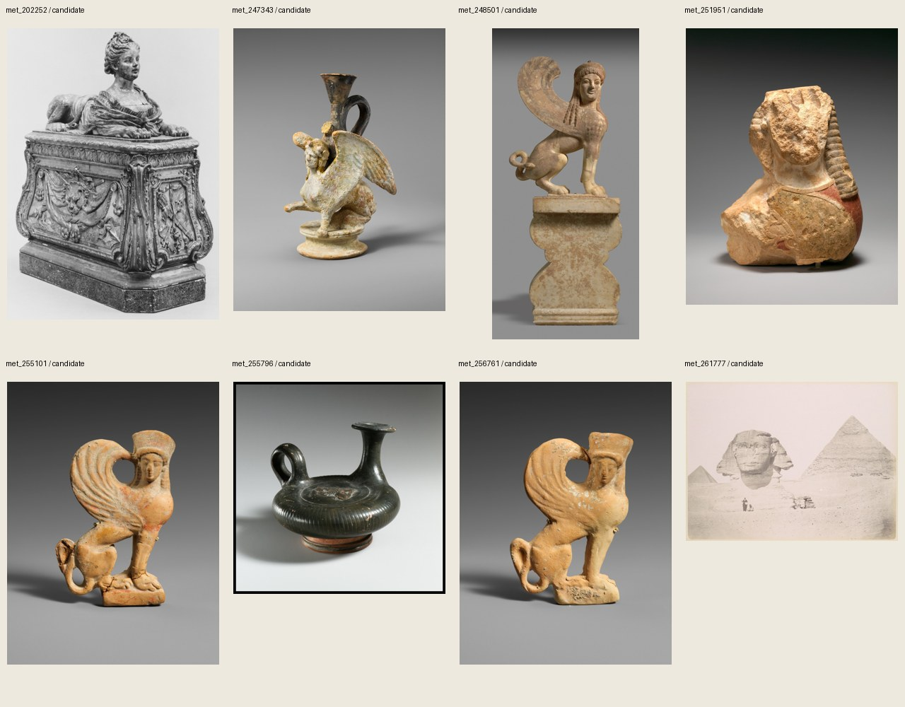
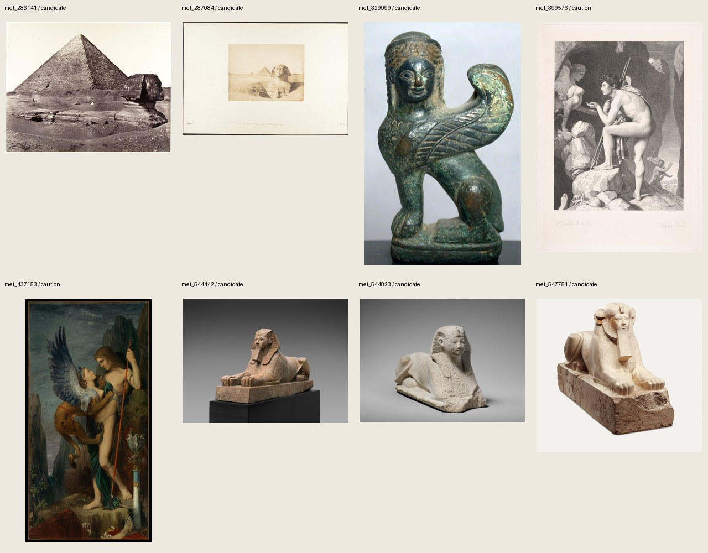
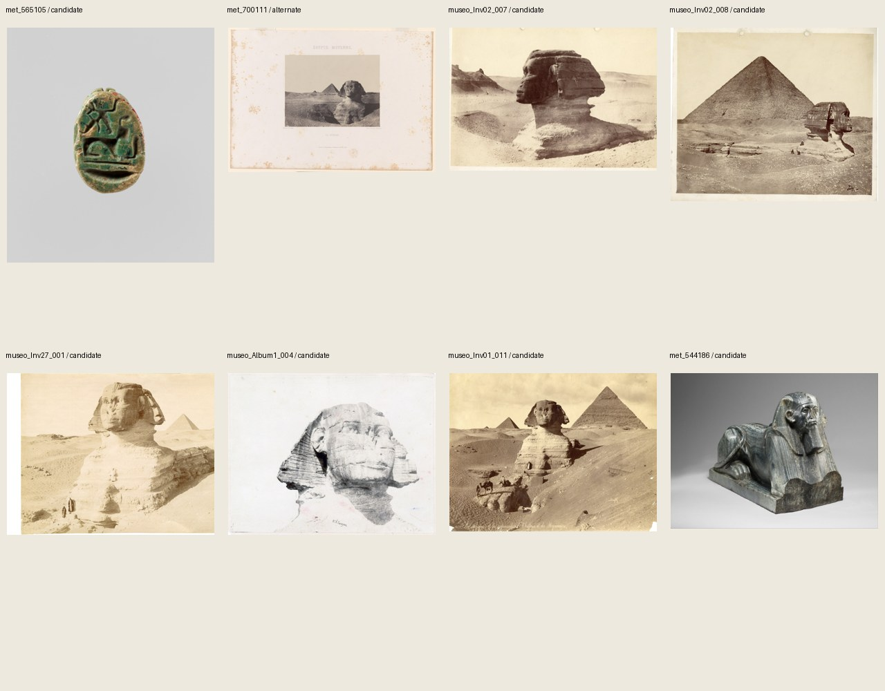
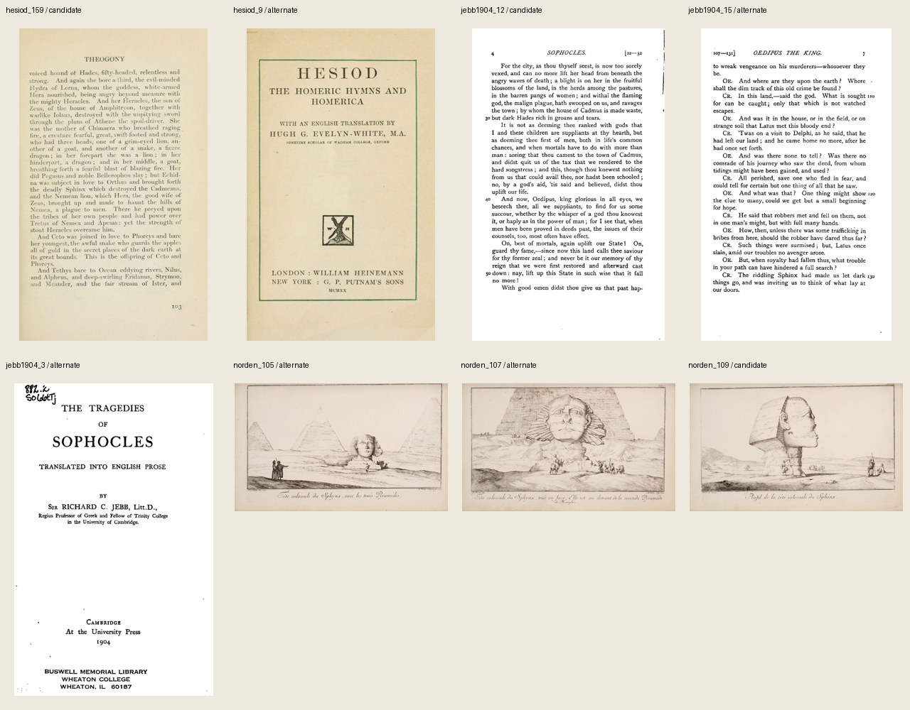

# wom06 スフィンクス：素材候補・Claudeへの引き継ぎ（2026-10-26）

依頼書の **素材調査・原典照合** を実施。動画・音声・AI映像は未制作。台本v01は変更せず、[原典訳文・v02修正案](research/wom06_原典訳文_20261026.md)に照合結果をまとめた。題、オイディプスの扱い、P13の採否は依頼書どおりv02で本人が決める。

## 集計

- 原寸由来の画像 **32枚** を確保。採用候補24、描写に使用注意2、同じ写真・刊本の代替6。重複・代替を数えない候補は **26件（うち使用注意2）**。同一刊本のページ違いも保守的に1件として数えた。
- 所蔵館・提供元のPD/CC0表示を各行に記録。作品番号、取得日、原寸サイズ、SHA-256、URL、用途は[機械可読台帳](research/wom06_素材台帳_20261026.json)に集約。
- 第1〜5話に関係するMD/JSON **758ファイル** の作品URL・Met ID・原寸SHA-256・刊本IDを照合し、一致0。過去の映像全体を目視再点検した結果ではなく、保存記録との照合結果。比較対象一覧も取得記録に保存。
- 原寸は `/Users/ryo/Desktop/新チャンネル/EP006_Sphinx/素材/`。Jebb原本PDF等は同フォルダの `原典照合/`。Gitには縮小JPGと資料だけを入れる。
- 確認JPG32枚＋一覧4枚。全36枚が長辺1280px以下・1MB以下。原寸の存在とSHA-256一致も確認。

## 条件別の充足状況

|依頼|結果|候補・次工程|
|---|---|---|
|S01 冒頭の絵|確保・使用注意|Moreau 1864、met_437153。胸の露出・犠牲者の手足あり。全景を無条件採用しない。|
|S02 ギザ古写真4点以上|充足|この分類で別写真7点。Du Campの2印画は同じ原写真として1点。Museoの北・南の横顔、Met Frith・Bonfilsなどから区間ごとに別写真を選べる。|
|S03 夢の碑|確保|Museo Inv01_011。碑の位置を示せる。文字を読むアップ用には不足。|
|S04 ハトシェプスト|2作品確保|Met 31.3.166／31.3.94。同一像の正面・側面ではない。|
|S05 参道に並ぶ像|未充足|Cleveland 1992.331のCC0表示は確認、画像取得は403。しかも参道全景ではなく2像。別の長い参道のPD画像は未確保。|
|S06 エジプトの小型像等|充足|Met Amenhotep II、スカラベ、Senwosret III。小型は前2点を優先。|
|S07 ヘシオドス旧刊本|確保|1920年再版（訳初版1914）、p.103と扉。本文を優先し扉は代替。|
|S08 墓標の頂部|確保|Met 11.185d,x、前530年頃。|
|S09 翼ある像2点以上|充足|レキュトス、浮彫、板、青銅など。キプロス作品をギリシャ本土出土としない。|
|S10 前5世紀の対面壺絵|該当画像なし・代替あり|条件適合の壺絵は今回未確保。GaillardによるIngres原画の版画1867はS01と別作品だが、裸体・犠牲者があり使用注意。ヴァチカン写真は採用していない。|
|S11 ソフォクレス旧刊本|確保|Jebb 1904のp.4、p.7、扉。依頼例の1887版とは区別。1枚を選ぶ。|
|S12 ノルデン|1780年版の代替確保|Wellcome Library PD図版集、45–47。47の横顔が第一候補。1755/1757年版そのものの画像ではない。|
|S13 『エジプト誌』|未確保|NYPL候補ページの取得ができず、PD表示・図版番号・鼻の状態を一組として照合できなかった。映像素材として採用不可。|
|S14 ローマ・後世|後世の予備1点|Metの18世紀様式のSphinx家具装飾。古代ローマ例ではない。|

## v02への主な申し送り

1. 「現存最古のなぞは後代の作家による」とは断定せず、今回照合したアテナイオスと偽アポロドロスの2文献を名指しする。両者に朝・昼・晩はないが、その言い回しの初出は未確認。
2. Frazerのアポロドロス訳では落下場所は「城塞」。台本の「岩から」はそのまま原典訳として扱えない。
3. ヘロドトスのアンドロスフィンクスは、サイスのアマシス王の造営。ギザを見て命名した証拠ではない。
4. ノルデンの図は鼻の欠損を確認できる。今回の取得版は1780年。マクリーズィーの犯人・年代は原典未確認なので追加しない。
5. 「夢の碑」は王権を語る碑の物語。夢の実在を検証したわけではない。エジプトにも翼ある作例があるので、翼の有無だけで両文化を区別しない。

原文引用・日本語訳・ページ位置・確認の限界は[原典訳文](research/wom06_原典訳文_20261026.md)を参照。

## 一覧

## 個別候補

取得日は全点2026-10-26。サイズは取得JPGのピクセル数。Jebbのみ原本PDFを1800pxでレンダーした派生画像なので、原寸とはPDFを指し、PDF自体のSHA-256は台帳のsource_filesにも記録。原寸画像のURLが後日変わっても、所蔵機関の作品番号から確認できるようにした。

### met_202252 — Sphinx (one of a pair)

- 分類・用途：S14／予備。扱い：candidate。
- 作者：作者未詳。年代：style of 18th century。
- 所蔵・提供：The Metropolitan Museum of Art。作品番号：58.183.1a, b。
- [作品ページ](https://www.metmuseum.org/art/collection/search/202252)／[画像・原本](https://images.metmuseum.org/CRDImages/es/original/167545.jpg)／[権利表示](https://www.metmuseum.org/policies/image-resources)。CC0; official API isPublicDomain=true
- 画像：1364 × 1872px、467,722 bytes。[確認JPG](サムネ確認用/wom06/met_202252.jpg)。
- SHA-256：`3e024791ff186684b4ee26555242aef4e5f6f7f4d9d59ac9405fdb369e60a6e6`
- 注意：18世紀様式のフランス製家具装飾。古代ローマ作例として使わない。

### met_247343 — Terracotta lekythos (oil flask) in the form of a sphinx

- 分類・用途：S09／P09。扱い：candidate。
- 作者：作者未詳。年代：ca. 380–360 BCE。
- 所蔵・提供：The Metropolitan Museum of Art。作品番号：06.1021.180。
- [作品ページ](https://www.metmuseum.org/art/collection/search/247343)／[画像・原本](https://images.metmuseum.org/CRDImages/gr/original/DP229116.jpg)／[権利表示](https://www.metmuseum.org/policies/image-resources)。CC0; official API isPublicDomain=true
- 画像：3000 × 4000px、1,158,402 bytes。[確認JPG](サムネ確認用/wom06/met_247343.jpg)。
- SHA-256：`98595794ef4fea71dd0536d1f14ff286fce66fdd7b4d5a6128db01edcaf40519`
- 注意：ギリシャの翼あるスフィンクス。

### met_248501 — Marble capital and finial in the form of a sphinx

- 分類・用途：S08／P08。扱い：candidate。
- 作者：作者未詳。年代：ca. 530 BCE。
- 所蔵・提供：The Metropolitan Museum of Art。作品番号：11.185d, x。
- [作品ページ](https://www.metmuseum.org/art/collection/search/248501)／[画像・原本](https://images.metmuseum.org/CRDImages/gr/original/DP-19517-001.jpg)／[権利表示](https://www.metmuseum.org/policies/image-resources)。CC0; official API isPublicDomain=true
- 画像：1893 × 4000px、1,584,940 bytes。[確認JPG](サムネ確認用/wom06/met_248501.jpg)。
- SHA-256：`58a4384548febc601266be28d06065ddeffb5a5ce0d4acf8848916441f09db32`
- 注意：墓標頂部。再構成全体ではなく頂部の画像。

### met_251951 — Fragmentary limestone sphinx

- 分類・用途：S09／P12。扱い：candidate。
- 作者：作者未詳。年代：early 6th century BCE。
- 所蔵・提供：The Metropolitan Museum of Art。作品番号：26.13。
- [作品ページ](https://www.metmuseum.org/art/collection/search/251951)／[画像・原本](https://images.metmuseum.org/CRDImages/gr/original/DP271501.jpg)／[権利表示](https://www.metmuseum.org/policies/image-resources)。CC0; official API isPublicDomain=true
- 画像：3066 × 4000px、1,596,649 bytes。[確認JPG](サムネ確認用/wom06/met_251951.jpg)。
- SHA-256：`e478dd9dfcd8d135f290d1b53a12efa0bf07f01f62150115d8b0f65f7c8cfeee`
- 注意：キプロスの断片像。ギリシャ本土出土としない。

### met_255101 — Terracotta relief of a sphinx

- 分類・用途：S09／P09。扱い：candidate。
- 作者：作者未詳。年代：1st half of 5th century BCE。
- 所蔵・提供：The Metropolitan Museum of Art。作品番号：61.11.8。
- [作品ページ](https://www.metmuseum.org/art/collection/search/255101)／[画像・原本](https://images.metmuseum.org/CRDImages/gr/original/DP229258.jpg)／[権利表示](https://www.metmuseum.org/policies/image-resources)。CC0; official API isPublicDomain=true
- 画像：3000 × 4000px、1,212,361 bytes。[確認JPG](サムネ確認用/wom06/met_255101.jpg)。
- SHA-256：`ef4d75b1c01285fd188b7710eb302c849f058160b9d6ec6c11108944287f7c8a`
- 注意：テラコッタ浮彫。256761とは別作品。

### met_255796 — Terracotta guttus (flask with handle and vertical spout)

- 分類・用途：S09／予備。扱い：candidate。
- 作者：作者未詳。年代：3rd century BCE。
- 所蔵・提供：The Metropolitan Museum of Art。作品番号：1983.571.7。
- [作品ページ](https://www.metmuseum.org/art/collection/search/255796)／[画像・原本](https://images.metmuseum.org/CRDImages/gr/original/DP1232.jpg)／[権利表示](https://www.metmuseum.org/policies/image-resources)。CC0; official API isPublicDomain=true
- 画像：2048 × 2048px、403,791 bytes。[確認JPG](サムネ確認用/wom06/met_255796.jpg)。
- SHA-256：`5733e8d32a868b1aefbe7990740e3a89d36466cd7d52f8b28e8167c8f21886b0`
- 注意：器の上面の図像は小さい。顔・翼の視認性を本番レイアウトで確認。

### met_256761 — Terracotta plaque of a sphinx

- 分類・用途：S09／P12。扱い：candidate。
- 作者：作者未詳。年代：1st half of 5th century BCE。
- 所蔵・提供：The Metropolitan Museum of Art。作品番号：X.189。
- [作品ページ](https://www.metmuseum.org/art/collection/search/256761)／[画像・原本](https://images.metmuseum.org/CRDImages/gr/original/DP229136.jpg)／[権利表示](https://www.metmuseum.org/policies/image-resources)。CC0; official API isPublicDomain=true
- 画像：3000 × 4000px、1,187,178 bytes。[確認JPG](サムネ確認用/wom06/met_256761.jpg)。
- SHA-256：`55c0250e642502eb1fb277a7023d3f21b693d3b0779912041d01d01d2f965bfe`
- 注意：テラコッタ板。255101と類似構図だが別作品。

### met_261777 — Pyramides et le Sphinx

- 分類・用途：S02／P01。扱い：candidate。
- 作者：Félix Bonfils。年代：1860s–70s, printed ca. 1870。
- 所蔵・提供：The Metropolitan Museum of Art。作品番号：1976.561.2。
- [作品ページ](https://www.metmuseum.org/art/collection/search/261777)／[画像・原本](https://images.metmuseum.org/CRDImages/ph/original/DP113869.jpg)／[権利表示](https://www.metmuseum.org/policies/image-resources)。CC0; official API isPublicDomain=true
- 画像：3833 × 2871px、1,412,551 bytes。[確認JPG](サムネ確認用/wom06/met_261777.jpg)。
- SHA-256：`e5eb10e11c30829432c74c3b514d85a81f926a3bc6bcdddadf611affb358222d`
- 注意：ギザの古写真。

### met_286141 — The Great Pyramid and The Great Sphinx

- 分類・用途：S02／P03。扱い：candidate。
- 作者：Francis Frith。年代：1858。
- 所蔵・提供：The Metropolitan Museum of Art。作品番号：2005.100.555。
- [作品ページ](https://www.metmuseum.org/art/collection/search/286141)／[画像・原本](https://images.metmuseum.org/CRDImages/ph/original/DP132062.jpg)／[権利表示](https://www.metmuseum.org/policies/image-resources)。CC0; official API isPublicDomain=true
- 画像：3686 × 2901px、2,896,919 bytes。[確認JPG](サムネ確認用/wom06/met_286141.jpg)。
- SHA-256：`2d34b04ef65f0e1ea229f1202e1e1add840ad9fb0dcaa7bc54537f21a4437036`
- 注意：ギザの古写真。

### met_287084 — Vue du grand Sphinx et de la grande pyramide de Menkazeh (Mycerinus)

- 分類・用途：S02／P14。扱い：candidate。
- 作者：Maxime Du Camp。年代：December 1849。
- 所蔵・提供：The Metropolitan Museum of Art。作品番号：2005.100.376.20。
- [作品ページ](https://www.metmuseum.org/art/collection/search/287084)／[画像・原本](https://images.metmuseum.org/CRDImages/ph/original/DP131835.jpg)／[権利表示](https://www.metmuseum.org/policies/image-resources)。CC0; official API isPublicDomain=true
- 画像：3816 × 2599px、963,561 bytes。[確認JPG](サムネ確認用/wom06/met_287084.jpg)。
- SHA-256：`ac5ef92d1eb08689dd128347307b63693a488283ac77adc9b718f6ab4c9f39fe`
- 注意：700111と同じ原写真の別印画と判断。どちらか1枚のみ。

### met_329999 — Bronze sphinx

- 分類・用途：S09／予備。扱い：candidate。
- 作者：作者未詳。年代：late 6th century–early 5th century  BCE。
- 所蔵・提供：The Metropolitan Museum of Art。作品番号：2021.40.14。
- [作品ページ](https://www.metmuseum.org/art/collection/search/329999)／[画像・原本](https://images.metmuseum.org/CRDImages/gr/original/KN216d.jpg)／[権利表示](https://www.metmuseum.org/policies/image-resources)。CC0; official API isPublicDomain=true
- 画像：922 × 1431px、187,240 bytes。[確認JPG](サムネ確認用/wom06/met_329999.jpg)。
- SHA-256：`838e03582a8e67a23f3487f7fb9cb77a34d9e7d0c51a619a4a7e695111726f9a`
- 注意：青銅製。翼の形が明瞭。

### met_399576 — Oedipus and the Sphinx, after Ingres

- 分類・用途：S10／P10。扱い：caution。
- 作者：Claude-Ferdinand Gaillard。年代：1867。
- 所蔵・提供：The Metropolitan Museum of Art。作品番号：2012.136.485。
- [作品ページ](https://www.metmuseum.org/art/collection/search/399576)／[画像・原本](https://images.metmuseum.org/CRDImages/dp/original/DP832867.jpg)／[権利表示](https://www.metmuseum.org/policies/image-resources)。CC0; official API isPublicDomain=true
- 画像：1267 × 1759px、1,767,191 bytes。[確認JPG](サムネ確認用/wom06/met_399576.jpg)。
- SHA-256：`ea368fd595ead3b2fa91eaad3b66bc0e578f92481c9af5600488be2bb13e9fa0`
- 注意：使用注意：男性裸体が中心、下部に犠牲者の身体。採用前に画角判断。

### met_437153 — Oedipus and the Sphinx

- 分類・用途：S01／P01。扱い：caution。
- 作者：Gustave Moreau。年代：1864。
- 所蔵・提供：The Metropolitan Museum of Art。作品番号：21.134.1。
- [作品ページ](https://www.metmuseum.org/art/collection/search/437153)／[画像・原本](https://images.metmuseum.org/CRDImages/ep/original/DP-14201-023.jpg)／[権利表示](https://www.metmuseum.org/policies/image-resources)。CC0; official API isPublicDomain=true
- 画像：2072 × 4000px、2,200,951 bytes。[確認JPG](サムネ確認用/wom06/met_437153.jpg)。
- SHA-256：`7ad53fd51bbe0ba88d81f5558b7791b2d69e57d9e05d73ae89acb189c3dc7b82`
- 注意：使用注意：胸の露出、オイディプスの身体、画面下部に犠牲者の手足。

### met_544442 — Sphinx of Hatshepsut

- 分類・用途：S04／P04。扱い：candidate。
- 作者：作者未詳。年代：ca. 1473–1458 BCE。
- 所蔵・提供：The Metropolitan Museum of Art。作品番号：31.3.166。
- [作品ページ](https://www.metmuseum.org/art/collection/search/544442)／[画像・原本](https://images.metmuseum.org/CRDImages/eg/original/DP-24216-003.jpg)／[権利表示](https://www.metmuseum.org/policies/image-resources)。CC0; official API isPublicDomain=true
- 画像：4000 × 3000px、2,683,480 bytes。[確認JPG](サムネ確認用/wom06/met_544442.jpg)。
- SHA-256：`b310c767bf42fac4f33bcd28b8e609b12bcca2559bb8c70a3af39ff2fc55ad56`
- 注意：花崗岩。王の頭巾・儀礼用あごひげ。547751は別作品。

### met_544823 — Sphinx of Amenhotep II

- 分類・用途：S06／P06。扱い：candidate。
- 作者：作者未詳。年代：ca. 1427–1396 BCE。
- 所蔵・提供：The Metropolitan Museum of Art。作品番号：30.8.72。
- [作品ページ](https://www.metmuseum.org/art/collection/search/544823)／[画像・原本](https://images.metmuseum.org/CRDImages/eg/original/DP136532.jpg)／[権利表示](https://www.metmuseum.org/policies/image-resources)。CC0; official API isPublicDomain=true
- 画像：3877 × 2897px、1,562,212 bytes。[確認JPG](サムネ確認用/wom06/met_544823.jpg)。
- SHA-256：`8ac7f0fe7e619831c84b2a9fbaedf10757a0ab63a973f295e2f249d6f85dbdd6`
- 注意：アメンホテプ2世。

### met_547751 — Sphinx of Hatshepsut

- 分類・用途：S04／予備。扱い：candidate。
- 作者：作者未詳。年代：ca. 1473–1458 BCE。
- 所蔵・提供：The Metropolitan Museum of Art。作品番号：31.3.94。
- [作品ページ](https://www.metmuseum.org/art/collection/search/547751)／[画像・原本](https://images.metmuseum.org/CRDImages/eg/original/21V_CAT089R3.jpg)／[権利表示](https://www.metmuseum.org/policies/image-resources)。CC0; official API isPublicDomain=true
- 画像：2113 × 1949px、584,379 bytes。[確認JPG](サムネ確認用/wom06/met_547751.jpg)。
- SHA-256：`b9fcaa2414f80cedb1ccc05d46718837d8e3c8c9c34dfc215ac6979f6784ca25`
- 注意：石灰岩の別作品。同一作品の別アングルではない。

### met_565105 — Scarab with the Representation of a Sphinx

- 分類・用途：S06／P12。扱い：candidate。
- 作者：作者未詳。年代：ca. 1200–945 BCE。
- 所蔵・提供：The Metropolitan Museum of Art。作品番号：09.180.998。
- [作品ページ](https://www.metmuseum.org/art/collection/search/565105)／[画像・原本](https://images.metmuseum.org/CRDImages/eg/original/DP-22281-004.jpg)／[権利表示](https://www.metmuseum.org/policies/image-resources)。CC0; official API isPublicDomain=true
- 画像：3535 × 4000px、1,113,795 bytes。[確認JPG](サムネ確認用/wom06/met_565105.jpg)。
- SHA-256：`b0fc5cbf6a53d5278fa6746690fcd7e22d7938e47c6314f88297d3ae6cc76f5a`
- 注意：小型スカラベ。

### met_700111 — Égypte Moyenne, Le Sphinx

- 分類・用途：S02／代替のみ。扱い：alternate。
- 作者：Maxime Du Camp。年代：December 1849, printed 1852。
- 所蔵・提供：The Metropolitan Museum of Art。作品番号：2015.778.35。
- [作品ページ](https://www.metmuseum.org/art/collection/search/700111)／[画像・原本](https://images.metmuseum.org/CRDImages/ph/original/DP-2597-215.jpg)／[権利表示](https://www.metmuseum.org/policies/image-resources)。CC0; official API isPublicDomain=true
- 画像：3808 × 2658px、2,043,504 bytes。[確認JPG](サムネ確認用/wom06/met_700111.jpg)。
- SHA-256：`f9cd35022ab9ad1755f7faa0411621ef4fe5ce70763722c907cf498b9ad30194`
- 注意：287084と同じ原写真の別印画。二重使用・二重点数算入をしない。

### museo_Inv02_007 — Great Sphinx of Giza — Inv02_007

- 分類・用途：S02／P03。扱い：candidate。
- 作者：作者未詳（V. R. Lanzone帰属の可能性）。年代：1875。
- 所蔵・提供：Archivio Museo Egizio, Torino。作品番号：Inv02_007。
- [作品ページ](https://archiviofotografico.museoegizio.it/en/archive/giza/sphynx-and-funerary-temple-of-khafre/19th-century-pictures/#INV02_007)／[画像・原本](https://archiviofotografico.museoegizio.it/data/media/STORICO/4-giza/sfinge-e-tempio-funerario-chefren/fotografie-ottocentesche/31E7208687C7D7AD927B5237485D8C23/Inv02_007.std_full.jpg)／[権利表示](https://archiviofotografico.museoegizio.it/en/section/How-to-use-the-Archive/Policy-on-access-and-use/)。CC0; official individual photograph label and archive policy
- 画像：5280 × 3647px、2,686,325 bytes。[確認JPG](サムネ確認用/wom06/museo_Inv02_007.jpg)。
- SHA-256：`16418391b7220a25e0daf80aa69dbda9a6a3b20aa89c8e93e7366047c8ab9b04`
- 注意：古写真の作者帰属・年代は所蔵館の表記に従う。

### museo_Inv02_008 — Great Sphinx of Giza — Inv02_008

- 分類・用途：S02／P14。扱い：candidate。
- 作者：R. V. Lanzone?。年代：1865–1870。
- 所蔵・提供：Archivio Museo Egizio, Torino。作品番号：Inv02_008。
- [作品ページ](https://archiviofotografico.museoegizio.it/en/archive/giza/sphynx-and-funerary-temple-of-khafre/19th-century-pictures/#INV02_008)／[画像・原本](https://archiviofotografico.museoegizio.it/data/media/STORICO/4-giza/sfinge-e-tempio-funerario-chefren/fotografie-ottocentesche/CEA906C8C731D9BC576DFB7A122C2E79/Inv02_008.std_full.jpg)／[権利表示](https://archiviofotografico.museoegizio.it/en/section/How-to-use-the-Archive/Policy-on-access-and-use/)。CC0; official individual photograph label and archive policy
- 画像：6031 × 5055px、4,492,539 bytes。[確認JPG](サムネ確認用/wom06/museo_Inv02_008.jpg)。
- SHA-256：`999ec919a222dde0646fe7bb1f17d029a1c91962fb96ba7f670eacd922943cb9`
- 注意：古写真の作者帰属・年代は所蔵館の表記に従う。

### museo_Inv27_001 — Great Sphinx of Giza — Inv27_001

- 分類・用途：S02／P12。扱い：candidate。
- 作者：C. Zangaki, G. Zangaki。年代：1870。
- 所蔵・提供：Archivio Museo Egizio, Torino。作品番号：Inv27_001。
- [作品ページ](https://archiviofotografico.museoegizio.it/en/archive/giza/sphynx-and-funerary-temple-of-khafre/19th-century-pictures/#INV27_001)／[画像・原本](https://archiviofotografico.museoegizio.it/data/media/STORICO/4-giza/sfinge-e-tempio-funerario-chefren/fotografie-ottocentesche/CA4C4A1B45F3D06559B494C2585F800D/Inv27_001.std_full.jpg)／[権利表示](https://archiviofotografico.museoegizio.it/en/section/How-to-use-the-Archive/Policy-on-access-and-use/)。CC0; official individual photograph label and archive policy
- 画像：6600 × 5144px、6,381,954 bytes。[確認JPG](サムネ確認用/wom06/museo_Inv27_001.jpg)。
- SHA-256：`e9eafbd87e47a27c69551a5ddb4f9c9d0dd0bded07229dc7939409cabe620bb4`
- 注意：古写真の作者帰属・年代は所蔵館の表記に従う。

### museo_Album1_004 — Great Sphinx of Giza — Album1_004

- 分類・用途：S02／P03。扱い：candidate。
- 作者：V. R. Lanzone。年代：1865–1870。
- 所蔵・提供：Archivio Museo Egizio, Torino。作品番号：Album1_004。
- [作品ページ](https://archiviofotografico.museoegizio.it/en/archive/giza/sphynx-and-funerary-temple-of-khafre/19th-century-pictures/#ALBUM1_004)／[画像・原本](https://archiviofotografico.museoegizio.it/data/media/STORICO/4-giza/sfinge-e-tempio-funerario-chefren/fotografie-ottocentesche/F892CBEB7AF3A8B06788DF394DC7393A/Album1_004.std_full.jpg)／[権利表示](https://archiviofotografico.museoegizio.it/en/section/How-to-use-the-Archive/Policy-on-access-and-use/)。CC0; official individual photograph label and archive policy
- 画像：14363 × 11220px、13,812,103 bytes。[確認JPG](サムネ確認用/wom06/museo_Album1_004.jpg)。
- SHA-256：`1569dc7e18808e46d02ab4c16c808d880eeff72748d79fac7d15b768d39315d8`
- 注意：頭部のみの切り抜き・白背景風の歴史写真。台地全景用にはしない。

### museo_Inv01_011 — Great Sphinx of Giza — Inv01_011

- 分類・用途：S03／P05。扱い：candidate。
- 作者：F. Bonfils。年代：1875–1877。
- 所蔵・提供：Archivio Museo Egizio, Torino。作品番号：Inv01_011。
- [作品ページ](https://archiviofotografico.museoegizio.it/en/archive/giza/sphynx-and-funerary-temple-of-khafre/19th-century-pictures/#INV01_011)／[画像・原本](https://archiviofotografico.museoegizio.it/data/media/STORICO/4-giza/sfinge-e-tempio-funerario-chefren/fotografie-ottocentesche/1224DF21343752E4512E0C043B12FF8C/Inv01_011.std_full.jpg)／[権利表示](https://archiviofotografico.museoegizio.it/en/section/How-to-use-the-Archive/Policy-on-access-and-use/)。CC0; official individual photograph label and archive policy
- 画像：6529 × 4976px、6,073,046 bytes。[確認JPG](サムネ確認用/wom06/museo_Inv01_011.jpg)。
- SHA-256：`f20baaef0267f64fc73409a8b7572a56d9a13509af88fa7d18d29b98436abc34`
- 注意：夢の碑の位置が見える。碑面の文字を読む用途には不足。

### met_544186 — Senwosret III as a Sphinx

- 分類・用途：S06／P02。扱い：candidate。
- 作者：作者未詳。年代：ca. 1878–1840 B.C.。
- 所蔵・提供：The Metropolitan Museum of Art。作品番号：17.9.2。
- [作品ページ](https://www.metmuseum.org/art/collection/search/544186)／[画像・原本](https://images.metmuseum.org/CRDImages/eg/original/DP247658.jpg)／[権利表示](https://www.metmuseum.org/policies/image-resources)。CC0; official API isPublicDomain=true
- 画像：3913 × 2931px、1,893,461 bytes。[確認JPG](サムネ確認用/wom06/met_544186.jpg)。
- SHA-256：`5723f81c291323d00d7108f3e9ac9135d60665c23ea580f885af57e284a75253`
- 注意：センウセレト3世。S04と別の王・作品。

### hesiod_159 — Hesiod, The Homeric Hymns and Homerica — p.103, Theogony 326付近

- 分類・用途：S07／P07。扱い：candidate。
- 作者：Hugh G. Evelyn-White（英訳）。年代：1920（初版1914の再版）。
- 所蔵・提供：University of California Libraries / Internet Archive。作品番号：hesiodhomerichym00hesi。
- [作品ページ](https://archive.org/details/hesiodhomerichym00hesi/page/n159/mode/1up)／[画像・原本](https://iiif.archive.org/iiif/hesiodhomerichym00hesi$159/full/full/0/default.jpg)／[権利表示](https://archive.org/metadata/hesiodhomerichym00hesi)。所蔵館提供メタデータ possible-copyright-status: NOT_IN_COPYRIGHT
- 画像：1487 × 2470px、406,952 bytes。[確認JPG](サムネ確認用/wom06/hesiod_159.jpg)。
- SHA-256：`6fe99e3460e7a66ae5d2b9904b61e198d38e964578a5ed7ac3ad60ce30440705`
- 注意：同じ刊本の扉と本文。区間を分けた使い回しを避け、どちらか選ぶ。

### hesiod_9 — Hesiod, The Homeric Hymns and Homerica — 扉

- 分類・用途：S07／P07。扱い：alternate。
- 作者：Hugh G. Evelyn-White（英訳）。年代：1920（初版1914の再版）。
- 所蔵・提供：University of California Libraries / Internet Archive。作品番号：hesiodhomerichym00hesi。
- [作品ページ](https://archive.org/details/hesiodhomerichym00hesi/page/n9/mode/1up)／[画像・原本](https://iiif.archive.org/iiif/hesiodhomerichym00hesi$9/full/full/0/default.jpg)／[権利表示](https://archive.org/metadata/hesiodhomerichym00hesi)。所蔵館提供メタデータ possible-copyright-status: NOT_IN_COPYRIGHT
- 画像：1487 × 2470px、261,745 bytes。[確認JPG](サムネ確認用/wom06/hesiod_9.jpg)。
- SHA-256：`ae260e37d67d48ce31473387e7123c42267fe77727c8aa7f454398a3cfdaf48c`
- 注意：同じ刊本の扉と本文。区間を分けた使い回しを避け、どちらか選ぶ。

### jebb1904_12 — The Tragedies of Sophocles — p.4, lines 22–52

- 分類・用途：S11／P10。扱い：candidate。
- 作者：Richard C. Jebb（英訳）。年代：1904。
- 所蔵・提供：Online Library of Liberty / 原本 Buswell Memorial Library。作品番号：OLL title 1155。
- [作品ページ](https://oll.libertyfund.org/titles/jebb-the-tragedies-of-sophocles)／[画像・原本](https://oll-resources.s3.us-east-2.amazonaws.com/oll3/store/titles/1155/0561_Bk.pdf)／[権利表示](https://oll-resources.s3.us-east-2.amazonaws.com/oll3/store/titles/1155/Sophocles_0561_EBk_v6.0.pdf)。提供元のCopyright Information: The text is in the public domain.（PDF p.3）
- 画像：1109 × 1800px、323,036 bytes。[確認JPG](サムネ確認用/wom06/jebb1904_12.jpg)。
- SHA-256：`f23619aff5fc77cb0db9a14e4a3d39fdb84b1d64fa0d987ae37b3294dd83553f`
- 注意：原寸ファイルは別保存した原本PDF。これはPDF 12ページ目の1800pxレンダー。原本スキャンを使用し、現代の再組版・ロゴ頁は素材にしない。同一刊本から1枚選択。

### jebb1904_15 — The Tragedies of Sophocles — p.7, lines 107–131

- 分類・用途：S11／P10。扱い：alternate。
- 作者：Richard C. Jebb（英訳）。年代：1904。
- 所蔵・提供：Online Library of Liberty / 原本 Buswell Memorial Library。作品番号：OLL title 1155。
- [作品ページ](https://oll.libertyfund.org/titles/jebb-the-tragedies-of-sophocles)／[画像・原本](https://oll-resources.s3.us-east-2.amazonaws.com/oll3/store/titles/1155/0561_Bk.pdf)／[権利表示](https://oll-resources.s3.us-east-2.amazonaws.com/oll3/store/titles/1155/Sophocles_0561_EBk_v6.0.pdf)。提供元のCopyright Information: The text is in the public domain.（PDF p.3）
- 画像：1098 × 1800px、292,808 bytes。[確認JPG](サムネ確認用/wom06/jebb1904_15.jpg)。
- SHA-256：`f333de3b74daf2333776bff37759d978633ce80102c374ae8fc4c13669a1b3f2`
- 注意：原寸ファイルは別保存した原本PDF。これはPDF 15ページ目の1800pxレンダー。原本スキャンを使用し、現代の再組版・ロゴ頁は素材にしない。同一刊本から1枚選択。

### jebb1904_3 — The Tragedies of Sophocles — 扉

- 分類・用途：S11／P10。扱い：alternate。
- 作者：Richard C. Jebb（英訳）。年代：1904。
- 所蔵・提供：Online Library of Liberty / 原本 Buswell Memorial Library。作品番号：OLL title 1155。
- [作品ページ](https://oll.libertyfund.org/titles/jebb-the-tragedies-of-sophocles)／[画像・原本](https://oll-resources.s3.us-east-2.amazonaws.com/oll3/store/titles/1155/0561_Bk.pdf)／[権利表示](https://oll-resources.s3.us-east-2.amazonaws.com/oll3/store/titles/1155/Sophocles_0561_EBk_v6.0.pdf)。提供元のCopyright Information: The text is in the public domain.（PDF p.3）
- 画像：1144 × 1800px、118,912 bytes。[確認JPG](サムネ確認用/wom06/jebb1904_3.jpg)。
- SHA-256：`067d8773c8328945e712e84983d0dd3c8e735aa17a4840b3d9ebfee14d012db3`
- 注意：原寸ファイルは別保存した原本PDF。これはPDF 3ページ目の1800pxレンダー。原本スキャンを使用し、現代の再組版・ロゴ頁は素材にしない。同一刊本から1枚選択。

### norden_105 — Norden: Sphinx — plate XLV (45)

- 分類・用途：S12／P13。扱い：alternate。
- 作者：F. L. Norden（原画）, M. Tuscher（版画）。年代：1780年刊（図版45に原画1737の署名）。
- 所蔵・提供：Wellcome Library / Internet Archive。作品番号：b33543975。
- [作品ページ](https://archive.org/details/b33543975/page/n105/mode/1up)／[画像・原本](https://iiif.archive.org/iiif/b33543975$105/full/full/0/default.jpg)／[権利表示](https://archive.org/metadata/b33543975)。Wellcome Library明記 Public Domain Mark 1.0
- 画像：9793 × 5880px、4,893,670 bytes。[確認JPG](サムネ確認用/wom06/norden_105.jpg)。
- SHA-256：`08977699d19359cc545c8d468903b91e3000e49d22110f2d5a7f6ca1429be71e`
- 注意：1755/1757版そのものではなく1780年の図版集。横顔47は鼻の突出部欠損が明瞭。1枚を選び他は比較用。

### norden_107 — Norden: Sphinx — plate XLVI (46)

- 分類・用途：S12／P13。扱い：alternate。
- 作者：F. L. Norden（原画）, M. Tuscher（版画）。年代：1780年刊（図版45に原画1737の署名）。
- 所蔵・提供：Wellcome Library / Internet Archive。作品番号：b33543975。
- [作品ページ](https://archive.org/details/b33543975/page/n107/mode/1up)／[画像・原本](https://iiif.archive.org/iiif/b33543975$107/full/full/0/default.jpg)／[権利表示](https://archive.org/metadata/b33543975)。Wellcome Library明記 Public Domain Mark 1.0
- 画像：9793 × 5880px、7,685,055 bytes。[確認JPG](サムネ確認用/wom06/norden_107.jpg)。
- SHA-256：`b42c9784e58c9329b9abf25c470ca7221113e5124589e98f5f1aec3eda902be2`
- 注意：1755/1757版そのものではなく1780年の図版集。横顔47は鼻の突出部欠損が明瞭。1枚を選び他は比較用。

### norden_109 — Norden: Sphinx — plate XLVII (47)

- 分類・用途：S12／P13。扱い：candidate。
- 作者：F. L. Norden（原画）, M. Tuscher（版画）。年代：1780年刊（図版45に原画1737の署名）。
- 所蔵・提供：Wellcome Library / Internet Archive。作品番号：b33543975。
- [作品ページ](https://archive.org/details/b33543975/page/n109/mode/1up)／[画像・原本](https://iiif.archive.org/iiif/b33543975$109/full/full/0/default.jpg)／[権利表示](https://archive.org/metadata/b33543975)。Wellcome Library明記 Public Domain Mark 1.0
- 画像：9793 × 5880px、5,199,881 bytes。[確認JPG](サムネ確認用/wom06/norden_109.jpg)。
- SHA-256：`07427ce8358a4506f19f882032d61f45a4b2fc7873b0ca7512af729ae25e129d`
- 注意：1755/1757版そのものではなく1780年の図版集。横顔47は鼻の突出部欠損が明瞭。1枚を選び他は比較用。

## 除外・未取得

- Met 553423、553456、558682、558683：APIでPD公開画像を確認できないため除外。作品解説を事実確認に使うことと、画像を動画に使うことは別。
- Cleveland 1992.331：作品頁のCC0は確認したが、原寸画像の取得が403。ダウンロード成功数・SHA-256検証数には含めない。
- 『エジプト誌』と前5世紀の対面壺絵：今回の条件に合う取得画像なし。探索結果を「存在しない」という美術史上の主張にしない。

## AI候補・次の制作工程

依頼どおり候補の記録だけ。P03の遠景、P05の砂と夕方の光、P07またはP10の翼の影、P14の別構図の夕暮れを保持する。実物資料で足りる区間も多いため、Claudeのv02と制作依頼で本数を決める。今回生成・購入・Klingクレジット消費はない。

本制作時は全ショットを同じ形式で再エンコードし、確認版を先頭から連続再生する。今回素材調査では動画エンコード・連続再生試験は実施していない。
