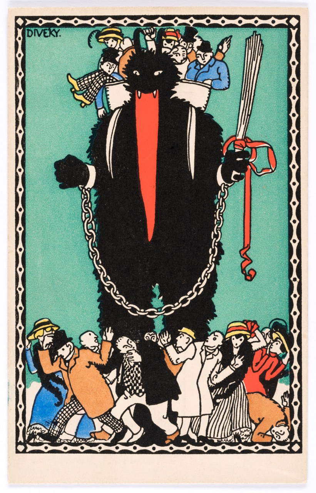
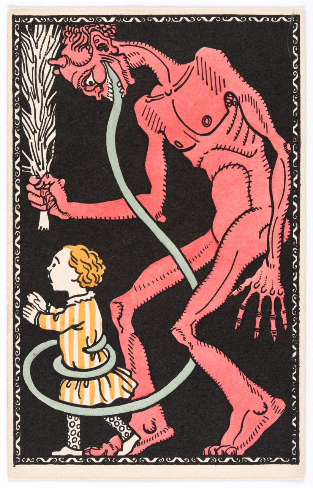
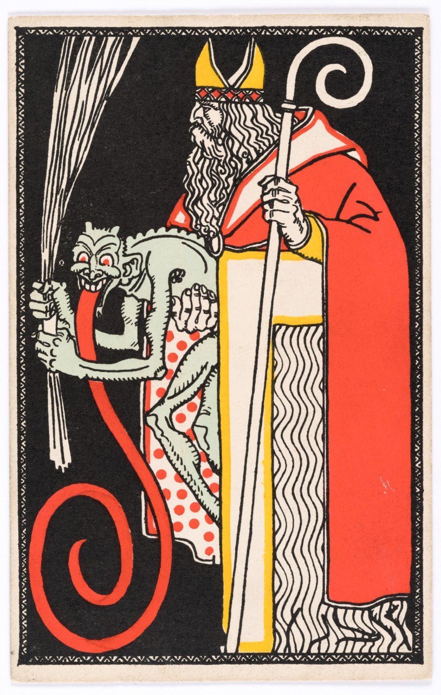
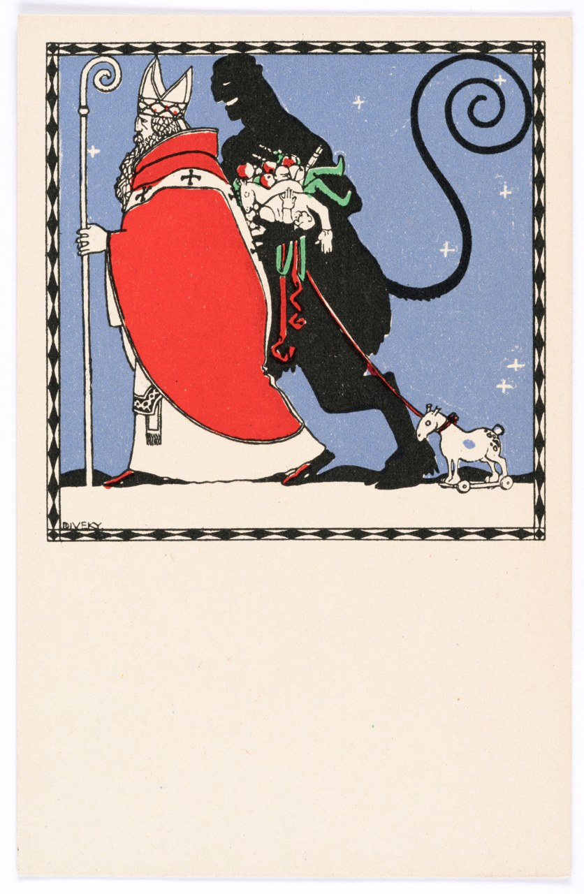

# wom10 クランプス 素材候補（2026-11-02）

状態：一次共有。**原寸保存・権利確認済み4点、全点カラーの絵葉書。目安25点以上／絵葉書12点以上には未達。** K01・K03・K06の候補を先行共有。K02の文字付き絵葉書・冗談の実物は引き続き確認する。

原寸保存先：`/Volumes/ESD-02/新チャンネル/EP010_Krampus/素材/`。指定SSDの実在と4ファイルの読み出しを確認。原寸はGitに入れない。縮小JPGは長辺1280px以下、各1MB以下。

[確認用一覧](サムネ確認用/wom10/一覧_01.jpg)／[機械可読台帳](research/wom10_素材台帳_20261102.json)／[原典照合13項目](research/wom10_原典訳文_20261102.md)

## 保存済み候補

### K01a — Postkarte der Wiener Werkstätte Nr. 247: Krampuskarte

- 作者：Josef (József) von Divéky（没年：1951）。年代：1909。所蔵：Wien Museum。作品番号：101968/101。
- [作品ページ](https://sammlung.wienmuseum.at/objekt/178961/)／[館の利用条件](https://sammlung.wienmuseum.at/ueber-uns/)。画像：**CC0**。写真：TimTom/L.Hilzensauer。取得日：2026-11-02。
- 原寸：3500×5460px、8,055,614 bytes。カラー／Farblithografie / 多色石版。
- 原寸：`/Volumes/ESD-02/新チャンネル/EP010_Krampus/素材/WM178961_front_original.jpg`
- SHA-256：`794be9692907c6206b32691880ce9567ffbe492885308637fd960ca06266a7a7`
- 使用候補：P01・サムネ。長い舌・鎖。子どもを背負う表現あり。子どもへの打撃は見えない。顔の恐怖表現と子どもの扱いに注意。
- 文字：表面にGruß vom Krampus等の文言なし。翻訳対象の挨拶文なし。
- 冗談の判定：子どもに追い払われるという描写は確認できない。

### K03a — Postkarte der Wiener Werkstätte Nr. 542: Krampuskarte

- 作者：不明（没年：未詳）。年代：1911。所蔵：Wien Museum。作品番号：101968/147。
- [作品ページ](https://sammlung.wienmuseum.at/objekt/179029/)／[館の利用条件](https://sammlung.wienmuseum.at/ueber-uns/)。画像：**CC0**。写真：TimTom/L.Hilzensauer。取得日：2026-11-02。
- 原寸：3500×5435px、8,040,893 bytes。カラー／Farblithografie / 多色石版。
- 原寸：`/Volumes/ESD-02/新チャンネル/EP010_Krampus/素材/WM179029_front_original.jpg`
- SHA-256：`994b83704d16255c010dc9f93ed2e93ab26f2eb192f6594e8bb1d11571261472`
- 使用候補：P08。枝束・舌・角。子どものすぐ後ろに立つ。打撃は描かれていないが威嚇として読める。冗談の具体例にはしない。
- 文字：表面にGruß vom Krampus等の文言なし。翻訳対象の挨拶文なし。
- 冗談の判定：子どもに追い払われるという描写は確認できない。

### K06a — Postkarte der Wiener Werkstätte Nr. 541: Nikolo und Krampuskarte

- 作者：不明（没年：未詳）。年代：1911。所蔵：Wien Museum。作品番号：101968/146。
- [作品ページ](https://sammlung.wienmuseum.at/objekt/179028/)／[館の利用条件](https://sammlung.wienmuseum.at/ueber-uns/)。画像：**CC0**。写真：TimTom/L.Hilzensauer。取得日：2026-11-02。
- 原寸：3500×5505px、7,405,177 bytes。カラー／Farblithografie / 多色石版。
- 原寸：`/Volumes/ESD-02/新チャンネル/EP010_Krampus/素材/WM179028_front_original.jpg`
- SHA-256：`f1b3eb5e88146941209b856291936c6b0a57fb5b5cd4040a20dabc43cbc987a1`
- 使用候補：P02・P05。聖人と悪魔の組合せ。枝束あり。これ自体は16〜17世紀の証拠ではない。
- 文字：表面にGruß vom Krampus等の文言なし。翻訳対象の挨拶文なし。
- 冗談の判定：子どもに追い払われるという描写は確認できない。

### K06b — Postkarte der Wiener Werkstätte Nr. 238: Nikolo und Krampuskarte

- 作者：Josef (József) von Divéky（没年：1951）。年代：1909。所蔵：Wien Museum。作品番号：311065。
- [作品ページ](https://sammlung.wienmuseum.at/objekt/2216650/)／[館の利用条件](https://sammlung.wienmuseum.at/ueber-uns/)。画像：**CC0**。写真：TimTom/L.Hilzensauer。取得日：2026-11-02。
- 原寸：3500×5358px、6,118,480 bytes。カラー／Farblithografie / 多色石版。
- 原寸：`/Volumes/ESD-02/新チャンネル/EP010_Krampus/素材/WM2216650_front_original.jpg`
- SHA-256：`1bdceffd207b3ce308b282ce2761c9549dfaaf99301a5b163735a14c2f1a686e`
- 使用候補：P02・P05の別候補。小さな犬、ニコラウスとクランプス。大きな体罰描写なし。
- 文字：表面にGruß vom Krampus等の文言なし。翻訳対象の挨拶文なし。
- 冗談の判定：子どもに追い払われるという描写は確認できない。

## 選外・不足

- WM180840（WW760、Jutta Sika、1912）：Auf Anfrage（要問い合わせ）。明示CC0ではないので使用不可。
- WM192595（WW891、Arnold Nechansky、1912）：CC0だが、男女の求愛風の絵なので選定外。
- Wien Museumの立体玩具写真（WM1390656等）：CC BY 4.0なので今回使用不可。
- 同じ絵葉書の表裏・色票付き画像・別所蔵館の同一図柄を別素材として水増ししない。
- K02：Gruß vom Krampus! の文字付きで条件に合う原寸を未確保。
- K03：子どもがクランプスを追い払う具体例を未確保。
- K04〜K05・K07〜K11：追加確認中。

## 過去話との照合

リモート最新履歴00cfa62上のwom01〜09素材台帳・素材候補に対し、保存済み4点の館IDで検索し一致なし。4点は図柄の異なる絵葉書。別番号による同一図柄は今後の追加時にも目視で排除する。
