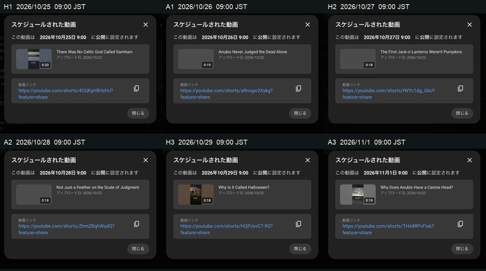
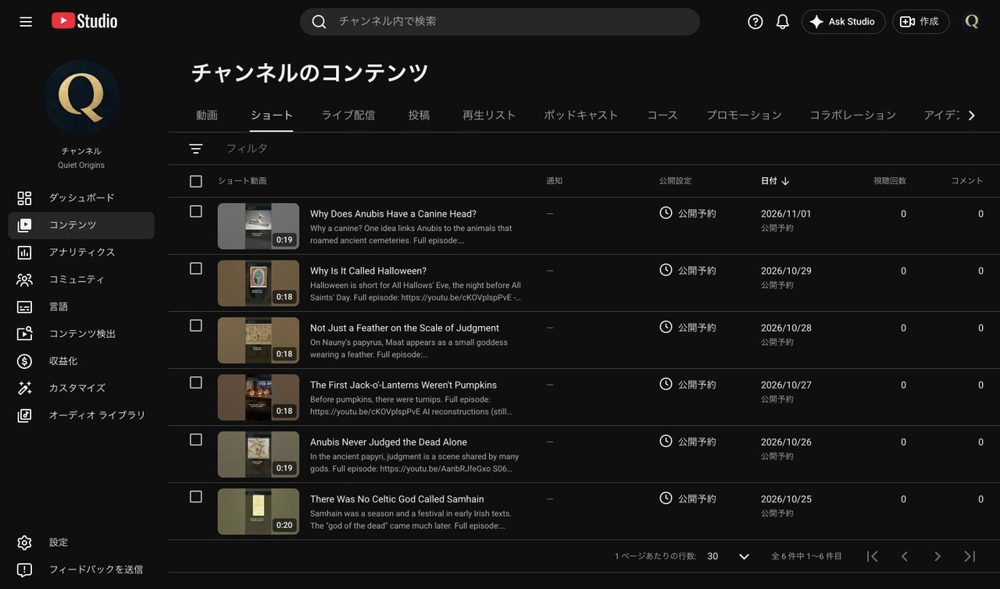

# Quiet Origins ショート6本 予約投稿結果（2026-10-22）

記録日時：2026-10-22T22:39:53+09:00。依頼：[ショート投稿依頼](wom_ショート投稿依頼_20261022.md)。

Quiet Origins（@QuietOriginsJP、チャンネルID `UCfLJOojEY9VB3rvrjICk90Q`）にv02を6本アップロードし、以下の日時に公開予約した。作業前と各アップロード直前に投稿先を確認。保存後の詳細画面とショート一覧で6本の公開予約を再確認した。

## 公開予約

時刻はすべて日本時間（GMT+0900）。予約時刻までは非公開。

| ID | 公開予約 | 動画・日本語タイトル | 動画ID | 関連動画 |
|---|---|---|---|---|
| H1 | 2026-10-25 09:00 | [サウィンという死の神はいなかった](https://youtube.com/shorts/4OQKyH8HzhU) | `4OQKyH8HzhU` | 第2話公開後に設定（下記） |
| A1 | 2026-10-26 09:00 | [アヌビスは一人で死者を裁いていない](https://youtube.com/shorts/aRnxgw2Xykg) | `aRnxgw2Xykg` | 第1話 `AanbRJfeGxo` 設定・保存済み |
| H2 | 2026-10-27 09:00 | [最初のジャック・オー・ランタンはかぼちゃではなかった](https://youtube.com/shorts/tWYc1dg_GkU) | `tWYc1dg_GkU` | 第2話公開後に設定（下記） |
| A2 | 2026-10-28 09:00 | [天秤の上は羽根だけではない](https://youtube.com/shorts/ZhmZBqhWq4Q) | `ZhmZBqhWq4Q` | 第1話 `AanbRJfeGxo` 設定・保存済み |
| H3 | 2026-10-29 09:00 | [「ハロウィン」という名前の由来](https://youtube.com/shorts/HQPJsvC7-9Q) | `HQPJsvC7-9Q` | 第2話公開後に設定（下記） |
| A3 | 2026-11-01 09:00 | [アヌビスはなぜイヌ科の頭なのか](https://youtube.com/shorts/THd4RPvFtxk) | `THd4RPvFtxk` | 第1話 `AanbRJfeGxo` 設定・保存済み |

## 保存済みの共通設定

- 6本とも英語の元タイトル・説明を登録。日本語のタイトル・説明は翻訳として登録し、再度開いて保存内容を確認した。末尾の改行を除いて依頼に基づく作成内容と一致。
- 動画の言語およびタイトル・説明の元の言語：英語。カテゴリ：教育。子ども向けではない。改変・合成コンテンツ（AIの使用）：はい。すべて保存後に確認。
- 概要欄に本編URL、使った素材に対応する本編のクレジット行、合成音声・音楽のクレジット、テーマのタグを登録。H1〜H3のAI素材の記載は、実際に使ったサービスに合わせた。H3の重複する `#History` は1件にした。
- サムネイルは、選択可能な自動生成候補の先頭（候補1、冒頭に最も近い字幕が読める候補）を6本とも選択・保存し、詳細を再度開いて確認した。
- 字幕焼き込み済みのv02 MP4のみを各1回、計6本アップロード。v01およびSRTはアップロードしていない。有料機能・広告・プロモーションは利用していない。

## ファイル照合・Studio確認

投稿前にGitHub Release `420633416` の `SHA256SUMS_shared.txt`（asset `665641441`）を取得し、Macのv02 MP4とSHA-256を照合した。**6/6本一致**。

| ファイル | SHA-256 |
|---|---|
| `QO_short_EP001_A1_v02.mp4` | `fcb23beb70eea652779b33af12e3386e1ad502fdfa263c6a546976268f3c4c76` |
| `QO_short_EP001_A2_v02.mp4` | `33c8ecd85627d4dd2e1738f8cacfe8a81c515c2934edc172032d405aef147c1a` |
| `QO_short_EP001_A3_v02.mp4` | `7cbbed20a96ac601f6aea9a32c302a1ae17b1d399bb89b9554b3b30cbbd941e9` |
| `QO_short_EP002_H1_v02.mp4` | `22cfb4620901a4d27751e3f68269e7df85a6a089f8957423a582c43551827e46` |
| `QO_short_EP002_H2_v02.mp4` | `23e3d11c940a35e2bf69cc86a5d858790087afc1d873945d1b3ec6bd9c0fa581` |
| `QO_short_EP002_H3_v02.mp4` | `bfa12dfb41655bb7211cbff53c055552e884bc126f0b654c42e6f919bd2a562e` |

H1・A1・H2・A2・H3はアップロード中のチェックで「問題は検出されませんでした」を確認。A3は予約保存時にはチェック処理中だった。最終のショート一覧では6件すべて「公開予約」、通知欄はすべて「—」で、表示上の問題通知はなかった。A3のチェック完了メッセージ自体は未確認。

## 第2話への関連動画：公開後の自動フォローアップ

第2話 `cKOVplspPvE` は10月24日09:00公開予約中のため、H1・H2・H3の関連動画はまだ設定していない。H2で動画IDを検索したところ「一致する結果がありません」と表示された。概要欄の第2話URLは3本とも登録済み。

本人が「10月24日9:10の自動実行を予約する」と明示承認したため、**2026年10月24日09:10 JSTに1回**、このチャットで実行する自動フォローアップを作成した。

- 名前：第2話公開後にショート3本を本編へ接続
- 自動化ID：`2-3`、状態：ACTIVE、対象：このチャット
- 第2話が一般公開済みであることを確認した場合に限り、H1 `4OQKyH8HzhU`・H2 `tWYc1dg_GkU`・H3 `HQPJsvC7-9Q` の関連動画を第2話へ設定し、保存後に確認する。すでに設定済みなら変更しない。
- 本編が非公開・予約中、候補に出ない、認証が必要、想定外の画面の場合は変更せず報告する。予約日時・本編・チャンネル設定を変更しない。結果は本書へ日時付きで追記する。
- ローカル自動実行のため、予定時刻にはMacを起動し、Codexアプリを実行しておく必要がある。[OpenAI公式の自動化案内](https://developers.openai.com/codex/app/automations)。

## 本編の既存表示について

開始前に第2話の日本語音声に「処理失敗」が表示されたため、依頼の想定外画面の条件に従って停止・報告した。本人から「本編には触れず、ショート6本の予約を進める」と回答を得て再開。本編2本と既存動画・チャンネル設定には変更を加えていない。この既存の音声表示の修復は今回の対象外。

## 確認画像

各画像は長辺1280px以下・1MB以下。動画、音源、高解像度素材、認証情報は本報告のGit共有に含めない。

## 2026-10-24 自動フォローアップ：Studioのエラーで未実施

実施日時：2026-10-24 09:12:22 JST。自動化 `2-3` の10月24日09:10実行。

第2話 `cKOVplspPvE` のStudio詳細ページ（`https://studio.youtube.com/video/cKOVplspPvE/edit`）を開いたところ、画面に **「エラーが発生しました。」** と表示された。投稿先チャンネル・本編の一般公開状態をこの画面で確認できなかったため、指示の「想定外の画面の場合は推測で進めず報告」に従って停止した。原因は未特定。

- 本編の一般公開：今回の実行では未確認。非公開や公開失敗と断定していない。
- 関連動画の操作：0件。H1・H2・H3は今回設定も設定済み確認もできていない。
- 予約日時、英日タイトル・説明、AI開示、動画、本編2本、チャンネル設定の変更・アップロード・公開・購入・広告は行っていない。
- 日本語音声は今回操作していない。10月22日の別作業で修復済みの記録は[再登録結果](wom02_日本語音声_再登録結果_20261022.md)を参照。
- エラー画面はMacの `/private/tmp/qo_followup_ep002_studio_error_20261024.png` に記録。本追記MarkdownのみをGit共有する。

| 対象 | ショートURL | 今回の結果 |
|---|---|---|
| H1 | https://youtube.com/shorts/4OQKyH8HzhU | 未変更・関連動画の状態未確認 |
| H2 | https://youtube.com/shorts/tWYc1dg_GkU | 未変更・関連動画の状態未確認 |
| H3 | https://youtube.com/shorts/HQPJsvC7-9Q | 未変更・関連動画の状態未確認 |

単発の自動実行は終了し、自動化 `2-3` を削除した。再開にはQuiet OriginsのStudioで本編が開ける状態を確認したうえで、本編公開の確認と3本の関連動画設定を行う必要がある。
