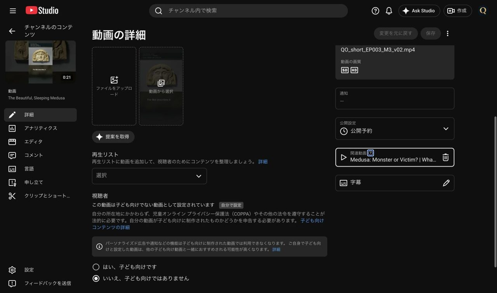

# 第3話メドゥーサ ショート3本の投稿結果（2026-10-23）

本人の承認とClaude確認後、`wom_ショート投稿依頼_EP003_20261023.md` の内容で新規登録。日時は新しい `wom_予約変更依頼_20261023.md` を適用した。

投稿先：**Quiet Origins / @QuietOriginsJP / UCfLJOojEY9VB3rvrjICk90Q**。アップロード直前にStudioのチャンネル表示・IDを確認。

| ID | 英語タイトル | URL | 公開予約（JST） |
|---|---|---|---|
| M1 | Medusa Wasn't Always Cursed | https://youtube.com/shorts/bpYa64ygMpk | 2026-10-25 12:00 |
| M2 | Why Put a Monster's Face on a Roof? | https://youtube.com/shorts/yp54F7xY1C0 | 2026-10-27 12:00 |
| M3 | The Beautiful, Sleeping Medusa | https://youtube.com/shorts/Z9aVsJcQ7e8 | 2026-10-28 12:00 |

## 登録・確認内容

- Release `421392117` のSHA256一覧（Asset `667737871`）をRESTで取得し、使うv02 MP4 3本の全文SHA256が一致することを確認。各1回アップロードし、最初に非公開で保存した。
- `asset_usage.csv` を照合：M1 R03/A05、M2 A04/A08/A26、M3 A01/A17。指定のMetクレジットを第3話の確定版からそのまま転記した。M1のみAI再現画の表記を追加。
- 英語タイトル・説明を元のメタデータとして登録。動画の言語とタイトル・説明の言語は英語、カテゴリ教育、子ども向けではない、有料プロモーションなし、AI使用は3本とも「はい」。
- 日本語のタイトル・説明は翻訳として3本とも「公開済み」を確認。概要欄の本編リンクは全件 `https://youtu.be/uUMStOFL-68`。投稿した全文は `records/posting_shorts_EP003_20261023.json` に保存。
- 字幕は焼き込み済み。SRTを追加アップロードしていない。サムネイルは自動生成を使用。
- SD/HD処理完了。通知欄のチェック中が消えたことを各詳細画面で確認した。
- 公開予約を保存した後、設定を開き直して上記日時とGMT+0900を確認。最後のStudio一覧は9本すべて公開予約。
- 関連動画は依頼どおり未設定。10/25 09:10 JSTに第3話の一般公開を確認して3本へ設定する1回の自動実行 **ID `3-3`** を作成済み。未来の実行結果は未確認。既存のH1〜H3用 **ID `2-3`** は維持した。

確認画面：`サムネ確認用/投稿確認_20261023/M1_schedule.jpg`〜`M3_schedule.jpg`。予約一覧・ほかの変更は `wom_予約変更結果_20261023.md`。

## 2026-10-25 09:10自動実行の結果：M1〜M3の関連動画設定完了

自動実行ID `3-3`。09:10 JSTに開始し、09:13 JSTまでに3本の保存・再読込確認を完了した。

Quiet Origins（`@QuietOriginsJP`、`UCfLJOojEY9VB3rvrjICk90Q`）へ切り替え、第3話 `uUMStOFL-68` のタイトル **Medusa: Monster or Victim? | What the Ancient Sources Say** と **公開設定「公開」** をStudioで確認してから実施。

| ショート | 動画ID | 作業前 | 保存・再読込後の関連動画 |
|---|---|---|---|
| M1 | `bpYa64ygMpk` | なし | 第3話 `uUMStOFL-68` |
| M2 | `yp54F7xY1C0` | なし | 第3話 `uUMStOFL-68` |
| M3 | `Z9aVsJcQ7e8` | なし | 第3話 `uUMStOFL-68` |

3本とも公開予約を維持し、タイトル・説明の画面テキストが作業前後で一致することも照合した。操作したのは関連動画の選択と保存だけ。音声・字幕・サムネイル・終了画面・公開設定・予約日時・他動画の設定を変更していない。第2話用の自動実行ID `2-3` は操作していない。

最初はStudioで別チャンネルが選択されていたため本編の直接URLがエラーになったが、アカウントメニューでQuiet Originsへ切り替えて解消した。Macの画面ロック中でも接続済みChromeで上記の保存・再読込確認を実施できた。

記録：`records/related_EP003_completed_20261025.json`。確認JPG4枚は `サムネ確認用/関連動画確認_EP003_20261025/`（各長辺1280px以下・1MB以下）。上記の「未設定」「実行結果未確認」は10/23時点の履歴であり、M1〜M3についてはこの節を最新状態とする。

自動実行 `3-3` は作業完了後に削除を試みたが、自動承認審査が「削除の明示承認がない。将来の再実行・失敗通知を止める変更」として拒否したため、削除していない。本人に削除／維持の確認を提示中。第2話用 `2-3` は変更していない。

### 自動実行3-3の削除完了（2026-10-25）

本人が削除確認へ「削除する」と明示回答。承認後にCodexの自動実行管理ツールでID `3-3`を削除し、結果 `deleteStatus: deleted` を確認した。これにより、この完了済み作業の将来の再実行・失敗通知は停止。上記の「削除承認待ち」は解消済み。関連動画3本の設定は維持し、第2話用ID `2-3`は操作していない。
