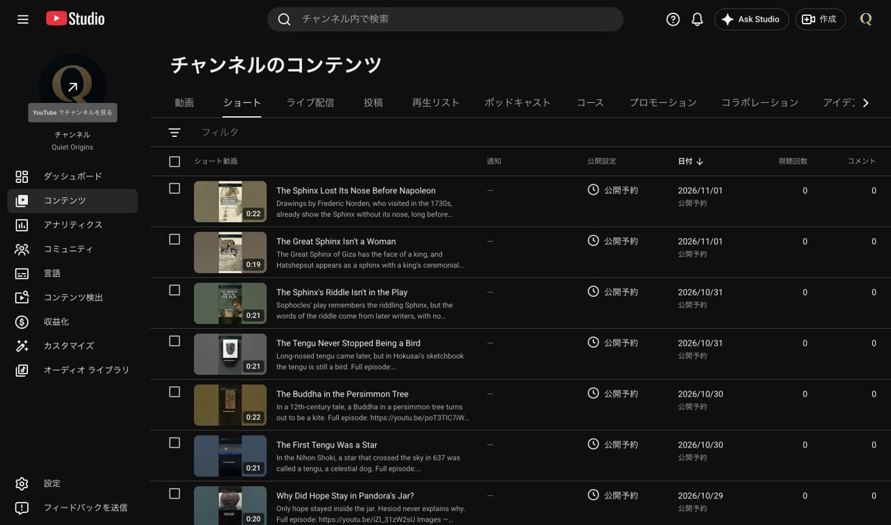

# 第6話スフィンクス・ショートv03 投稿結果（2026-10-28）

**Quiet Originsに3本を予約済み。関連動画の設定のみ、本編公開後の自動実行へ引き継ぎ。**

[投稿指示](wom_ショート投稿依頼_EP006_20261027.md)と[Claudeのv03合格確認](wom_ショートClaude確認_EP006_v03_20261028.md)に従って実施。本人がQuiet Originsへ切り替えたとの回答後、チャンネル名・IDを確認し再開した。投稿先は `@QuietOriginsJP` / `UCfLJOojEY9VB3rvrjICk90Q`。既存動画・他チャンネル・チャンネル設定は変更していない。

## 予約結果（日本時間）

| 本 | 動画ID・URL | 予約日時 | 日本語タイトル |
|---|---|---|---|
| S1 | [R-p7fqxAWwE](https://youtube.com/shorts/R-p7fqxAWwE) | 2026-10-31 18:00 JST | スフィンクスのなぞは、劇に出てこない |
| S2 | [vGCbrzm6MIo](https://youtube.com/shorts/vGCbrzm6MIo) | 2026-11-01 12:00 JST | ギザのスフィンクスは、女ではない |
| S3 | [gB1Fq47ErW0](https://youtube.com/shorts/gB1Fq47ErW0) | 2026-11-01 18:00 JST | スフィンクスの鼻は、ナポレオンより前に欠けていた |

非公開でアップロード後、指定日時に予約。各保存後に詳細を開き直し、公開設定のダイアログで日時・GMT+0900・公開まで非公開と表示されることを確認した。即時公開はしていない。

## 照合・設定

- Release `425278519` の `SHA256SUMS_shared.txt`（asset `681176036`）とMacのv03 MP4を照合。3本とも一致、総計19,501,720バイト。`asset_usage.csv`の9行も指示と一致。
- 英語タイトル・説明を登録し、保存後の原文と準備データを照合。日本語のタイトル・説明は翻訳として登録し、再度開いて内容を確認。説明は英語610／822／655字、日本語515／738／559字。
- 動画の言語、タイトルと説明の言語は両方とも英語。子ども向けではない。カテゴリは教育。
- AIの使用は3本とも「はい、AIを使用しました」。有料プロモーションは「いいえ」。
- サムネイルは3本とも自動生成候補1を選択。冒頭の見出しと絵が読めることを目視確認。S1はMoreau、S2はギザ、S3は鼻のないスフィンクスの冒頭画面。
- SRT・追加音声はアップロードしていない。字幕は動画に焼き込み済み。
- 標準画質・高画質とも処理完了。3本の「申し立ての概要」で「この動画に申し立ては検出されませんでした」「動画のリーチに影響なし」を確認。S1はアップロード画面の著作権・コミュニティチェック完了を確認。S2/S3は予約時にチェック中だったが、後の詳細・一覧に保留や問題の通知はなく、上記の申し立てなしを確認した（最終のチェック完了率そのものは再表示していない）。

[ハッシュ・事前照合](records/posting_EP006_shorts_preflight_20261028.json)／[投稿文と設定の保存データ](records/posting_EP006_shorts_metadata_20261028.json)

## 当日の本数

Studioの本編・ショート全件を確認。既存T3の日時も開いて確認し、変更せず閉じた。

| 日付（JST） | 本編 | ショート | 合計 | 内訳 |
|---|---:|---:|---:|---|
| 2026-10-31 | 0 | 2 | 2 | 既存T3 `S66NV_CTVZY` 12:00、S1 18:00 |
| 2026-11-01 | 0 | 2 | 2 | S2 12:00、S3 18:00 |

各日合計3本以下、ショート2本以下。既存本編の日時変更なし。

## 本編への関連付け（残作業）

本編 `YKM_fjRLt9E` は10/29 09:00公開予定。今回の設定時は関連動画の選択検索で見つからなかったため、3本とも空欄のまま予約した。説明欄の本編URLは英語・日本語とも登録済み。

- 自動実行ID：`3`（heartbeat、このチャットに紐付け）
- 実行予定：**2026-10-29 09:10 JST、1回**
- 名前：スフィンクスのショート3本に本編を関連付け
- 処理：Quiet Originsと本編の公開を確認し、3本の関連動画を `YKM_fjRLt9E` に設定・保存。詳細を開き直して確認し、この結果へ追記、コミット・pushする。
- チャンネル不一致、本編未公開・選択不可、画面操作不能なら変更せず報告する。

## 確認画像

縮小JPGはすべて長辺1280px以下・1MB以下。

| 本 | 予約成功画面 | 保存後の日時確認 |
|---|---|---|
| S1 | [予約成功](records/EP006_shorts_20261028/S1_scheduled.jpg) | [再確認](records/EP006_shorts_20261028/S1_final_schedule.jpg) |
| S2 | [予約成功](records/EP006_shorts_20261028/S2_scheduled.jpg) | [再確認](records/EP006_shorts_20261028/S2_final_schedule.jpg) |
| S3 | [予約成功](records/EP006_shorts_20261028/S3_scheduled.jpg) | [再確認](records/EP006_shorts_20261028/S3_final_schedule.jpg) |

[S2申し立てなし](records/EP006_shorts_20261028/S2_claims.jpg)／[S3申し立てなし](records/EP006_shorts_20261028/S3_claims.jpg)

