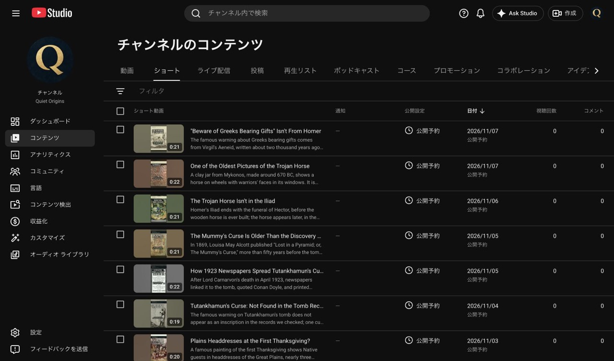

# Quiet Origins EP009 ショートv03 投稿結果（2026-11-02）

記録：2026-11-02 15:18 JST。Claudeの本人承認済み投稿依頼（e8e32f2）に従い、3本を予約保存。投稿先は **Quiet Origins / @QuietOriginsJP / UCfLJOojEY9VB3rvrjICk90Q**。アップロード前にStudioのチャンネル名とIDを照合した。

## 予約結果

| ID | 動画URL | 公開予定（JST） | 状態 |
|---|---|---|---|
| T1 | https://youtube.com/shorts/HrWI_c67Kw0 | 2026-11-06 18:00 | 予約保存済み |
| T2 | https://youtube.com/shorts/HLvuRtKFxJU | 2026-11-07 12:00 | 予約保存済み |
| T3 | https://youtube.com/shorts/ATdiw5sT2Oc | 2026-11-07 18:00 | 予約保存済み |

3本それぞれの完了ダイアログで上記日時とGMT+0900を確認。最後にQuiet Originsのショート一覧で3本の「公開予約」を確認した。公開予定までは非公開。本編 WSipndkxiiE の11/6 09:00予約は変更していない。

日時証拠：[T1](records/20261102/EP009_upload/EP009_T1_scheduled.jpg) / [T2](records/20261102/EP009_upload/EP009_T2_scheduled.jpg) / [T3](records/20261102/EP009_upload/EP009_T3_scheduled.jpg)

## ファイルと登録内容

SSD `/Volumes/ESD-02/新チャンネル/ショート/EP009_v03_20261102/deliverables/` の承認済みMP4を使用。Release 431109483 の承認ハッシュと一致。v01/v02やSRTはアップロードしていない。

| ID | SHA-256 |
|---|---|
| T1 | `496d44e5cfa9f5533cc5cc287ca8f9c4e84f09564a85a109de0bdbb8b75662b7` |
| T2 | `5dd27ed5eb14fbc543aa9f3720a34b3f0f6f14511574d21ea58e50f77c8e475d` |
| T3 | `b66e18ae4ca86296358ab5766b05a1f7c06426324f506d47d770a825bcf73ab5` |

- 英語タイトル・概要欄：指定全文を登録し、保存後の画面内容と照合。素材クレジット、本編URL、Kokoro/Suno、ハッシュタグを含む。
- 日本語タイトル・概要欄：3本とも翻訳として登録。「公開済み」を確認し、翻訳編集画面を開き直して全文一致を照合した（翻訳の公開済み表示であり、動画の先行公開ではない）。
- 動画の言語、タイトルと説明の言語：ともに英語。子ども向けではない、カテゴリ教育、有料プロモーションなし、AIの使用「はい」。コメント設定はオン。
- サムネイル：3本とも自動生成候補1を選択。冒頭見出しが読めることを目視確認。T3は生成を待ち、保存・再読み込み後に候補1の反映を確認した。
- SD/HD処理完了。T1/T2は著作権・コミュニティガイドラインのチェック完了／問題なしを確認。T3は著作権問題なし、予約時点ではコミュニティチェック中。最後のコンテンツ一覧では3本とも通知「—」。T3のコミュニティチェック完了ダイアログは未確認のため、完了と断定しない。

投稿情報全文・ハッシュ：[metadata.json](records/20261102/EP009_upload/metadata.json)。保存結果：[upload_progress.json](records/20261102/EP009_upload/upload_progress.json)。翻訳証拠：[T1](records/20261102/EP009_upload/EP009_T1_translation.jpg) / [T2](records/20261102/EP009_upload/EP009_T2_translation.jpg) / [T3](records/20261102/EP009_upload/EP009_T3_translation.jpg)。

## 公開本数の照合

アップロード前に動画全11件、ショート全24件の一覧を確認（次ページなし）。11/6は第9話本編1本、11/7は0本だった。

| 日付（JST） | 本編 | ショート | 合計 | 判定 |
|---|---:|---:|---:|---|
| 11/6 | 1 | 1（T1） | 2 | 合計3本以内・ショート2本以内 |
| 11/7 | 0 | 2（T2/T3） | 2 | 合計3本以内・ショート2本以内 |

[事前照合記録](records/20261102/EP009_upload/preflight.json)。既存動画の予約は動かしていない。

## 公開後の補完（未実施）

関連動画は3本とも **未設定**。T1の選択画面で `WSipndkxiiE` を検索したところ一致結果なし。本編が非公開予約中なので、指示どおり空欄で予約した。

固定コメントは3本とも **未投稿・未固定**。T1視聴ページでは非公開で再生不可、視聴側のアカウント表示がWhispers of Japanだったため、そのページでのコメント操作を中止してタブを閉じた。Whispersに投稿・設定変更は一切行っていない。Studio側はQuiet OriginsのID一致を再確認し、予約を継続した。コメントがオフだから投稿できなかったとは判断していない。補完時にも投稿者がQuiet Originsであることを必ず確認する。

固定する承認文面：

> New origin stories every few days. Subscribe so you don't miss the next one.

以下をこのチャットの単発自動実行として登録済み（ACTIVE、COUNT=1）。コメントは本編公開09:10時点では各ショートがまだ非公開なので、それぞれ公開10分後に分けた。

| 実行予定（JST） | 自動実行ID | 内容 |
|---|---|---|
| 2026-11-06 09:10 | `quiet-origins-9` | 本編公開確認後、3本の関連動画をWSipndkxiiEへ設定・再読込確認 |
| 2026-11-06 18:10 | `quiet-origins-ep009-t1` | T1の公開確認、承認コメント投稿・固定・画面確認 |
| 2026-11-07 12:10 | `quiet-origins-ep009-t2` | T2の公開確認、承認コメント投稿・固定・画面確認 |
| 2026-11-07 18:10 | `quiet-origins-ep009-t3` | T3の公開確認、承認コメント投稿・固定・画面確認 |

実行には **MacとCodexアプリの起動、Chromeの接続、YouTubeへのログインとQuiet Originsへの操作権限**が必要。アプリ停止中の実行を保証しない。動画が未公開なら強制公開しない。チャンネル不一致・本人確認などでは停止して報告し、コメントがオフなら設定を変えない。同文コメントが既にある場合は重複投稿しない。結果は本書へ追記してpushする。

[登録済み自動実行の内容](records/20261102/EP009_upload/automations.json)。第8話用 `quiet-origins-8` は変更していない。

## 別件：EP008 K3

英語タイトルを依頼どおり `The Mummy's Curse Is Older Than the Discovery of Tutankhamun's Tomb` へ変更。再読み込み後の完全一致、英語説明文の変更なし、日本語タイトルの維持、11/5 18:00 JST・公開予約の維持を確認。[第8話結果への追記](wom_ショート投稿結果_EP008_20261030.md)を参照。
