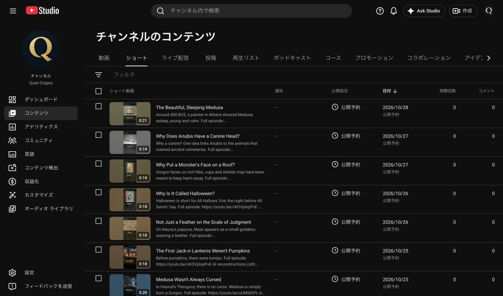

# Quiet Origins 毎日投稿への予約変更結果（2026-10-23）

本人の「クロードの確認が済みました。依頼通りに予約」により実施。最新依頼は `wom_予約変更依頼_20261023.md`、パンドラは `wom04_投稿依頼_EP004_20261023.md`。共有履歴 `edddc90` を確認して着手した。

投稿先は **Quiet Origins / @QuietOriginsJP / UCfLJOojEY9VB3rvrjICk90Q**。すべて日本時間、Studioのローカルタイムゾーンは **GMT+0900**。保存後に公開設定を開き直して日付・時刻を確認し、最後にショート一覧の全9件が公開予約であることを照合した。

| 日 | 09:00 本編 | 12:00 ショート | 18:00 ショート |
|---|---|---|---|
| 10/24 | 第2話 `cKOVplspPvE`（変更なし） | H1 `4OQKyH8HzhU` | A1 `aRnxgw2Xykg` |
| 10/25 | 第3話 `uUMStOFL-68` | M1 `bpYa64ygMpk` | H2 `tWYc1dg_GkU` |
| 10/26 | 第4話 `iZl_31zW2sU` | A2 `ZhmZBqhWq4Q` | H3 `HQPJsvC7-9Q` |
| 10/27 | — | M2 `yp54F7xY1C0` | A3 `THd4RPvFtxk` |
| 10/28 | — | M3 `Z9aVsJcQ7e8` | 空き |

## 既存動画について

- 第3話は10/27 09:00から10/25 09:00へ変更。日本語音声・日本語字幕1件・日本語翻訳は公開済みのまま。終了画面の最新アップロードは6:29:17〜6:39:17（30fps、389.566667〜399.566667秒）、登録要素も残っている。日時以外の内容は変更していない。
- H1・H2・H3・A2・A3は指定日時へ変更し、保存後に再確認。関連動画は変更していない（A2・A3は第1話、H1〜H3は未設定）。
- **A1は依頼書と異なり作業前から一般公開済み**だったため、いったん変更を保留して本人へ確認。本人が「非公開に戻して10/24 18:00に予約し直す」と明示回答した後、非公開に保存し、続いて10/24 18:00に予約し直した。タイトル・説明・関連動画（第1話）は維持。
- A2の実画面は10/26 09:00、A3は10/28 09:00で、依頼書の旧日時と異なった。公開予約であることを確認し、新しい指定日時へ設定した。
- 第2話は10/24 09:00の予約を確認したのみ。

## 関連動画と自動実行

| 対象 | 現在 | 設定予定 | 自動実行 |
|---|---|---|---|
| A1〜A3 | 第1話 `AanbRJfeGxo` | 変更なし | なし |
| H1〜H3 | 未設定 | 第2話 `cKOVplspPvE` | 既存ID `2-3`、10/24 09:10、変更せず維持 |
| M1〜M3 | 未設定 | 第3話 `uUMStOFL-68` | 新規ID `3-3`、10/25 09:10に1回、ACTIVE |

`3-3` は作成後に表示して確認した。本編の一般公開・チャンネル・動画IDを確認してから関連動画だけを変更し、3本とも再表示で保存を確認、結果を記録・pushする内容。`2-3` も表示し、既存設定を変更していない。**どちらも未来の実行で、実行結果はまだない。MacとCodexが動作し、Chrome接続が必要。**

## 記録

- 新規ショートの詳細：`wom_ショート投稿結果_EP003_20261023.md`
- 第4話の詳細：`wom04_投稿結果_EP004_20261023.md`
- Studio一覧の取得記録：`records/reservation_table_verified_20261023.json`
- 確認画面：`サムネ確認用/投稿確認_20261023/`。21枚、各長辺1280px以下・1MB以下のJPG。
- 今回の作業では指定日時より前の公開操作を行っていない。A1のみ、本人承認により既に公開されていた状態から予約へ戻した。

## 2026-10-25 09:10自動実行の結果：M1〜M3の関連動画設定完了

自動実行ID `3-3`。09:10 JSTに開始し、09:13 JSTまでに3本の保存・再読込確認を完了した。

Quiet Origins（`@QuietOriginsJP`、`UCfLJOojEY9VB3rvrjICk90Q`）へ切り替え、第3話 `uUMStOFL-68` のタイトル **Medusa: Monster or Victim? | What the Ancient Sources Say** と **公開設定「公開」** をStudioで確認してから実施。

| ショート | 動画ID | 作業前 | 保存・再読込後の関連動画 |
|---|---|---|---|
| M1 | `bpYa64ygMpk` | なし | 第3話 `uUMStOFL-68` |
| M2 | `yp54F7xY1C0` | なし | 第3話 `uUMStOFL-68` |
| M3 | `Z9aVsJcQ7e8` | なし | 第3話 `uUMStOFL-68` |

3本とも公開予約を維持し、タイトル・説明の画面テキストが作業前後で一致することも照合した。操作したのは関連動画の選択と保存だけ。音声・字幕・サムネイル・終了画面・公開設定・予約日時・他動画の設定を変更していない。第2話用の自動実行ID `2-3` は操作していない。

最初はStudioで別チャンネルが選択されていたため本編の直接URLがエラーになったが、アカウントメニューでQuiet Originsへ切り替えて解消した。Macの画面ロック中でも接続済みChromeで上記の保存・再読込確認を実施できた。

記録：`records/related_EP003_completed_20261025.json`。確認JPG4枚は `サムネ確認用/関連動画確認_EP003_20261025/`（各長辺1280px以下・1MB以下）。上記の「未設定」「実行結果未確認」は10/23時点の履歴であり、M1〜M3についてはこの節を最新状態とする。

