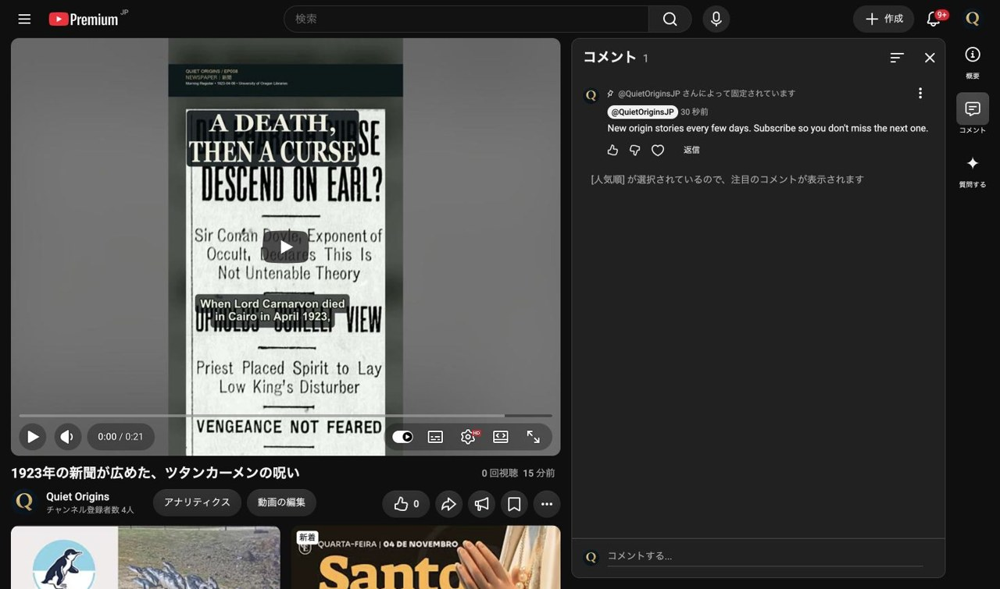

# Quiet Origins 公開後作業結果（2026-11-05）

## 2026-11-05 12:16 JST：EP008 K2 固定コメント完了

- 対象：Quiet Origins（`@QuietOriginsJP`、`UCfLJOojEY9VB3rvrjICk90Q`）の EP008 K2 `UCV-fU0BmUI` のみ。
- Studioの詳細で「公開」、動画ID、チャンネルIDを確認。視聴ページでも公開動画と投稿者のハンドルを操作直前に照合した。
- コメントを新しい順にして既存の同文コメントがないことを確認後、指定文を1件投稿・固定した。

> New origin stories every few days. Subscribe so you don't miss the next one.

- コメントID：`UgzrOAsltFy2pNIfTKF4AaABAg`。
- [固定コメントへのリンク](https://www.youtube.com/watch?v=UCV-fU0BmUI&lc=UgzrOAsltFy2pNIfTKF4AaABAg)。
- 再読み込み後、「コメント 1」と「@QuietOriginsJP さんによって固定されています」、文面の完全一致を画面で確認した。新規投稿1件、固定1件、重複0件。
- [証跡JPG](records/20261105/EP008_K2_固定コメント.jpg)：1280×755、120,205 bytes（長辺1280px以下・1MB未満）。
- 他動画・予約日時・公開設定・タイトル・説明・翻訳・関連動画は変更していない。
- 単発自動実行 `quiet-origins-ep008-k2` は完了後に削除した。他の自動実行は変更していない。
- 最新 `origin/bgm/production`（作業開始時 `c73803a2`）から分離worktreeを作成し、今回の結果・証跡のみを共有。旧分岐履歴のpush、reset、force-pushは行っていない。

