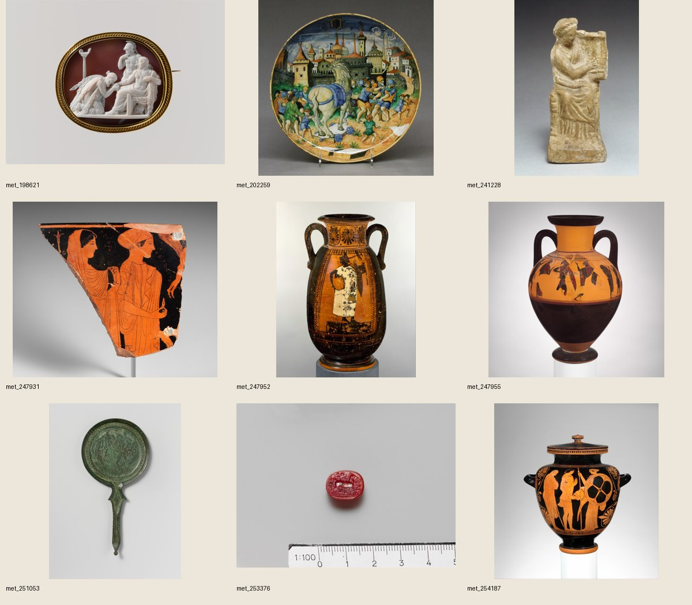
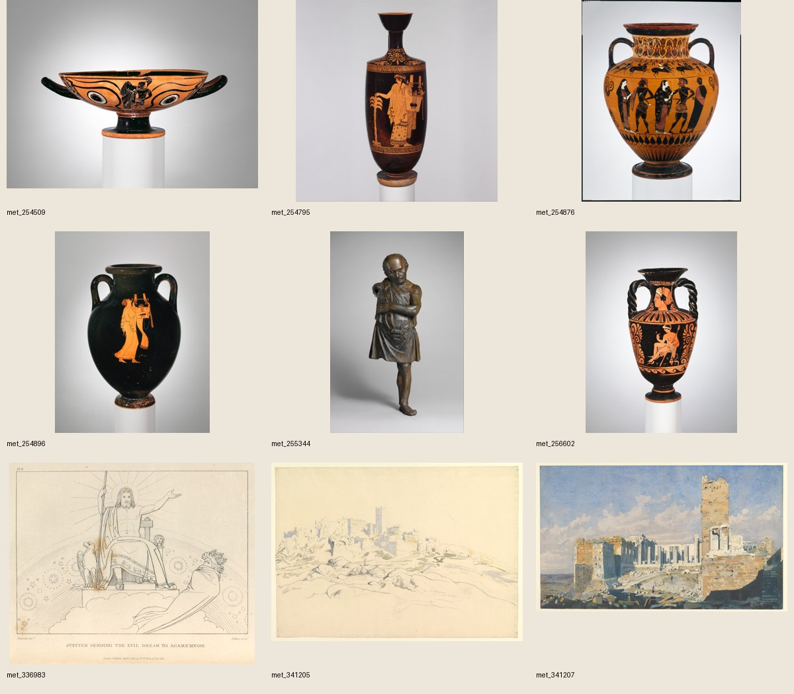
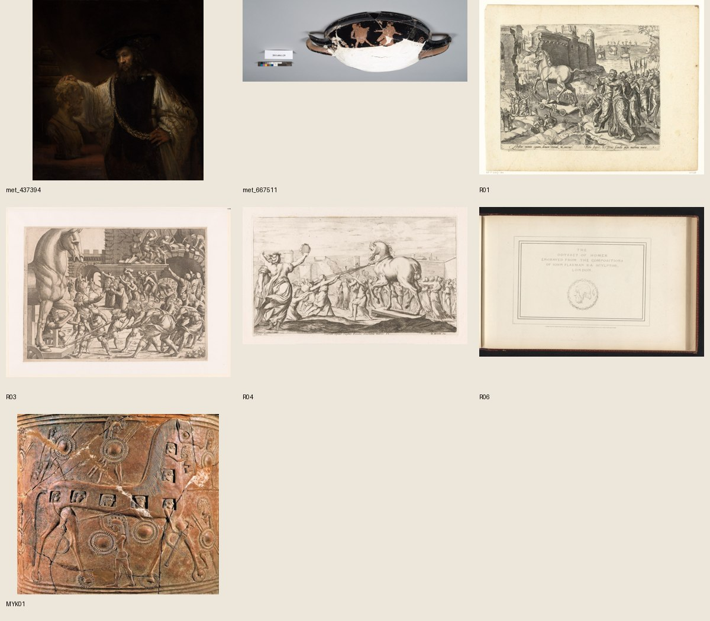

# wom09 素材候補・確認画像（2026-11-01）

採用検討対象25作品。連絡シートは対象のみ。不採用画像も再選定防止のため残し、下表に理由を記す。最終採用・編集は未実施。

|ID|区間|判定|縮小画像|
|---|---|---|---|
|met_10482|—|不採用|[The Parthenon](met_10482.jpg)|
|met_198621|P03|主候補|[Priam Supplicating Achilles for the Body of Hector](met_198621.jpg)|
|met_202259|P01／サムネ|主候補|[Dish depicting the Trojan Horse](met_202259.jpg)|
|met_241228|P05／P14|予備|[Terracotta statuette of a seated woman playing a kithera](met_241228.jpg)|
|met_247931|P06|条件付き予備|[Fragment of a terracotta skyphos (deep drinking cup)](met_247931.jpg)|
|met_247952|P05|主候補|[Terracotta neck-pelike (wine jar)](met_247952.jpg)|
|met_247955|P06|条件付き予備|[Terracotta neck-amphora (jar)](met_247955.jpg)|
|met_248179|—|不採用|[Terracotta Nolan neck-amphora (jar)](met_248179.jpg)|
|met_248714|—|不採用|[Fragmentary terracotta statuette of a woman with a kithara](met_248714.jpg)|
|met_251053|P06|条件付き予備|[Bronze mirror](met_251053.jpg)|
|met_253376|P09の補足／P13|主候補|[Carnelian scarab](met_253376.jpg)|
|met_254187|P03|条件付き予備|[Terracotta stamnos (jar)](met_254187.jpg)|
|met_254509|P06|条件付き予備|[Terracotta kylix: eye-cup (drinking cup)](met_254509.jpg)|
|met_254795|P05／P14|予備|[Terracotta lekythos (oil flask)](met_254795.jpg)|
|met_254876|P06|主候補|[Terracotta neck-amphora (jar)](met_254876.jpg)|
|met_254896|P05|主候補|[Terracotta amphora (jar)](met_254896.jpg)|
|met_255344|P05のエペイオス言及|条件付き予備|[Bronze statuette of an artisan with silver eyes](met_255344.jpg)|
|met_256602|P07|条件付き予備|[Terracotta neck-amphora with twisted handles (jar)](met_256602.jpg)|
|met_336983|P03|予備|[The Iliad and the Odyssey](met_336983.jpg)|
|met_337384|—|不採用|[The Iliad of Homer, The Odyssey of Homer, Compositions from The Tragedies of Aeschylus, and The Theogony, Works and Days of Hesiod](met_337384.jpg)|
|met_341205|P12|予備|[The Acropolis from the Areopagus, Athens](met_341205.jpg)|
|met_341207|P12|主候補|[The Acropolis from the West, with the Propylaea and the Temple of Athena Nike, Athens](met_341207.jpg)|
|met_354833|—|不採用|[The Works of Publius Virgilius Maro: Translated, Adorned with Sculpture, and illustrated with Annotations](met_354833.jpg)|
|met_437394|P02／P11|主候補|[Aristotle with a Bust of Homer](met_437394.jpg)|
|met_667511|P06|条件付き予備|[Terracotta kylix (drinking cup)](met_667511.jpg)|
|R01|P10|主候補|[Paard van Troje](R01.jpg)|
|R02|—|不採用|[Trojanen halen het houten paard binnen](R02.jpg)|
|R03|P10|予備|[Binnenhalen van het paard van Troje](R03.jpg)|
|R04|P10|主候補|[Paard van Troje wordt binnengehaald](R04.jpg)|
|R05|—|不採用|[Faam met het portret van Publius Vergilius Maro](R05.jpg)|
|R06|P02／P04|主候補|[Portret van Homerus en profil](R06.jpg)|
|MYK01|P09|主候補|[Mykonos Pithos 2240 — Trojan Horse detail](mykonos_cc0.jpg)|

## 一覧

詳細・使用条件は[素材候補](../../wom09_素材候補_20261101.md)と[機械可読台帳](../../research/wom09_素材台帳_20261101.json)。
